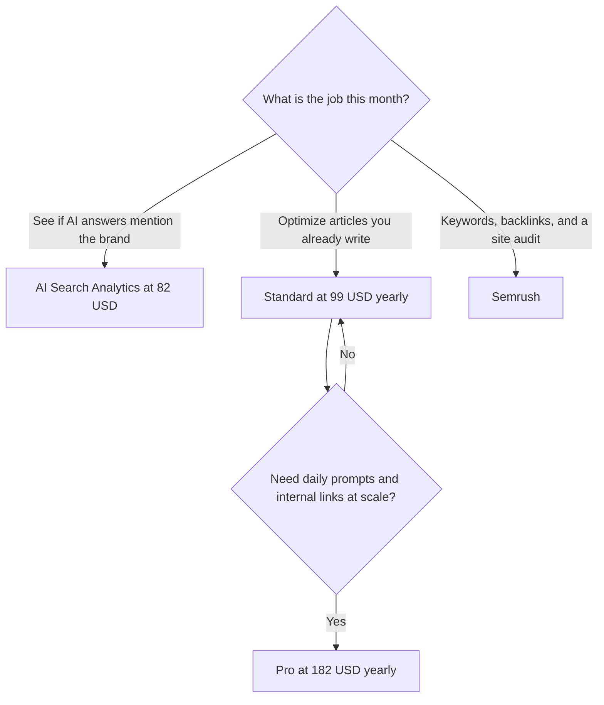

**[Surfer SEO](/tools/surfer-seo/) is a content editor and an AI-visibility tracker.** Standard is $99 a month billed yearly, listed as saving $240 a year, with 360 documents to create or optimize and 25 AI prompts tracked weekly. Pro is $182 a month billed yearly, listed as saving $444 a year, and adds 50 AI prompts refreshed daily, one-click internal linking, and content ideas with coverage gaps. AI Search Analytics, a separate plan, is $82 a month billed yearly, listed as saving $156 a year, with 50 prompts, 5 Brand Spaces, and Brand Knowledge.

There was no free plan on the pricing page we checked October 16, 2026. Monthly billing costs more than those yearly rates. Enterprise is through sales. Figures are US dollars. Tax and local currency can differ. We did not measure whether a higher content score produced rankings, and a Surfer score is a writing target.

The category map is [best AI SEO tools](/blog/best-ai-seo-tools-2026/). The dataset next door is the [Semrush review](/blog/semrush-review-2026/). Drafting tools are in [best AI writing assistants](/blog/best-ai-writing-assistants/).

## Three products, easy to mix up

| Plan | Yearly rate | What the yearly price is said to save | Allowance that matters |
|---|---|---|---|
| AI Search Analytics | $82/month | $156 a year | 50 AI prompts, 5 Brand Spaces, mention gaps, sentiment. Tracking, not a full editor seat |
| Standard | $99/month | $240 a year | 360 documents, 25 AI prompts tracked weekly, Content Editor, rank-drop detection, plagiarism checker |
| Pro | $182/month | $444 a year | Standard, plus daily prompt refresh, internal linking at scale, content ideas and coverage gaps |

Standard at $99 × 12 is $1,188 a year before the saving language. The $240 saving is Surfer's comparison with its own monthly price, not a coupon against Semrush. Pro at $182 × 12 is $2,184. The step from Standard to Pro is $83 a month, or $996 a year, at those yearly rates.

## What the editor is asking you to do

You open a document, Surfer compares it with pages that already rank, and it recommends terms, structure, and length, with a live score and a one-click optimize pass. That score will rise if you follow it. A higher score means you matched the checklist more closely. It does not, by itself, mean the article is better for a reader or that Google will move it.

Use the checklist as a gap list: missing sections, thin subtopics, no internal links. Then edit like a person. Pages that chase every suggested term read the same. Surfer's own product shape rewards coverage. Your readers reward a point of view and a source. Both can live in one draft if you refuse to accept the first optimized pass as finished.

AI Search Analytics watches mentions in ChatGPT, Gemini, AI Overviews, and other models Surfer lists. Standard includes a lighter prompt allowance, weekly. Pro refreshes 50 prompts daily. The $82 plan is the tracker without committing to the full editor. A brand that already writes in another tool can buy the tracker alone. A content team producing many articles will hit the 360-document Standard allowance or the Pro linking tools first.

Integrations include writing surfaces such as Google Docs. Rank-drop detection is how you find a URL that slipped. The plagiarism checker is a safety pass, not a guarantee that a page is original in the way a search engine means it.

## Fit score

| Need | AI Search Analytics $82 | Standard $99 yearly | Pro $182 yearly |
|---|---|---|---|
| Track AI mentions | Strong | 25 prompts, weekly | 50 prompts, daily |
| Optimize a writing pipeline | Not the editor plan | 360 documents | More workflow on top |
| One-click internal linking at scale | No | Partial | Yes |
| A free trial of the whole suite | No free plan was listed | No | No |
| Backlink index and keyword database | No | No | No |

This is a plan-fit table from Surfer's pricing page. It is not a traffic case study.

## When the other invoice is the right one

| Situation | Open |
|---|---|
| You need the keyword and backlink dataset | [Semrush](/tools/semrush/). SEO annual is $117.33 a month |
| You want research, a draft, and a lower yearly entry | [Frase](/tools/frase/) Starter at $39 a month billed yearly |
| The brief is "where do we show up in answer engines," then a rewrite | [Writesonic](/tools/writesonic/) Starter at $79 a month billed annually |
| The brief is on-brand campaign copy | [Jasper](/tools/jasper/), in the writing guide |

[Semrush One](/tools/semrush/) Starter is $165.17 a month annually. That is a larger product. Surfer Standard plus AI-search habits can be enough when the team already knows which prompts matter and does not need a backlink index.

## FAQ

### Does Surfer have a free plan?

Not on the pricing page checked October 16, 2026.

### How much does Surfer cost?

Yearly: AI Search Analytics $82 a month, Standard $99, Pro $182. Monthly billing is higher. The page lists yearly savings of $156, $240, and $444 on those three.

### How many articles can I optimize?

Standard includes 360 documents to create or optimize.

### Will a higher score rank the page?

The score measures fit with Surfer's checklist. Rankings and AI citations depend on the page, the site, and the query. This review did not run a before-and-after traffic test.

## Last verified

October 16, 2026.

**Sources:** [Surfer pricing](https://get.surferseo.com/surfer-pricing), [Surfer](https://surferseo.com).

[Surfer SEO](/tools/surfer-seo/) is in the [marketing and SEO directory](/tools/category/marketing-seo/). Directory pages may use affiliate links. A purchase through them can earn us a commission at no extra cost to you.
