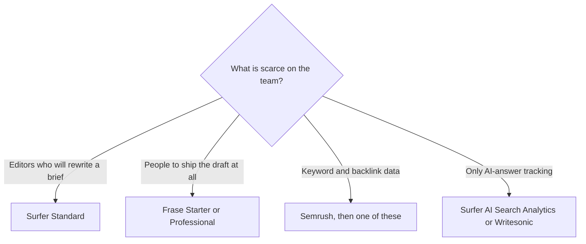

**Buy Surfer when a writer already has a draft and needs a target to optimize against. Buy Frase when the team wants a monthly machine that finds topics, drafts, publishes, and watches the page after it is live.** Both now talk about AI answers as well as Google. They meter the work differently: documents and tracked prompts on one side, articles, sites, and audit pages on the other.

Prices are US list prices excluding tax, from vendor pages checked October 16, 2026, published here on October 24, 2026. A live refetch of the pricing URLs that day did not return numbers. Yearly prices are the ones in the table. Monthly billing costs more on both products.

The product reviews are [Surfer SEO review](/blog/surfer-seo-review-2026/) and [Frase review](/blog/frase-review-2026/). The wider set is [best AI SEO tools](/blog/best-ai-seo-tools-2026/).

## What a content team is actually choosing

| Decision | Surfer | Frase |
|---|---|---|
| Center of the product | A Content Editor and a score for a document, plus AI visibility | An SEO and GEO loop: audit, draft, publish, monitor decay |
| Entry yearly price | Standard $99/month, saving $240 a year versus monthly | Starter $39/month, or $49 month to month |
| What the entry plan counts | 360 documents to create or optimize. 25 AI prompts tracked weekly | 1 seat, 1 site, 10 articles a month, 50 audit pages |
| Next plan | Pro $182/month yearly, saving $444 a year | Professional $103/month yearly, or $129 monthly |
| What you unlock next | 50 AI prompts refreshed daily, 1-click internal linking, content ideas and coverage gaps | 3 seats, 5 sites, 40 articles, 250 audit pages. AI Visibility adds [Perplexity](/tools/perplexity/) |
| Top self-serve plan | Enterprise through sales. AI Search Analytics is a separate $82/month yearly product | Scale $239/month yearly, or $299 monthly. 5 seats, up to 10 domains, 100 articles, 1,000 audit pages. AI Visibility adds [Claude](/tools/claude/) and [Gemini](/tools/gemini/) |
| Trial | No free plan on the page we checked | 7 days, no credit card |
| Publishing | Integrations, including a writing flow such as Google Docs | WordPress, Webflow, Sanity, Wix, or FraseCMS |
| The failure mode | Chasing a content score until the article sounds like the score | Trusting an agent draft that never had a human on the claims |

## How the meters punish a real calendar

**Ten articles a month, one site, one person.** Frase Starter at $39 yearly is the plan that lists that exact cap. Surfer Standard at $99 does not cap you at 10 documents. It gives you 360, which is far more than a solo calendar, and charges you for the editor and the weekly prompt tracking. If you will not open the Content Editor, you are paying Surfer for headroom you will not use.

**A three-person team, several clients.** Frase Professional is the first multi-seat, multi-site row: 3 seats and 5 sites at $103 yearly. Surfer's collaboration is part of the subscription rather than a seat ladder on the page we used. If the constraint is "five client sites, each with a monthly quota," Frase's caps are the thing to map. If the constraint is "every article must be scored the same way," Surfer is the shared standard.

**Forty articles a month.** That is Frase Professional's article cap and Scale's reason for existing. Surfer Standard's 360 documents can hold that volume. The question is whether you have writers who will use the guidelines, or an agent you want to publish through a CMS. Frase is explicit about the agent and the CMS. Surfer is explicit about the optimization document.

**AI answers, not a blog quota.** Surfer sells AI Search Analytics on its own at $82/month yearly: 50 prompts, 5 brand spaces, visibility across [ChatGPT](/tools/chatgpt/), [Gemini](/tools/gemini/), and AI Overviews. Standard already includes 25 prompts tracked weekly, and Pro moves that to a daily refresh. Frase folds AI Visibility into the content plans: ChatGPT and Google AI on the lower tier, Perplexity on Professional, Claude and Gemini on Scale. [Writesonic](/tools/writesonic/) is the third pattern, a visibility product that starts at $79/month billed annually and is no longer a simple writer. Compare that repositioning in [Jasper vs Copy.ai vs Writesonic](/blog/jasper-vs-copy-ai-vs-writesonic-2026/).

## What neither tool replaces

[Semrush](/tools/semrush/) is still the suite for keyword and backlink research. The SEO plan is $117.33/month billed annually, or $139 monthly. A content optimizer does not become that dataset because it has a content score. Many teams pay for Semrush and one of these. That is a rational stack when the research and the draft are different jobs. It is an expensive stack when a single blog has ten posts and no one is looking at competitors.

[Jasper](/tools/jasper/) is the brand-voice and campaign layer, at $59/seat/month on yearly billing. It is not a Surfer substitute. A Jasper draft can still go through Surfer or Frase if search is the distribution.

## A rule for the score

Surfer will tell a writer to add terms. Frase will score SEO and GEO and can draft in a saved voice. Both can make a true article worse if the editor's job becomes "make the number go up." Use the score on a draft that already has a claim and a source. Do not let the score invent the claim.

Content Guard on Frase is the decay watch: 10 pages on Starter, 75 on Professional, 300 on Scale. Surfer's matching idea is rank-drop detection. Pick the one that matches the page you are afraid of losing, not the one with the larger marketing adjective.

## FAQ

### Is Frase cheaper than Surfer?

At the entry yearly price, yes. Frase Starter is $39/month and Surfer Standard is $99/month. Frase Professional at $103 is in the same band as Surfer Standard, with a different meter: seats and articles instead of a large document pool. Surfer Pro at $182 is the internal-linking and daily-prompt tier, not the default.

### Which is better for AI search?

Both track it. Surfer can sell that tracking as its own product and, on Pro, refresh prompts daily. Frase adds more answer engines as you move up plans, and it pairs the tracking with publishing. If you only want the tracking, price Surfer's AI Search Analytics and Writesonic before you buy a content suite.

### Do I need both?

Not to start. Add the second when the first meter's failure is specific: Surfer if optimized drafts still are not getting written, Frase if the drafts exist and nobody will score them. Overlap is real. Pay for it only when the missing control is real.

### Is there a free plan?

Frase has a 7-day trial and no free plan. Surfer's pricing page, when we checked it, did not list a free plan.

## Last verified

October 16, 2026 for prices. Published October 24, 2026. The pricing pages did not return a fresh fetch that day.

**Sources:** [Surfer pricing](https://get.surferseo.com/surfer-pricing), [Frase pricing](https://www.frase.io/pricing), [Semrush pricing](https://www.semrush.com/pricing/).

Both tools are in the [marketing and SEO directory](/tools/category/marketing-seo/). [Surfer SEO](/tools/surfer-seo/) and [Frase](/tools/frase/) may use affiliate links. A purchase through them may earn us a commission at no extra cost to you.
