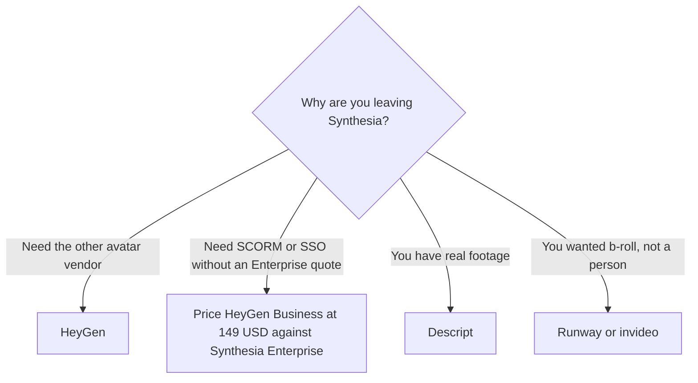

**The direct Synthesia alternative is HeyGen, if you still need a presenter on camera without a shoot. Everything else on this page is a different job: an edit of footage you filmed, a voice with no face, or generated b-roll.** Switching to Runway because Synthesia's credit math was opaque will not give you an avatar plan.

Synthesia's bill is [Synthesia pricing explained](/blog/synthesia-pricing-explained-2026/). The product page is [Synthesia review](/blog/synthesia-review-2026/). The head-to-head is [HeyGen vs Synthesia](/blog/heygen-vs-synthesia-2026/). Training modules are [Synthesia vs HeyGen for training](/blog/synthesia-vs-heygen-for-training-2026/). The other direction of this switch is [HeyGen alternatives](/blog/heygen-alternatives-2026/).

Prices are US list prices excluding tax from directory pages checked October 16, 2026. Published October 24, 2026. We did not score likeness or lip sync.

## The job, then the tool

| The job | Start here | First price that matters | Not this |
|---|---|---|---|
| Another avatar vendor | [HeyGen](/tools/heygen/) | Creator is $29 a month for 600 credits and 1080p | A text-to-video model |
| Stay on Synthesia and change the tier | [Synthesia](/tools/synthesia/) | Starter is $29 billed monthly, shown as $19 yearly, for 1,250 credits. Pro is $89 billed monthly for 6,000 | Assuming Starter includes SCORM |
| Footage you already filmed | [Descript](/tools/descript/) | Hobbyist is $16 a person billed annually | An avatar of someone who did not record |
| A voice, no face | [ElevenLabs](/tools/elevenlabs/) | Starter is $6 a month | A video export |
| A prompt-built video, not a fixed presenter | [invideo AI](/tools/invideo-ai/) | Starter is $10 a seat billed annually, or $20 monthly | A training avatar with a named likeness |
| Generated shots | [Runway](/tools/runway/) | Standard is $12 a month billed annually | A Synthesia replacement |

## HeyGen is the actual alternative

[HeyGen](/tools/heygen/) Free is three videos a month, up to one minute each. Creator at $29 allows videos up to 30 minutes, 1080p, watermark removal, and voice cloning, with 600 credits. Pro at $49 is 1,000 credits and 4K. Business at $149 is 1,500 credits, videos up to 60 minutes, SSO, SCORM, and LMS integrations, with extra seats at $20. The invoice is [HeyGen pricing explained](/blog/heygen-pricing-explained-2026/).

Read the gate before you switch to save money. On the Synthesia page recorded October 16, one-click translation, Brand Kits, SAML/SSO, unlimited video minutes, and SCORM sit on Enterprise. A team that needs SCORM can get a published price on HeyGen Business and only a sales conversation on Synthesia. Get the Enterprise number before you call HeyGen the bargain, and get it before you call Synthesia the bargain in the other direction.

Creator-tier work is $29 on both monthly lists. Synthesia's yearly toggle shows Starter at $19. HeyGen's recorded Creator price in this directory is $29, without a yearly cell repeated here. The difference at that level is the credit definition and the minute cap, not a winner. This directory does not convert HeyGen credits into Synthesia credits. Produce one real module on each trial.

Consent is the same on both. The steps for a likeness you are allowed to use are [how to create AI avatars with HeyGen](/blog/how-to-create-ai-avatars-with-heygen-2026/). An avatar of a coworker who did not agree is not an alternative. It is a reason to stop. Localizing a module you are allowed to ship is [how to localize video with AI](/blog/how-to-localize-video-with-ai-2026/).

## Tools people book instead, and should not

**An editor.** [Descript](/tools/descript/) is for media you recorded. The card is [Descript pricing explained](/blog/descript-pricing-explained-2026/). The switch list, if the transcript metaphor is what you wanted all along, is [Descript alternatives](/blog/descript-alternatives-2026/).

**A generator.** [Runway](/tools/runway/) Standard at $12 annually is a shot tool. [invideo AI](/tools/invideo-ai/) builds from a prompt. [Pika](/tools/pika/) Starter is $10 for 900 credits, and the commercial license on the recorded card starts at Creator for $35. None of them is an avatar studio. The shelf is [best AI video generators](/blog/best-ai-video-generators-2026/). Runway's arithmetic is [Runway pricing explained](/blog/runway-pricing-explained-2026/).

**A voice.** [ElevenLabs](/tools/elevenlabs/) Starter at $6 is narration. Pair it with slides or footage. It does not become Synthesia. The bill is [ElevenLabs pricing explained](/blog/elevenlabs-pricing-explained-2026/).

Synthesia Basic is free, watermarked, with 500 credits and about 10 minutes of video. A watermarked test is a test. It is not a training library. Learner seats, when you need them, are a separate $29 per learner per month on the recorded Synthesia card.

## FAQ

### What is the closest Synthesia alternative?

HeyGen. Compare Creator with Synthesia Starter on one script you already use. If the requirement is SCORM, compare HeyGen Business at $149 with Synthesia Enterprise, not with Starter.

### Is Descript a Synthesia alternative?

Only if you have footage of a real person. Descript edits a recording. It does not invent a presenter. Teams that filmed the trainer should not be on an avatar plan in the first place.

### Which Synthesia plan should I leave before I switch?

Leave Basic if you are publishing without a watermark. Leave Starter for Pro when 1,250 credits are the bottleneck. Leave the product when the vendor, not the tier, is the problem. Pro at $89 does not add SCORM. That gate is Enterprise.

### Are translations included if I switch to HeyGen Creator?

Do not assume it. Synthesia's recorded page puts one-click translation on Enterprise. HeyGen's recorded Business tier is the one with the LMS and SCORM lines. Read the card for the language feature you need, on the tier you are about to pay for, before you move a catalog.

## Last verified

October 16, 2026 for Synthesia, HeyGen, Descript, ElevenLabs, invideo, Runway, and Pika list prices named above. Published October 24, 2026.

**Sources:** [Synthesia pricing](https://www.synthesia.io/pricing), [HeyGen pricing](https://www.heygen.com/pricing), [Descript pricing](https://www.descript.com/pricing).

*Published by Andrew for [AI Tools Optimizer](https://aitoolsoptimizer.com).*

[Synthesia](/tools/synthesia/) and [HeyGen](/tools/heygen/) are in the [video directory](/tools/category/video/). Directory pages may use affiliate links. A purchase through them may earn us a commission at no extra cost to you.
