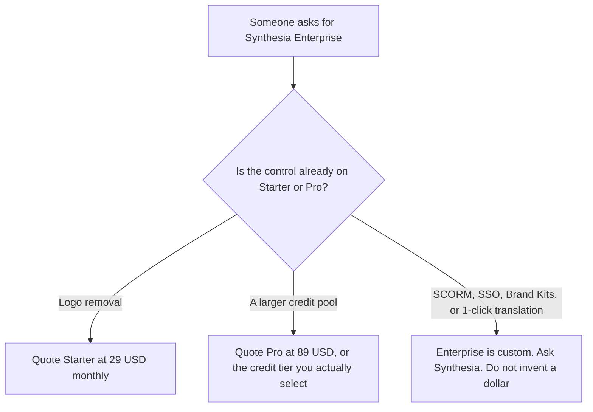

**Synthesia Enterprise is custom.** The pricing page recorded October 16, 2026, and restated in [Synthesia pricing explained](/blog/synthesia-pricing-explained-2026/), lists unlimited video minutes, 1-click translation into 140+ languages, 240+ avatars, unlimited personal avatars, SAML/SSO, Brand Kits, and SCORM export on that contract. It does not list a dollar, a credit total, or a seat price. Pro, the published tier under it, is $89 a month billed monthly with 6,000 credits. Starter, at $29 a month billed monthly, already removes the watermark. This page is the Enterprise name, and what not to invent when a security review or an LMS requirement asks for it.

HeyGen's published SCORM tier is [HeyGen Enterprise pricing explained](/blog/heygen-enterprise-pricing-explained-2026/), which is a different product: HeyGen lists SCORM on Business at $149, not only on a custom contract. The product page is [Synthesia review](/blog/synthesia-review-2026/). The head-to-head is [HeyGen vs Synthesia](/blog/heygen-vs-synthesia-2026/).

Prices that do exist below are US list prices excluding tax, from the October 16 record. Yearly billing saves up to 3 months at the rates that page published. The page does not print an Enterprise yearly dollar, so this page does not invent one. Published October 24, 2026. We did not score avatars. We did not receive an Enterprise quote.

## What the card actually separates

| Plan | Price recorded | Credits recorded | What you may quote |
|---|---|---|---|
| Starter, for contrast | $29 a month billed monthly, shown as $19 with yearly billing | 1,250 | Downloads and logo removal. Not SCORM |
| Pro, for contrast | $89 a month billed monthly | 6,000, with tiers up to 48,000 credits at $676 a month | The credit pool. Not 1-click translation |
| Enterprise | Custom | Custom | Unlimited video minutes, 140+ language translation, 240+ avatars, unlimited personal avatars, SSO, Brand Kits, SCORM |
| Learner seats | $29 per learner per month | A separate line | Not included because you bought a creator plan |

Basic is $0, with a watermark, 500 credits, and 10 minutes of video or dubbing. Buying Enterprise to remove a watermark pays for a contract when Starter already lists logo removal. Buying Enterprise because 1,250 credits felt small is a Pro question, or a higher credit tier up to 48,000 credits at $676 a month. Those are published dollars. Enterprise credits are custom. A receipt from Pro does not predict them.

The base article records video at about 100 credits a minute and dubbing at about 76 credits a minute, beyond the first 10 minutes included on every plan. Those rates are for the credit plans. They are not an Enterprise minutes price. Unlimited video minutes are the words on the Enterprise row. Confirm on the quote what "unlimited" excludes before you put it in a budget.

Learner seats are $29 per learner per month, separate from the creator plan. An Enterprise quote that does not mention learners has not priced the people who watch the course. Count them before you compare the quote with HeyGen's $149 Business card.

## What a neighboring row does, and does not, tell you

**HeyGen's published admin tier.** [HeyGen](/tools/heygen/) Business is $149 a month for 1,500 credits, videos up to 60 minutes, SSO, SCORM, and LMS integrations, with extra seats at $20 a month. SCORM on HeyGen is a Business line with a dollar. SCORM on Synthesia is an Enterprise line without a dollar, on the cards we used. Do not swap those sentences. The invoice is [HeyGen pricing explained](/blog/heygen-pricing-explained-2026/).

**A filmed edit, which is not an avatar contract.** [Descript](/tools/descript/) is the tool when you are cutting footage you already shot. This page does not restate a Descript dollar. An Enterprise avatar quote does not edit the camera you used.

**The script the avatar may speak.** [Notion AI](/tools/notion-ai/) Business is $20 a seat a month on the October 16 card. The page holds the approved script. It is not a Synthesia seat. The invoice is [Notion AI pricing explained](/blog/notion-ai-pricing-explained-2026/).

**The course you are allowed to publish.** The workflow is [how to make training videos with Synthesia](/blog/how-to-make-training-videos-with-synthesia-2026/). A contract does not supply the lesson. Consent for a personal avatar is not a plan feature.

## What not to assume

Do not print an Enterprise price. Do not say 140 languages are on Starter. Do not say SCORM is on Pro. Do not treat "unlimited video minutes" as a credit total you can multiply by 100. Do not ignore the $29 learner line. Do not convert a non-USD checkout into the Starter or Pro dollars, and do not convert those dollars into an Enterprise estimate.

## FAQ

### How much is Synthesia Enterprise?

The October 16 card says custom. There is no seat price and no credit total on that card. Pro at $89 a month billed monthly is the last published creator dollar before the volume credit tiers. If a reseller offers a number, that quote is the price, and this page will not round it into a list.

### Does Enterprise include SSO and SCORM?

Those words are on the Enterprise row we recorded: SAML/SSO and SCORM export, with Brand Kits, unlimited personal avatars, and 1-click translation into 140+ languages. They are not on the Starter or Pro rows in that record. A company that only needs the watermark gone should quote Starter. A company that needs SCORM without a sales call should price HeyGen Business before requesting this quote.

### What is the $29 learner seat?

It is a separate line, $29 per learner per month, on the page the base article used. It is not an Enterprise creator price, and it is not included in Pro's $89. Count learners on the quote.

### Does this page replace the main Synthesia pricing article?

No. That article is Basic, Starter, Pro, credits, and the gate. This article is the Enterprise name: which controls sit only on the custom contract, and which published dollars people mislabel as Enterprise.

## Last verified

October 16, 2026, from the directory card, matching the October 24 base pricing article. Published October 24, 2026. Enterprise remains custom. No quote was received for this page.

**Sources:** [Synthesia pricing](https://www.synthesia.io/pricing), [Synthesia](https://www.synthesia.io).

*Published by Andrew for [AI Tools Optimizer](https://aitoolsoptimizer.com).*

[Synthesia](/tools/synthesia/) is in the [video directory](/tools/category/video/). Directory pages may use affiliate links. A purchase through them may earn us a commission at no extra cost to you.
