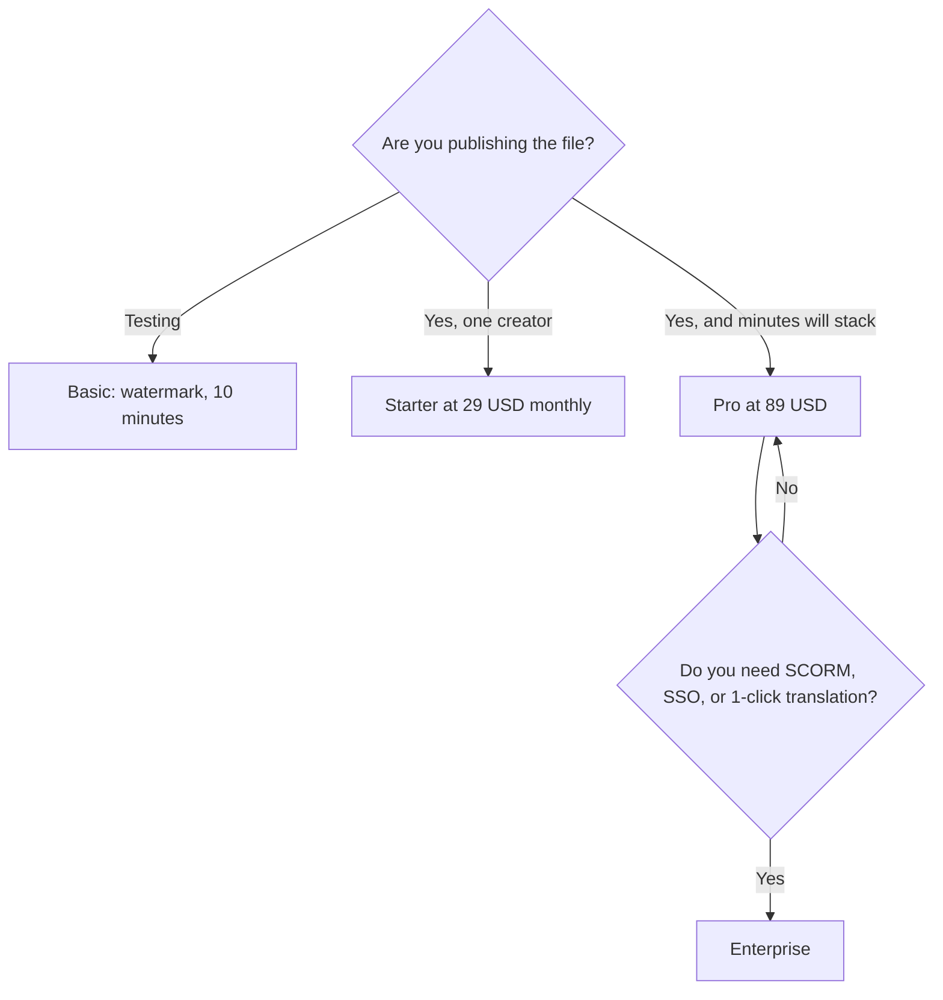

**Synthesia pricing is a shared credit pool, then an Enterprise contract for the learning-system features.** Basic is free and watermarked. Starter is $29 a month billed monthly, shown as $19 a month on yearly billing, with 1,250 credits. Pro is $89 a month billed monthly with 6,000 credits. One-click translation into 140+ languages, Brand Kits, SAML/SSO, unlimited video minutes, and SCORM export are Enterprise features on the page we checked.

Prices are US list prices excluding tax, from Synthesia's pricing page as recorded October 16, 2026. This explainer is published October 24, 2026. The product review is [Synthesia review](/blog/synthesia-review-2026/). The other avatar bill is [HeyGen pricing explained](/blog/heygen-pricing-explained-2026/). The head-to-head is [HeyGen vs Synthesia](/blog/heygen-vs-synthesia-2026/).

## The ladder

| Plan | Monthly list | Credits | What is new |
|---|---|---|---|
| Basic | $0 | 500, plus 10 minutes of video or dubbing and 3 survey responses | Share links, templates, roleplays, surveys. Videos carry a watermark |
| Starter | $29 billed monthly, shown as $19 with yearly billing | 1,250 | Downloads, logo removal, 125+ avatars, chat and email support |
| Pro | $89 billed monthly | 6,000, with tiers up to 48,000 credits at $676/month | The practical team credit pool |
| Enterprise | Custom | Custom | Unlimited video minutes, 140+ language translation, 240+ avatars, unlimited personal avatars, SSO, Brand Kits, SCORM |

Yearly billing saves up to 3 months at the rates Synthesia published. Learner seats are $29 per learner per month, separate from the creator plan.

## How to read the credits

Credits are a shared currency. The page we used prices video at about 100 credits a minute and dubbing at about 76 credits a minute, beyond the first 10 minutes included on every plan. Survey responses are 350 credits after the first 3.

A sketch, using those rates, for a module after the included 10 minutes:

| Module | Rough credit spend | Fits in Starter's 1,250? | Fits in Pro's 6,000? |
|---|---|---|---|
| 6 minutes of video, no dub | about 600 | Yes, one module, with room for a second if you do not dub | Yes |
| 6 minutes of video plus a dub of the same length | about 600 + about 456 | Tight. Two of those months overflow Starter | Yes |
| A 20-minute course | about 2,000 | No | Yes, until you dub it and add surveys |

These sketches are arithmetic on Synthesia's published per-minute rates. They are not a meter reading from an account. The run button in the product is the receipt. The jump to 48,000 credits at $676 a month is a volume plan. It is not the default after Starter feels small. Pro at $89 is the step between them.

Personal avatars exist. Enterprise includes them without a tight cap. Do not assume Starter includes unlimited personal avatars or SCORM. The workflow for a training module is [how to make training videos with Synthesia](/blog/how-to-make-training-videos-with-synthesia-2026/).

## Four buyers

**Someone testing whether an avatar is acceptable.** Basic. Ten watermarked minutes is a real test. [HeyGen](/tools/heygen/)'s free plan, by comparison, is 3 videos of up to 1 minute. If the test needs a longer clip, Synthesia Basic is the more generous free file.

**One trainer publishing a short monthly module.** Starter, after you estimate minutes. Yearly at the $19-equivalent is the discount once the format sticks. Stay on monthly at $29 until the second video ships.

**A team producing dubbed modules every week.** Pro at $89, then a higher credit tier only when the 6,000-credit month actually ran out. Dubbing spends the same pool.

**An L&D buyer who must drop SCORM into an LMS, translate in one click, and lock the brand.** Enterprise. HeyGen lists SCORM and LMS integrations on Business at $149 a month, which is a published price. If the requirement is SCORM without a sales call, price HeyGen Business before you request a Synthesia Enterprise quote. If the requirement is the bundle of SSO, Brand Kits, unlimited minutes, and 140+ languages together, Synthesia's page puts that bundle on Enterprise.

## Mistakes that change the bill

- **Buying Enterprise for watermark removal.** Starter removes the logo.
- **Ignoring the included 10 minutes.** The per-minute rate applies beyond those minutes. A short module may be cheaper than the sketch.
- **Treating credits as minutes.** About 100 credits per video minute is the recorded rate. A 1,250-credit plan is not 1,250 minutes.
- **Adding learner seats by accident.** $29 per learner per month is a second line. Count learners before you count creators.
- **Using an avatar tool to edit footage you shot.** [Descript](/tools/descript/) Hobbyist is $16 a person a month billed annually. [invideo AI](/tools/invideo-ai/) is the prompt-to-edit path. Starter there is a different product.

Voice-only narration, with no avatar, is [ElevenLabs](/tools/elevenlabs/) Starter at $6 a month, which includes a commercial license. The voice aisle is [best AI voice generators](/blog/best-ai-voice-generators/).

## FAQ

### How much is Synthesia Starter?

$29 a month billed monthly, or the yearly presentation of $19 a month, with 1,250 credits, downloads, and logo removal. Basic is $0 with a watermark.

### How much is Synthesia Pro?

$89 a month billed monthly, with 6,000 credits. Higher credit packs on that plan go up to 48,000 credits at $676 a month.

### Does Synthesia include translation on Starter?

One-click translation into 140+ languages is an Enterprise line on the page we checked. Dubbing spends credits on the plans below that. Confirm the current language list inside the plan you will buy.

### Is Synthesia cheaper than HeyGen?

Both list a $29 monthly entry on the pages we used. Synthesia shows a yearly Starter equivalent of $19. HeyGen's next step is Pro at $49, then Business at $149 with SCORM at a published price. Synthesia's comparable controls are Enterprise. Cheaper depends on which of those controls you need.

## Last verified

October 16, 2026 for the prices and the per-minute credit rates. Published October 24, 2026.

**Sources:** [Synthesia pricing](https://www.synthesia.io/pricing), [Synthesia](https://www.synthesia.io/).

[Synthesia](/tools/synthesia/) is in the [video directory](/tools/category/video/). Directory pages may use affiliate links. A purchase through them may earn us a commission at no extra cost to you.
