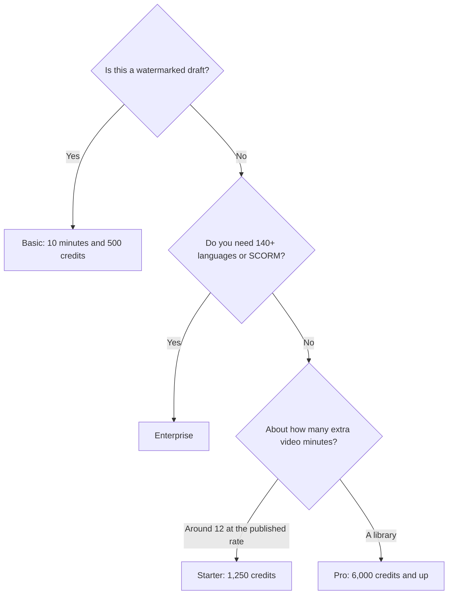

**[Synthesia](/tools/synthesia/) is a script-to-presenter studio aimed at training, onboarding, and enablement.** Basic is free: 10 minutes of video or dubbing, 3 survey responses, and 500 credits a month, with a watermark. Starter is $29 a month billed monthly, shown as $19 a month on yearly billing, with 1,250 credits. Pro is $89 a month billed monthly with 6,000 credits, and higher credit tiers on that plan run up to 48,000 credits for $676 a month. Enterprise is custom.

Prices are US dollar list prices from Synthesia's pricing page, recorded October 16, 2026. Yearly billing saves up to 3 months. Tax and local checkout can differ. This review does not score how human the avatars look.

If you are choosing between the two big avatar studios, use [HeyGen vs Synthesia](/blog/heygen-vs-synthesia-2026/) for the comparison and the [HeyGen review](/blog/heygen-review-2026/) for HeyGen's own ladder. Footage you already shot belongs in the [Descript review](/blog/descript-review-2026/).

## The shared credit pool

Synthesia treats credits as one currency across AI features. Its pricing materials describe video at about 100 credits per minute and dubbing at about 76 credits per minute, after the first 10 minutes included on every plan. A survey response uses 350 credits after the first 3. Learner seats are listed at $29 per learner per month.

| Plan | Price we recorded | Credits / month | What changes |
|---|---|---|---|
| Basic | $0 | 500, plus 10 minutes and 3 survey responses | Share links, templates, roleplays, surveys. Watermark |
| Starter | $29/month monthly, or $19/month shown yearly | 1,250 | Downloads, Synthesia logo removed, 125+ avatars |
| Pro | $89/month monthly, up to $676 for 48,000 credits | 6,000 on the entry tier | More of the same pool. Confirm which Pro features your tier unlocks |
| Enterprise | Custom | Custom | Unlimited video minutes, 1-click translation in 140+ languages, 240+ avatars, unlimited personal avatars, SAML/SSO, Brand Kits, SCORM |

The credit math is [Synthesia pricing explained](/blog/synthesia-pricing-explained-2026/).

Read that as a planning path. Basic is the draft. Enterprise is the learning-system and wide-translation contract. Starter and Pro are credit sizes.

## Minutes, estimated from Synthesia's rate

At the published 100 credits per video minute, Starter's 1,250 credits cover about 12 extra minutes after the 10 minutes included on the plan. Pro's 6,000 credits cover about 60 extra minutes on that same rate. Dubbing is cheaper per minute on the published 76-credit figure, and surveys are expensive relative to a talking-head minute.

Those are arithmetic on Synthesia's rate card. They are not a stopwatch from a render we ran. Images, personal avatars, and other AI features share the pool, so a deck full of generated visuals will buy fewer minutes than a plain script.

A training team should count three numbers before picking Pro's $89 tier:

1. Minutes of new video this month, minus the included 10.
2. Minutes of dubs. A 10-minute lesson in four languages is 30 extra dubbing minutes if one language is the original.
3. Survey responses past the included 3, at 350 credits each.

If that sum fits in 1,250 credits, Starter's yearly price (the $19 a month figure Synthesia shows) is the contract to price. If the sum needs 6,000 credits every month, Pro is the contract. If the requirement is SCORM, SSO, Brand Kits, or 140+ languages in one click, the credit tier does not unlock them. Those sit on Enterprise in the pricing we recorded.

## What sits in the editor

You paste a script, choose an avatar and voice, and add slides, media, or a template. Paid plans list 125+ stock avatars. Enterprise lists 240+ and unlimited personal avatars. Personal avatars exist on the product. Create one only for a person who has agreed to it.

Roleplays and surveys are the features that make this a learning tool rather than a slide reader. They are available to try on Basic, with the survey cap above. Downloads and logo removal start on Starter. Share links exist on Basic, which is enough for a review link and a poor way to ship a course.

## Fit score

| Requirement | Basic | Starter | Pro | Enterprise |
|---|---|---|---|---|
| Draft a lesson and share a link | Strong | Strong | Strong | Strong |
| Download without the Synthesia logo | No | Yes | Yes | Yes |
| A monthly library past ~20 minutes | Tight | Only if the rate card holds | Stronger | Unlimited minutes listed |
| One-click translation in 140+ languages | No | No | No | Yes |
| SCORM export | No | No | No | Yes |
| Predict the invoice from a minute count | Partial | Partial | Partial | Custom |

The fit labels follow the pricing page. We did not grade video quality.

## When another studio is the purchase

| Situation | Look here |
|---|---|
| You want 1080p avatar video with watermark removal at a listed $29, and SCORM on a listed $149 Business seat | [HeyGen](/tools/heygen/), and the comparison post |
| You are editing a person who was actually filmed | [Descript](/tools/descript/) |
| You need a generated scene, not a presenter | [invideo AI](/tools/invideo-ai/) or the [video generator guide](/blog/best-ai-video-generators-2026/) |
| You only need a voice | [Murf](/tools/murf-ai/) |

## FAQ

### Is Synthesia free?

Yes. Basic includes 10 minutes of video or dubbing, 3 survey responses, and 500 credits a month. Those videos carry a watermark.

### How much does Synthesia cost?

Starter is $29 a month billed monthly, or $19 a month as shown with yearly billing. Pro starts at $89 a month billed monthly for 6,000 credits. Enterprise is custom.

### How do credits work?

Video is about 100 credits a minute and dubbing about 76, after 10 included minutes. Survey responses are 350 credits after the first 3. Confirm the live rate card. It can change.

### Can I export SCORM?

SCORM export is listed on Enterprise, along with SSO and Brand Kits. Learner seats are listed at $29 per learner per month.

## Last verified

October 16, 2026.

**Sources:** [Synthesia pricing](https://www.synthesia.io/pricing), [Synthesia](https://www.synthesia.io).

[Synthesia](/tools/synthesia/) is in the [video directory](/tools/category/video/). Directory pages may use affiliate links. A purchase through them can earn us a commission at no extra cost to you.
