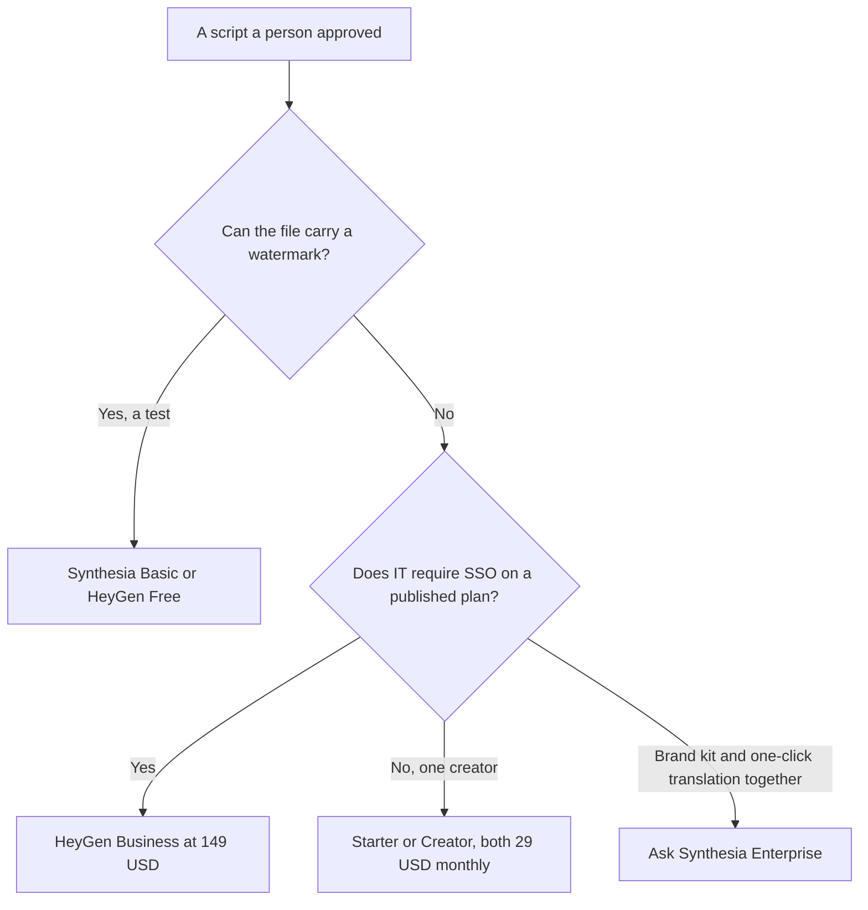

**Use HeyGen Business at $149 a month when an internal video library needs SSO on a published plan. Use Synthesia Starter at $29 a month when one communicator needs a download without a watermark, and ask Synthesia for Enterprise when the requirement is Brand Kits plus one-click translation in the same contract.** Both can put an avatar on an all-hands or a policy explainer. The training decision, which is SCORM and an LMS, is a different page. The prospect clip is a different page again.

The invoices are [Synthesia pricing explained](/blog/synthesia-pricing-explained-2026/) and [HeyGen pricing explained](/blog/heygen-pricing-explained-2026/). The course comparison is [Synthesia vs HeyGen for training](/blog/synthesia-vs-heygen-for-training-2026/). The sales comparison is [HeyGen vs Synthesia for sales](/blog/heygen-vs-synthesia-for-sales-2026/). The team shelf is [best AI tools for internal comms](/blog/best-ai-tools-for-internal-comms-2026/).

Prices are US list prices excluding tax from directory pages checked October 16, 2026. Published October 24, 2026. We did not score avatars, lip sync, or languages.

## What internal comms is buying

| | [Synthesia](/tools/synthesia/) | [HeyGen](/tools/heygen/) |
|---|---|---|
| Free test | Basic: 10 minutes of video, watermark, 500 credits | 3 videos a month, up to 1 minute each |
| First plan that removes the watermark | Starter, $29 a month billed monthly, shown as $19 on yearly billing, 1,250 credits | Creator, $29 a month, 600 credits, 1080p, videos up to 30 minutes |
| A larger credit pool | Pro, $89 a month billed monthly, 6,000 credits | Pro, $49 a month, 1,000 credits and 4K |
| SSO on a published price | The directory puts SAML/SSO on Enterprise, which is custom | Business, $149 a month, also lists SCORM, LMS, and videos up to 60 minutes. Extra seats $20 a month |
| Brand kit and one-click translation | Brand Kits and 140+ language translation are Enterprise lines on the page we checked | Creator lists 175+ languages and dialects, and voice cloning. This page does not treat that list as a brand-kit bundle |
| Who the video is for | Employees, from a script you approved | Employees, from a script you approved |

Five communicators do not fit on a casual reading of either starter plan. HeyGen Business lists extra seats at $20 a month. Synthesia also lists learner seats at $29 per learner per month, which is a training line. Do not buy learner seats to give five managers a login. Ask what an editor seat costs before you multiply.

## The internal job, and the jobs this page is not

**A three-minute policy explainer from a script legal already signed.** Either paid starter plan can remove a watermark. Keep the script in [Notion AI](/tools/notion-ai/). Business is $20 a seat a month if that wiki is the system of record. The model may not add a policy line that legal did not write. The fact habit is [how to fact-check AI writing](/blog/how-to-fact-check-ai-writing-2026/).

**A global workforce and a locked brand.** Synthesia's recorded page puts Brand Kits, SSO, and one-click translation together on Enterprise. Get the quote. HeyGen's published SSO price is Business at $149. Compare the quote to $149 plus $20 for each extra seat. Language lists are not a quality score. Watch one clip in the language you will actually ship.

**Footage you already shot.** An avatar is the wrong tool. [Descript](/tools/descript/) Hobbyist is $16 a person a month billed annually for editing real recordings. The invoice is [Descript pricing explained](/blog/descript-pricing-explained-2026/).

**The line edit on the script.** [Grammarly](/tools/grammarly/) Pro is $12 a member a month billed annually. It will not know the policy.

A course that must drop into an LMS belongs on the training comparison linked above. A clip for a buyer belongs on the sales comparison. Internal comms that borrows either script will sound like a pitch or a class.

## FAQ

### Is the free plan enough for an all-hands?

No, if the video will be posted as an official file. Synthesia Basic is watermarked. HeyGen Free stops at one minute and three videos. Use free to test whether an avatar is acceptable, then pay before you publish.

### Which one is clearer for a global team?

We did not score languages. Synthesia lists one-click translation into 140+ languages on Enterprise. HeyGen lists 175+ languages and dialects on Creator. Pick from the contract you can sign, then review one real script.

### Can we use a coworker's face?

Only with consent you can show, on a plan that includes the avatar type you need. HeyGen Business includes 5 custom video avatars on the recorded card. Synthesia lists unlimited personal avatars on Enterprise. Do not upload a likeness because the all-hands would look warmer.

### Should internal comms buy SCORM?

Buy SCORM when the file is a course in an LMS. That is the training article. An all-hands does not become a course because the video tool can export a package.

## Last verified

October 16, 2026 for Synthesia, HeyGen, Notion, Descript, and Grammarly. Published October 24, 2026.

**Sources:** [Synthesia pricing](https://www.synthesia.io/pricing), [HeyGen pricing](https://www.heygen.com/pricing), [Descript pricing](https://www.descript.com/pricing).

*Published by Andrew for [AI Tools Optimizer](https://aitoolsoptimizer.com).*

[HeyGen](/tools/heygen/) is in the [video directory](/tools/category/video/). Directory pages may use affiliate links. A purchase through them may earn us a commission at no extra cost to you.
