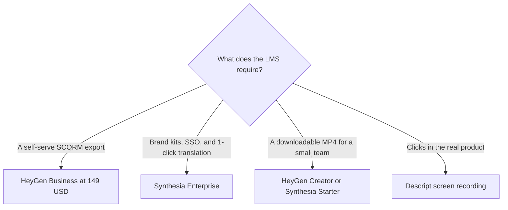

**For training, buy HeyGen Business when you need a published SCORM price without a sales call. Buy Synthesia when the course stack is Enterprise: one-click translation, Brand Kits, and a learner seat.** Both can put an avatar in front of a script. The L&D decision is the package your LMS accepts, and the minutes you will actually render.

This directory does not have a Colossyan page, so this comparison stays on the two avatar tools we can price. The broader marketing-and-training split is [HeyGen vs Synthesia](/blog/heygen-vs-synthesia-2026/). Use that piece when the video is a campaign. Use this one when the video is a course.

Prices are US list prices excluding tax from directory pages checked October 16, 2026. Published October 24, 2026. We did not score avatar realism or completion rates.

## The training contract

| Training need | HeyGen | Synthesia |
|---|---|---|
| A watermarked test | Free: 3 videos a month, up to 1 minute, Avatar IV | Basic: $0, 500 credits, 10 minutes of video or dubbing, watermark |
| A creator publishing a module | Creator $29/month: 600 credits, up to 30 minutes, 1080p, no watermark, voice cloning | Starter $29/month billed monthly, shown as $19 on yearly billing: 1,250 credits, downloads, logo off |
| A team credit pool | Pro $49/month: 1,000 credits and 4K. Business $149/month: 1,500 credits | Pro $89/month billed monthly: 6,000 credits, with packs up to 48,000 credits at $676/month |
| SCORM and the LMS | Business $149/month lists SSO, SCORM, and LMS integrations. Extra seats $20/month | SCORM, SAML/SSO, Brand Kits, and 1-click translation into 140+ languages are Enterprise, custom price |
| Learner seats | Extra HeyGen seats are $20/month on Business | Learner seats are $29 per learner per month, separate from the creator plan |
| A course that is really a screen recording | Use [Descript](/tools/descript/) instead of an avatar | Same. An avatar narrating a UI you could record is the expensive version of a tutorial |

The invoices in full are [HeyGen pricing explained](/blog/heygen-pricing-explained-2026/) and [Synthesia pricing explained](/blog/synthesia-pricing-explained-2026/). A Synthesia production path is [how to make training videos with Synthesia](/blog/how-to-make-training-videos-with-synthesia-2026/).

## Minutes and credits, before anyone films an avatar

Synthesia shares one credit pool. The page we used prices video at about 100 credits a minute and dubbing at about 76 credits a minute, after the first 10 minutes included on every plan. A 6-minute module past those included minutes is on the order of 600 credits. That is half of Starter's 1,250 and a tenth of Pro's 6,000. Dubbing the same module adds another line. Estimate the course, then pick the pool.

HeyGen's summary does not publish one universal minutes-per-credit rate. Treat the minute caps as maximum video length: 1 minute on Free, 30 on Creator, 60 on Business. Creator's 600 credits and Business's 1,500 credits are allowances. Run one module and read the debit before you promise a 20-video curriculum on Creator.

HeyGen lists 175+ languages and dialects on the paid plans, and 30+ on Free. Synthesia's one-click translation into 140+ languages is an Enterprise line on the page we checked. A self-serve team that must ship a second language this month is on HeyGen's published plans, or on a separate dubbing tool. [ElevenLabs](/tools/elevenlabs/) Starter at $6 a month includes Dubbing Studio and a commercial license, with 30,000 credits. The voice bill is [ElevenLabs pricing explained](/blog/elevenlabs-pricing-explained-2026/).

## When the avatar is the wrong teacher

Record the product. [Descript](/tools/descript/) Hobbyist at $16 a person a month billed annually includes 10 media hours, Studio Sound, and filler-word removal. Business at $50 annually adds translation and dubbing in 30+ languages. A screen tutorial with a real cursor teaches a workflow an avatar can only describe. The edit order is [how to edit podcasts with Descript](/blog/how-to-edit-podcasts-with-descript-2026/).

Use an avatar when the trainer should not be on camera, when the script will change every quarter, and when a stock or custom presenter is acceptable to the audience. HeyGen's custom avatar and voice cloning start on Creator at $29. Synthesia's unlimited personal avatars are listed on Enterprise, with 125+ stock avatars on the paid self-serve plans and 240+ on Enterprise.

Interactive pieces follow the same gate. HeyGen lists interactive video on Business. Synthesia includes surveys on Basic, with 3 responses included and further responses at 350 credits. A quiz inside the LMS may still be the LMS's job. Confirm which system records completion before you rebuild it in the video tool.

## A rollout for one course

1. Write a 3-minute script from a policy or a help article you already stand behind. The avatar does not supply the policy.
2. Render it on the free tier of one tool. HeyGen's cap is one minute, so use a 60-second slice there, or use Synthesia's 10 included minutes.
3. Ask the LMS owner whether they need SCORM this quarter. If yes, price HeyGen Business at $149 or a Synthesia Enterprise quote. If they only need an MP4, stay on Creator or Starter.
4. Add a language only after the English module is one you would assign. Dubbing a draft multiplies a draft.

## FAQ

### Which is better for employee training, Synthesia or HeyGen?

HeyGen Business is the self-serve plan that lists SCORM and LMS integrations at $149 a month. Synthesia puts SCORM, Brand Kits, SSO, and one-click translation on Enterprise. For a single creator exporting an MP4, either Creator or Starter at $29 a month is the experiment. We did not score which avatar looks more human.

### Why is Colossyan not in this comparison?

This directory has no Colossyan page and no recorded Colossyan price. Adding it here would mean inventing a column. Compare it from its own current price list if you are evaluating it.

### Do I need an avatar platform to localize a course?

You need a script you have rights to, and a dubbing path. HeyGen's paid language list, Synthesia Enterprise translation, ElevenLabs Dubbing Studio, and Descript Business are four different contracts. The production order is [how to localize video with AI](/blog/how-to-localize-video-with-ai-2026/).

### Are learner seats the same as creator seats?

On Synthesia, learner seats are $29 per learner per month, separate from the plan that creates the video. On HeyGen Business, extra seats are $20 a month. Count viewers only if the product charges for them. An LMS you already own may be the viewer system.

## Last verified

October 16, 2026. Published October 24, 2026. SCORM and translation gates are plan claims from those pricing pages. Confirm them against your LMS before you sign an annual contract.

**Sources:** [HeyGen pricing](https://www.heygen.com/pricing), [Synthesia pricing](https://www.synthesia.io/pricing), [Descript pricing](https://www.descript.com/pricing).

*Published by Andrew for [AI Tools Optimizer](https://aitoolsoptimizer.com).*

[Synthesia](/tools/synthesia/) and [HeyGen](/tools/heygen/) are in the [video directory](/tools/category/video/). Directory pages may use affiliate links. A purchase through them may earn us a commission at no extra cost to you.
