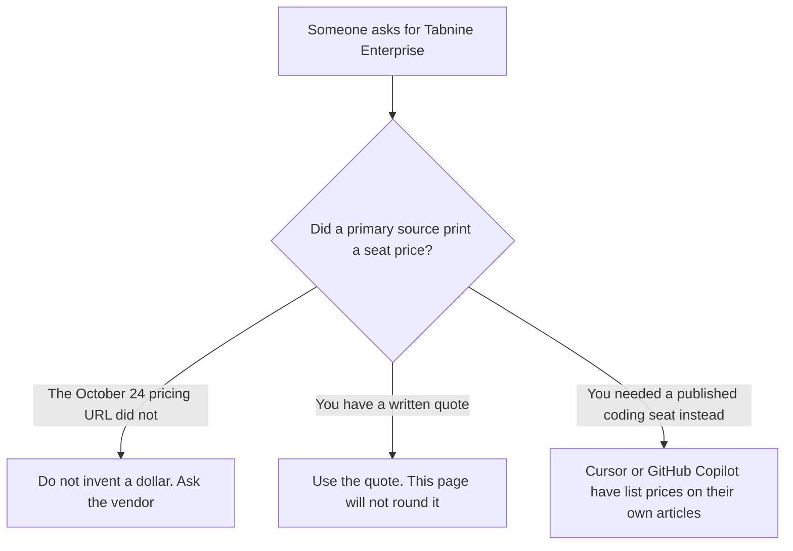

**This page does not quote a Tabnine Enterprise price. The official pricing URL did not show one.** On October 24, 2026, tabnine.com/pricing redirected to a Tricentis page that says Tabnine is now part of Tricentis and offers links to log in, to Tabnine documentation, and to Tabnine support. That page did not list a Dev plan, a Pro plan, an Enterprise plan, or any dollar. A documentation path that used to be a pricing article returned a not-found page the same day. The directory does not list Tabnine, so there is no earlier card to fall back on. A quote from the vendor is the price.

Published coding seats you can still print, for a different product, are [Cursor Enterprise pricing explained](/blog/cursor-enterprise-pricing-explained-2026/) and [GitHub Copilot Enterprise pricing explained](/blog/github-copilot-enterprise-pricing-explained-2026/). The editor comparison that includes the Windsurf successor is [Windsurf vs Cursor for refactors](/blog/windsurf-vs-cursor-for-refactors-2026/).

Published October 24, 2026. We did not score completions. We did not receive a Tabnine quote. We do not convert an old blog post, a forum comment, or a non-USD checkout into a US list price.

## What the October 24 fetch contained

| Source | What it showed | What this page will quote |
|---|---|---|
| tabnine.com/pricing | A redirect to a Tricentis notice: Tabnine is now part of Tricentis, plus login, docs, and support links | No plan name and no dollar |
| The docs pricing path we tried | Not found | No historical price recovered from that URL |
| This site's directory | Tabnine is not listed | No directory dollar to repeat |
| A salesperson's quote | Not received for this article | The quote, when you have it, is the price |

Neighboring products have numbers because their pages printed numbers. Cursor Enterprise is contact sales, while Cursor Teams is $30, $100, or $200 a seat a month, on the October 24 help page. GitHub Copilot Enterprise is $39 a user a month on the October 16 directory card, and Business is $19. Those are not Tabnine tiers. Putting $39 next to Tabnine because both words say Enterprise is how a budget gets a fictional line.

Claude Code is included on [Claude](/tools/claude/) Pro, at $17 a month billed annually or $20 monthly, on the October 24 pricing table. That is an Anthropic seat. It does not unlock a Tabnine contract, and it does not imply what Tabnine costs.

The Tricentis notice is a ownership statement, not a price list. Logging in as an existing user may show that account's plan. This page did not log in, and it will not describe an account we did not see.

## What a published coding seat does, and does not, tell you

**An editor with a list price and a sales row.** [Cursor](/tools/cursor/) Plus is $8 a month, or $80 a year. Enterprise has no dollar on the help page. The individual ladder is [Cursor pricing explained](/blog/cursor-pricing-explained-2026/).

**A GitHub seat with a printed Enterprise dollar.** [GitHub Copilot](/tools/github-copilot/) Enterprise at $39 is that product's card. The invoice is the Copilot Enterprise article above. It is a poor template for a vendor whose pricing URL no longer shows a table.

**A terminal agent on a chat plan.** [Claude Code](/tools/claude-code/) rides the Claude plan. The invoice is [Claude Code pricing explained](/blog/claude-code-pricing-explained-2026/).

**The refactor, which is not a Tabnine quote.** The person who owns the code still reads the diff. The tool choice for that read is the Windsurf-versus-Cursor article, which also refuses to invent an Enterprise dollar.

## What not to assume

Do not quote a Tabnine Dev, Pro, or Enterprise price from memory. Do not use Copilot's $39, Cursor's $30, or Claude's $20 as a stand-in. Do not treat the Tricentis redirect as a discount or as a new SKU with a hidden list price. Do not convert a price you saw in another currency.

## FAQ

### How much is Tabnine Enterprise?

The sources read on October 24, 2026 do not say. tabnine.com/pricing redirected to a Tricentis notice without a plan table, the docs pricing path was not found, and this directory has no Tabnine card. Ask Tabnine or Tricentis. Put their quote in the budget. Leave this page's number blank.

### Did Tabnine used to publish a price?

This page does not reconstruct an old price. The URL that should have been the current list did not show one on October 24. An old number, if you still have an invoice, is that invoice. It is not a 2026 list price this article will print.

### Is the Tricentis page a new Enterprise tier?

It is a notice that Tabnine is part of Tricentis, with links for existing users and for sales contact paths elsewhere on that site. It is not a feature matrix and not a seat price. A demo request is not a dollar.

### Which published coding seats can I quote today?

Cursor Teams at $30, $100, or $200 a seat a month, with Enterprise as contact sales, from the October 24 help page. GitHub Copilot Business at $19 and Enterprise at $39, from the October 16 directory card. Claude Pro at $17 a month billed annually or $20 monthly, with Claude Code included. None of those are Tabnine.

## Last verified

October 24, 2026 for tabnine.com/pricing, which redirected to a Tricentis notice without plan prices, and for a Tabnine docs pricing path, which was not found. October 24, 2026 for Cursor and Claude, via the posts cited above. October 16, 2026 for GitHub Copilot. Published October 24, 2026. No Tabnine quote was received.

**Sources:** [Tabnine pricing URL](https://www.tabnine.com/pricing), [Cursor pricing](https://cursor.com/help/account-and-billing/pricing), [GitHub Copilot plans](https://github.com/features/copilot/plans), [Claude pricing](https://claude.com/pricing).

*Published by Andrew for [AI Tools Optimizer](https://aitoolsoptimizer.com).*

[Cursor](/tools/cursor/) is in the [coding directory](/tools/category/coding/). Directory pages may use affiliate links. A purchase through them may earn us a commission at no extra cost to you.
