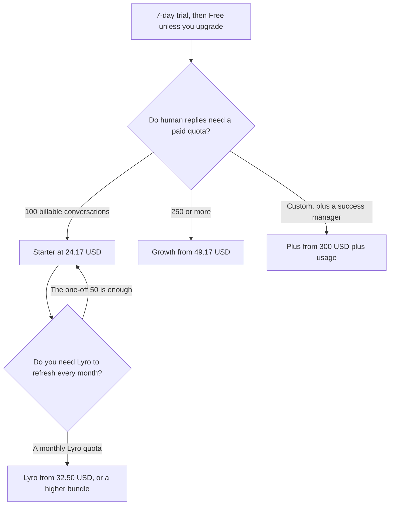

**Tidio Starter is $24.17 a month on the pricing page's annual view, with 100 billable conversations. Growth starts at $49.17 a month, from 250 billable conversations. Plus starts at $300 a month plus usage. Premium is contact sales.** The page, read October 24, 2026, labels the annual toggle "2 months free." A 7-day trial does not require a card, and the FAQ says the account drops to Free afterward unless you upgrade. Lyro conversations and human billable conversations are different meters.

The product page is [Tidio review](/blog/tidio-review-2026/). A credit-meter bot is [Chatbase pricing explained](/blog/chatbase-pricing-explained-2026/). An outcome-priced bot is [Intercom Fin pricing explained](/blog/intercom-fin-pricing-explained-2026/).

The October 16 directory recorded the same three entry figures: Starter $24.17 billed annually, Growth from $49.17, Plus from $300. The October 24 page adds the Free row and the annual label. Published October 24, 2026. We did not score resolution rates. Figures on the page that advertise a percent are the vendor's claims, not a measurement by this site.

## The plans

| Plan | Price on the October 24 page | Conversations | What you are buying |
|---|---|---|---|
| Free | $0 | 50 billable, on the comparison table | Live chat and ticketing limits, 10 seats on that table, a lifetime first 50 Lyro conversations, 100 Flows visitors |
| Starter | $24.17 a month | 100 billable | 50 one-off Lyro conversations, 100 Flows visitors, live chat and ticketing |
| Growth | Starts at $49.17 a month | From 250 billable | Advanced analytics, permissions, automatic assignment, macros |
| Plus | Starts at $300 a month, plus usage | Custom | Premium support, a success manager, departments, custom branding, OpenAPI |
| Premium | Contact sales | Custom | A managed tier. The page lists terms you negotiate |
| Lyro, stand-alone | Starts at $32.50 a month | From 50 Lyro conversations | The agent on a help desk you already run |
| Flows, stand-alone | Starts at $24.17 a month | From 2,000 visitors reached | The automation paths, separate from the agent |

Tidio's FAQ defines a billable conversation as a live chat, ticket, email, or social conversation that includes a message from a human agent. Unanswered visitor messages are not billed. Replies from Flows and from Lyro are not billable conversations. A Lyro conversation is an interaction with at least one reply from the agent, and many replies in that thread still count as one. The first 50 Lyro conversations are a lifetime grant. They refresh monthly only on a paid Lyro quota. The first 100 Flows visitors are free. A paid Flows quota refreshes on the cycle the FAQ describes.

Self-serve plans list up to 10 seats on the comparison table. Plus is the row for a custom seat count. Removing Tidio branding is an add-on at $16.67 a month on that table. The comparison table also shows billable quotas stepping from 50 through 2,000, and Lyro quotas from 0 through 1,000. Above that, the page says to contact sales. "Starts at" means the $49.17 and $300 figures are entry points, not a ceiling.

## How to read the other bots

[Chatbase](/tools/chatbase/) Hobby is $40 a month, or $32 billed yearly, for 700 message credits. That is a credit, not a Tidio billable conversation. [Intercom Fin](/tools/intercom-fin/) is $0.99 per outcome inside a $49 a month base with 50 resolutions, on its pricing article. A Tidio billable, a Chatbase credit, and a Fin outcome are three units. Compare them by counting a week of your own tickets, not by dividing the stickers.

[HubSpot](/tools/hubspot/) has a free CRM. Starter was advertised from $7 or $10 a seat on the October 16 card, as a limited-time offer. The invoice is [HubSpot pricing explained](/blog/hubspot-pricing-explained-2026/). HubSpot is a CRM. Tidio is the chat and the agent. Buying both is two bills.

## What not to assume

Do not treat $24.17 as the monthly sticker if your toggle is on Monthly and the cart shows another number. The page we read had the annual label next to that figure, and the directory recorded it as billed annually. Do not expect the 50 Lyro conversations on Starter to refresh. The page calls them one-off. Do not quote a resolution percent from the marketing blocks as a result you will get.

## FAQ

### How much does Tidio Starter cost?

$24.17 a month on the October 24, 2026 pricing page, beside an annual toggle marked "2 months free," with 100 billable conversations and 50 one-off Lyro conversations. Confirm the monthly toggle before you quote a different cadence.

### What is a billable conversation?

A conversation that a human agent replies to or starts. Lyro replies and Flow replies are not that meter. A thread with many human messages still counts as one billable conversation, on the FAQ we read.

### Can I buy Lyro without the help desk?

Yes. Stand-alone Lyro starts at $32.50 a month for 50 Lyro conversations. Stand-alone Flows starts at $24.17 a month for 2,000 visitors reached. The FAQ says each product can be purchased on its own, and a free human-conversation limit still applies.

### What happens after the trial?

The FAQ says the 7-day trial does not need a card, and the account moves to Free unless you subscribe. Free is not the same quota as Starter. Read the 50-conversation row before you let the trial end during a busy week.

## Last verified

October 24, 2026, from tidio.com/pricing. The same entry prices were on the directory card checked October 16, 2026. Published October 24, 2026.

**Sources:** [Tidio pricing](https://www.tidio.com/pricing/), [Tidio](https://www.tidio.com).

*Published by Andrew for [AI Tools Optimizer](https://aitoolsoptimizer.com).*

[Tidio](/tools/tidio/) is in the [customer support directory](/tools/category/customer-support/). Directory pages may use affiliate links. A purchase through them may earn us a commission at no extra cost to you.
