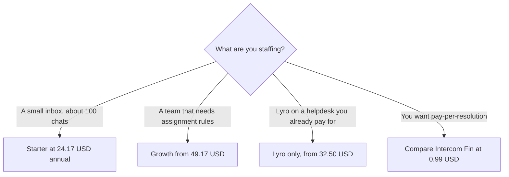

**[Tidio](/tools/tidio/) is a customer-chat product that combines a human inbox, automation flows, and an AI agent called Lyro.** On October 24, 2026 the pricing page's annual control, labeled **two months free**, showed Starter at **$24.17 a month** for **100 billable conversations**, Growth **from $49.17 a month** for **250 billable conversations**, and Plus **from $300 a month** plus usage. Lyro as a standalone agent starts at **$32.50 a month** for **50 Lyro conversations**. There is a **7-day trial**. Above roughly **2,000 billable conversations**, Tidio tells you to contact sales.

We did not audit a resolution rate. Tidio says customers average a high Lyro resolution rate. That is their statistic. Yours will depend on the help content you give the agent. This review separates the inbox bill from the AI bill so they are not quoted as one number.

## Annual prices we could read

These figures were on the annual view. Monthly will be higher. "Two months free" means the annual per-month price is the one to compare with a 12-month commitment, not with a single month you might cancel.

| Plan | Annual price we read | Conversations | What the card adds |
|---|---|---|---|
| Starter | $24.17/month | 100 billable | 50 Lyro conversations as a one-off, 100 Flows visitors, live chat and tickets, operating hours, basic analytics |
| Growth | From $49.17/month | From 250 billable | Advanced analytics, permissions, automatic assignment, macros, typing preview, viewed pages |
| Plus | From $300/month, plus usage | Custom | Premium support, a success manager, discounted usage, departments, multiple projects, custom branding, OpenAPI |
| Premium | Contact | From 3,000 Lyro conversations on the feature list | Managed Lyro, a stated resolution guarantee, pay-per-resolution, SSO, compliance |
| Lyro only | From $32.50/month | From 50 Lyro AI conversations | The agent without buying the full inbox, including on another helpdesk |

Starter's 50 Lyro conversations are marked **one-off**. They are not a monthly Lyro allowance. A shop that turns Lyro on and leaves it on will leave Starter's included AI in the first month and then pay the Lyro add-on. Budget that on day one. Growth does not, in the lines we read, magically include unlimited Lyro. AI and human conversations are priced apart, and Plus says so directly: pay separately for AI and human conversations, at lower rates as you scale.

## Billable conversations versus outcomes

Tidio's meter on Starter and Growth is **billable conversations**. A conversation can be a human chat that never involved AI. Fin, reviewed separately, is **$0.99 per outcome** with a $49 floor. Those units are not convertible. One hundred Tidio conversations at the Starter annual rate is $24.17 whether or not an agent resolved them. One hundred Fin outcomes is $99. The cheaper invoice is whichever unit matches how your customers actually behave. If most chats need a person, a conversation seat can be the better buy. If most chats are repeats the help center answers, an outcome meter can be the better buy even at a higher unit price. [Intercom Fin](/tools/intercom-fin/) is that other quote. [Chatbase](/tools/chatbase/) is the smaller bot if you do not need a full inbox. [HubSpot](/tools/hubspot/) is the CRM many of these chats are supposed to update.

Flows are the automation layer: a visitor count, not a conversation count. Starter includes 100 Flows visitors. A promotional flow on a busy store can burn a visitor allowance without anyone talking to support. Read both meters. The [chatbot roundup](/blog/best-ai-chatbots-for-business-2026/) is the wider shelf, and [how to create an AI agent without coding](/blog/how-to-create-an-ai-agent-without-coding/) is the build path if Tidio's flows are too fixed.

Plus at $300 is the point where Tidio stops being a small-shop tool. Departments, multi-project, OpenAPI, and a success manager are agency and mid-market features. A store doing 100 chats a month should not "upgrade for the AI." They should add Lyro at $32.50 if the one-off 50 runs out. Premium's managed service and pay-per-resolution option is a sales conversation, closer in spirit to Fin than to Starter. Ask for the resolution definition in the order form.

## A year of Starter, as arithmetic

Starter at $24.17 on the annual plan is about **$290 a year** for 100 billable conversations a month. That is a small inbox. Growth from $49.17 is about **$590 a year** before you raise the conversation slider, and the card says "from," so 250 is the floor, not the only step. Lyro at $32.50 is about **$390 a year** on top if you need the agent every month. Starter plus Lyro is the realistic AI inbox, not Starter alone. Quote both.

The 7-day trial is long enough to connect a help center and watch one busy day. It is not long enough to know a seasonal peak. If your peak is a product launch, do not annualize from a quiet week.

## Who should pay

**Start the trial** on the real site widget. **Buy Starter** when 100 conversations and a human inbox are the job, and treat the 50 Lyro chats as a sample. **Add Lyro** when that sample was the useful part. **Buy Growth** when assignment, macros, and more than 100 conversations are the constraint. **Buy Plus** when you need departments and a success manager, with usage on top of $300. **Skip Tidio** if you already pay for a helpdesk and only want an agent. Price Lyro-only against Fin, and do not migrate the inbox to get the bot.

## FAQ

### How much does Tidio cost?

On the annual view checked October 24, 2026, Starter is $24.17 a month for 100 billable conversations. Growth starts at $49.17 for 250. Plus starts at $300 plus usage. Lyro alone starts at $32.50 for 50 AI conversations. The annual label is two months free.

### Does Starter include Lyro every month?

The card says 50 Lyro conversations as a one-off. Ongoing AI is the Lyro plan or a higher conversation about usage, not an assumption you can leave the agent on inside $24.17.

### Is there a free plan?

There is a 7-day trial, and a way to try Lyro. The priced cards are subscriptions. Plan the inbox on a paid tier if the widget will stay on the site.

### When do we have to call sales?

The page says to contact them above about 2,000 billable conversations, 1,000 Lyro conversations, or 100,000 Flows visitors. Plus and Premium are sales-assisted as well.

### How is this different from Intercom Fin?

Tidio's entry meter is billable conversations. Fin's meter is $0.99 per outcome with a $49 minimum. Compare your chat volume with your resolved-by-bot volume before you pick a unit.

## Last verified

October 24, 2026, from Tidio's pricing page, annual toggle. "From" prices step up with volume. The Starter $24.17 and the one-off Lyro line are the details that change a small-business quote.

**Sources:** [Tidio pricing](https://www.tidio.com/pricing/), [Tidio](https://www.tidio.com).

[Tidio](/tools/tidio/) is in the [customer support directory](/tools/category/customer-support/). Directory pages may use affiliate links. A purchase through them may earn us a commission at no extra cost to you.
