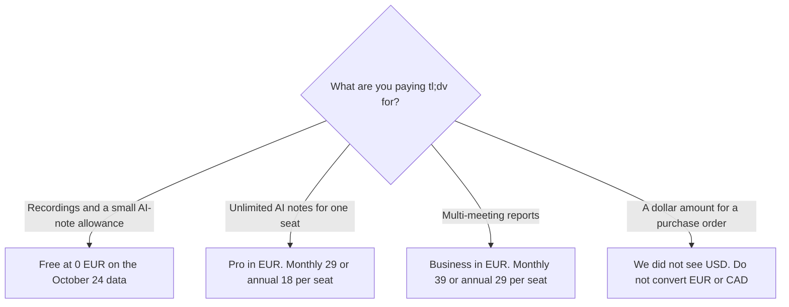

**tl;dv's pricing page, fetched October 24, 2026, exposed plan prices in euros, not dollars.** Structured data on that page listed Pro at €29 per seat per month billed monthly, or €18 per seat per month billed annually (€216 per seat per year). Business was €39 per seat per month billed monthly, or €29 per seat per month billed annually (€348 per seat per year). Free was €0. This article does not convert those figures to USD.

A customer-call comparison that also names [Otter](/tools/otter-ai/) is [Otter vs tl;dv for customer success calls](/blog/otter-vs-tl-dv-for-customer-success-calls-2026/). Otter's dollar seats are [Otter AI pricing explained](/blog/otter-ai-pricing-explained-2026/). A free recording seat in USD, on a different product, is [Fathom pricing explained](/blog/fathom-pricing-explained-2026/).

Published October 24, 2026. We did not score transcripts. The October 16 directory check saw Canadian dollars, not these euros, and not a USD sticker. Both records are below. Neither one is a conversion of the other.

## The October 24 offers, in EUR

| Plan | What the structured data named | Price it printed |
|---|---|---|
| Free | Billed monthly | €0 |
| Pro | Billed monthly | €29 per seat per month |
| Pro | Billed annually | €18 per seat per month, €216 per seat for the year |
| Business | Billed monthly | €39 per seat per month |
| Business | Billed annually | €29 per seat per month, €348 per seat for the year |

Enterprise was custom on the October 16 directory card, which named SCIM, custom SSO, privately hosted AI, and org-wide automations. The October 24 structured data we read did not include an Enterprise offer. Ask sales for that price in the currency on the quote.

## What the October 16 card still says, in CAD

From the directory page checked October 16, 2026, the pricing page "showed Pro at C$27 per seat per month billed annually and Business at C$39." The card does not say whether C$39 was monthly or annual. This article does not guess, and it does not turn C$27 or €18 into a dollar.

That same card, which is about limits rather than currency, says Free includes unlimited recordings and transcription in 30+ languages, with AI notes on 10 meetings and 10 Ask AI queries. Pro adds unlimited meetings with AI notes, premium transcription, and custom templates. Business adds custom vocabulary, unlimited multi-meeting AI insights, scheduled AI reports, playbook monitoring, and objection handling. Re-read the live plan before you rely on a limit. Currency and limits can move on different days.

## Dollar products, if you need a USD list price today

**Otter** Pro is $8.33 a user a month billed annually, or $16.99 monthly, on the October 16 card. Business is $19.99 a user a month billed annually, or $30 monthly. Those are Otter's dollars. They are not a tl;dv translation.

**[Fathom](/tools/fathom/)** Premium is $16 a month billed annually on that card. Free is $0 for unlimited recordings, on the same card. Read the limits. A $0 plan is not the tl;dv Free plan.

**[Granola](/tools/granola/)** Business is $14 a user a month on that card, with no bot in the meeting. The invoice is [Granola pricing explained](/blog/granola-pricing-explained-2026/). A board that refuses a bot is [Otter vs Granola for board meetings](/blog/otter-vs-granola-for-board-meetings-2026/).

## What not to assume

Do not multiply €18 by an exchange rate and put the result on a USD purchase order. Do not average the October 16 Canadian figure and the October 24 euro figure. Do not assume Free's unlimited transcription includes unlimited AI notes. The directory card separates those limits.

## FAQ

### How much does tl;dv cost in USD?

We do not have a USD sticker. The October 24 fetch returned euros in the page's structured data. The October 16 directory check recorded Canadian dollars. Checkout in your currency is the price. This site does not convert EUR or CAD to USD.

### How much is Pro?

€29 per seat per month billed monthly, or €18 per seat per month billed annually, on the October 24 structured data. The October 16 card recorded C$27 per seat per month billed annually, from a different check. Use the currency on the screen you are paying.

### What is free?

€0 on the October 24 data. The October 16 card describes unlimited recordings and transcription, with AI notes limited to 10 meetings and 10 Ask AI queries. Confirm those caps before you promise the team unlimited summaries.

### Does Business include a USD price if I toggle the page?

Not in the extract we saved. If your browser shows dollars, those dollars are the ones to cite, with the date you saw them. Do not back-solve them from the euros above.

## Last verified

October 24, 2026 for the EUR offers in structured data on tldv.io/app/pricing/. October 16, 2026 for the CAD figures and the plan limits on the directory card. Published October 24, 2026.

**Sources:** [tl;dv pricing](https://tldv.io/app/pricing/), [Otter pricing](https://otter.ai/pricing), [Fathom pricing](https://www.fathom.ai/pricing), [Granola pricing](https://www.granola.ai/pricing).

*Published by Andrew for [AI Tools Optimizer](https://aitoolsoptimizer.com).*

[tl;dv](/tools/tl-dv/) is in the [meetings and transcription directory](/tools/category/meetings-transcription/). Directory pages may use affiliate links. A purchase through them may earn us a commission at no extra cost to you.
