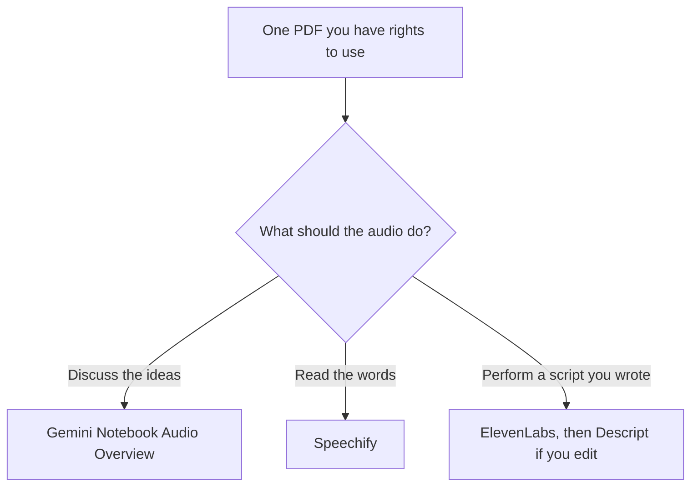

**A PDF becomes listenable in three different ways, and only one of them is a podcast-style conversation.** [Gemini Notebook](/tools/gemini-notebook/) can make an Audio Overview from sources you upload. [Speechify](/tools/speechify/) reads the document aloud. [ElevenLabs](/tools/elevenlabs/) speaks a script you write from the PDF. Pick the one that matches whether you want a discussion, a verbatim read, or a produced narration.

Audio Overviews can be inaccurate. Google says so. A generated host can misstate a table. Listen for orientation, then check the page. Prices are US list prices. Notebook caps were read from Google's plan table on October 24, 2026. Speechify and ElevenLabs prices were checked October 16, 2026. This is not a license to republish someone else's book. You need the right to use the file.

## Which output you are actually making

| You want | Use | Free limit | Pay when |
|---|---|---|---|
| Two hosts discussing the sources, grounded in the file | [Gemini Notebook](/tools/gemini-notebook/) Audio Overview | 3 a day on the free Standard plan | Google AI Plus is $4.99/month (6 a day). Pro is $19.99/month (20 a day) |
| The PDF read in order, so you can follow the sentences | [Speechify](/tools/speechify/) | 10 voices, up to 1.5x, text-to-speech only | Premium is $29/month billed monthly. Speechify says yearly billing saves 60% |
| A narration in a chosen voice, from a script you edited | [ElevenLabs](/tools/elevenlabs/) | 10,000 credits, no commercial license | Starter is $6/month for the commercial license |
| An edit after you have audio | [Descript](/tools/descript/) | 60 media minutes, no card | Hobbyist is $16/person/month annual for watermark-free 1080p |

Study workflows that use the same notebook, including quizzes, are in [how to study with Gemini Notebook](/blog/gemini-notebook-study-workflows/). The rename from NotebookLM is [NotebookLM is now Gemini Notebook](/blog/notebooklm-is-now-gemini-notebook/). Credit math for the narration path is [ElevenLabs pricing explained](/blog/elevenlabs-pricing-explained-2026/).

## Path A: a notebook episode from the PDF

Gemini Notebook is free with a Google account in supported countries. Upload the PDF as a source. Ask for an Audio Overview of that notebook, not of "the topic" in general. The overview is generated from the sources. If the PDF is one chapter, the episode stays on that chapter. If you drop in five unrelated papers, the hosts will blend them.

Free Standard limits from Google's table:

| | Standard | Plus | Pro |
|---|---|---|---|
| Audio Overviews | 3/day | 6/day | 20/day |
| Sources per notebook | 50 | 100 | 300 |
| Notebooks | 100 | 200 | 500 |

An overview the product creates automatically when you first add sources is generated once and does not count against the limit, according to the plan notes we used. Daily quotas reset after 24 hours. Three a day is enough for a course if you spend them on the readings you did not finish. It is not enough for a back catalog of textbooks in one afternoon.

Plus at $4.99/month and Pro at $19.99/month raise the caps. They do not make the audio a primary source. After you listen, open the citation in the notebook for any claim you would repeat. The chat side of the notebook is the place to ask "where did that number come from?"

Scanned pages that are pictures of text are a weak source until the text is actually in the file. If the notebook cannot find a passage you can see on the page, the audio will not know it either.

## Path B: press play on the document

Speechify is the verbatim path. It reads PDFs, articles, and email. Free is 10 voices, up to 1.5x speed, and text-to-speech features only. The tool page describes those free voices as more robotic than Premium. Premium is $29/month billed monthly, with 1,000-plus voices in 60-plus languages, speeds up to 4.5x, PDF summaries, and AI podcasts from documents. Speechify says yearly billing saves 60% compared with monthly. We are not turning that into a dollar yearly price, because the page we checked stated the discount rather than a second list price. Confirm the yearly total at checkout. It will differ by tax and region.

Use Speechify when you need the sentences in order: a paper, a contract you are allowed to process, a textbook chapter. Use the notebook when you want a conversation about the ideas and you will verify them. Speechify's AI podcast feature is on Premium, so a free account is the read-aloud, not the produced show.

[Claude](/tools/claude/) or [ChatGPT](/tools/chatgpt/) can summarize the PDF first if it is too long to hear in full. That summary is a new document. It is not the PDF. If you then listen to the summary, label it as a summary.

## Path C: write the episode, then generate the voice

This is the path when you want a publishable narration.

1. Pull the points you will actually say. Keep quotes short and attributed.
2. Write the script in your own structure. A chatbot can draft from notes you paste. You edit the facts.
3. Generate the voice in ElevenLabs. Free is fine for a private test. Anything you publish or sell needs a paid plan. Starter is $6/month and is the first commercial license, with 30,000 credits. Do not convert credits to minutes without measuring one script. The pricing page we used does not publish that rate.
4. If the file needs cuts, bring it into Descript. Free covers 60 media minutes. Hobbyist removes the 1080p watermark and adds filler-word removal.

A two-host show you script yourself is still Path C. Generate each host, then edit. It is more work than an Audio Overview, and you control the words. That is the reason to do it.

[HeyGen](/tools/heygen/) is the wrong tool if you only need audio. It makes a presenter video. Creator is $29/month. See [best AI tools for YouTubers](/blog/best-ai-tools-for-youtubers-2026/) if the PDF is becoming a video, not a listen.

## Limits that apply to every path

- **Rights.** A personal study copy you are allowed to hear is not the same as an episode you upload. The tools will generate either way. You are responsible for the upload.
- **Length.** Notebook source caps and Speechify's plan limits will stop a giant scanned volume before your patience does. Split by chapter.
- **Numbers.** Tables, dosages, prices, and legal clauses need the page, not the host's paraphrase.
- **Language.** Speechify Premium documents 60-plus languages. An Audio Overview follows the sources you uploaded. If the PDF is in one language, do not expect a polished translation unless the product offers that control and you turned it on.
- **Region.** Gemini Notebook's free plan is for supported countries. If the product is missing, Plus will not conjure it.

Students building a weekly habit around this should start with the notebook and the free Speechify voices, then read [best AI tools for students](/blog/best-ai-tools-for-students-2026/). Paying for Plus, Speechify Premium, and ElevenLabs in the same month is three products for one PDF.

## FAQ

### Can AI turn a PDF into a podcast for free?

Yes, with limits. Gemini Notebook's free plan includes 3 Audio Overviews a day. Speechify's free plan reads the file with 10 voices at up to 1.5x. ElevenLabs Free can speak a script and does not include a commercial license.

### Is a Gemini Notebook Audio Overview accurate?

Treat it as a briefing. Google says Audio Overviews can be inaccurate. Check any claim you will repeat against the PDF.

### What is the cheapest way to publish the audio?

If you mean a narration you wrote, ElevenLabs Starter at $6/month is the first plan with a commercial license. If you mean a private study episode, the notebook's free tier is the one that does not add a voice subscription.

## Last verified

October 24, 2026 for Gemini Notebook's Audio Overview caps. October 16, 2026 for Speechify Premium at $29/month and ElevenLabs plan prices.

**Sources:** [Gemini Notebook plans](https://support.google.com/gemininotebook/answer/16213268), [Speechify pricing](https://speechify.com/pricing), [ElevenLabs pricing](https://elevenlabs.io/pricing), [Descript pricing](https://www.descript.com/pricing).

Directory pages may include affiliate links. A purchase through them may earn us a commission at no extra cost to you.
