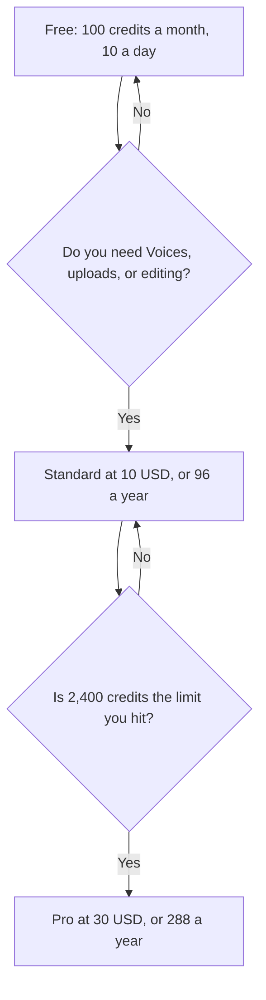

**Udio Standard is $10 a month, or $8 a month billed annually ($96 a year), with 2,400 credits. Pro is $30 a month, or $24 a month billed annually ($288 a year), with 6,000 credits. Free is 100 credits a month, capped at 10 a day.** Those figures are from the directory page checked October 16, 2026. A fetch of udio.com/pricing on October 24, 2026 returned the page shell and no plan table, so this article does not update the October 16 numbers.

The neighbor with a commercial-rights cliff is [Suno pricing explained](/blog/suno-pricing-explained-2026/). The product page for that neighbor is [Suno review](/blog/suno-review-2026/). Speech and sound effects, which are not a song plan, are [ElevenLabs pricing explained](/blog/elevenlabs-pricing-explained-2026/).

Published October 24, 2026. Prices are US list prices excluding tax, as recorded in the directory. We did not rank songs. There is no separate Udio review on this site yet. The directory card is the product record.

## The plans on the October 16 card

| Plan | Monthly | Annual | Credits | What the card adds |
|---|---|---|---|---|
| Free | $0 | $0 | 100 a month, 10 a day | 2 simultaneous generations, up to three 130-second songs a day |
| Standard | $10 | $8 a month, $96 a year | 2,400 a month, no daily limit on the card | Voices, audio uploads, premium Artist Styles, editing, 3 simultaneous generations |
| Pro | $30 | $24 a month, $288 a year | 6,000 a month | 5 simultaneous generations, described as 10 songs, and song access permissions |

A year of Standard at the monthly rate is 12 × $10 = $120, against $96 billed annually. The difference is $24. A year of Pro at the monthly rate is 12 × $30 = $360, against $288. The difference is $72. Extra credits on the card are 100 for $3 or 1,000 for $25. Student pricing is mentioned and not priced. Do not invent a student dollar. A free trial of Standard is on the card, with a note that some features are not in the trial.

## What you are choosing besides the dollar

**Free** is the experiment: 10 credits a day, not a commercial plan this card defines. Read Udio's terms on downloads and usage rights before a track leaves a demo. The directory verdict says to do that. This page does not summarize those terms as a license.

**Standard** is the first paid row with Voices, uploads, and editing. Buy it when the daily cap is the thing you hit, or when those features are the job.

**Pro** is the larger pool and the permissions control. It is not a better song. It is more generations at once and a larger month.

[Suno](/tools/suno/) Free is 50 credits a day, with no monthly downloads and no commercial rights on the October 16 card. Suno Pro is $11 a month, or $8 a month yearly, for 2,500 credits and commercial rights. A Udio credit and a Suno credit are not the same unit. An $8 yearly sticker on both products is a coincidence of the annual math, not a shared plan. [ElevenLabs](/tools/elevenlabs/) Starter at $6 a month is the first tier on that card with commercial use for voice, which is a different product. [Descript](/tools/descript/) is the editor if the job is a cut, not a generation. Hobbyist is $16 a person a month billed annually.

## What not to assume

Do not quote a price from a checkout this directory has not recorded. The October 24 page did not render one. Do not convert 2,400 Udio credits into minutes. The card does not print that rate. Do not buy Pro to get Voices if Standard already lists them. Do not assume a student discount without the number in your account.

## FAQ

### How much does Udio cost?

On the October 16, 2026 directory card, Standard is $10 a month or $96 a year, and Pro is $30 a month or $288 a year. Free is $0 with 100 credits a month. The October 24 pricing page did not show a table in the fetch we ran.

### What do extra credits cost?

The card lists 100 credits for $3 and 1,000 credits for $25. Confirm the pack in the cart. A pack is not a change of plan.

### Is Udio cheaper than Suno?

They can both show an $8 annual monthly equivalent on a paid tier, for different credit counts and different rights language. Compare the right you need, then the credits you will actually spend. This page does not call a winner.

### Does Free include commercial use?

The directory does not say that it does. It tells you to read the terms before a commercial project. Until you have read them, treat Free as a private experiment.

## Last verified

October 16, 2026, from the Udio directory card. A fetch of the pricing page on October 24, 2026 returned no plan prices. Published October 24, 2026.

**Sources:** [Udio](https://www.udio.com), [Udio pricing](https://www.udio.com/pricing).

*Published by Andrew for [AI Tools Optimizer](https://aitoolsoptimizer.com).*

[Udio](/tools/udio/) is in the [audio, voice, and music directory](/tools/category/audio-voice-music/). Directory pages may use affiliate links. A purchase through them may earn us a commission at no extra cost to you.
