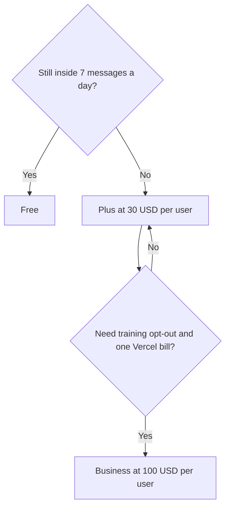

**v0 pricing is a free plan with a 7-message daily limit, Plus at $30 per user per month with $30 of included monthly credits, and Business at $100 per user per month.** Plus also includes $2 of free daily credits when you log in. Business, on the lines read October 24, 2026, includes the same $30 monthly and $2 daily credit lines, and adds training opt-out by default. The seat price does not cap you at the included credits. You can buy more.

Those figures are US list prices from [v0's pricing page](https://v0.app/pricing), read October 24, 2026. The page says prices exclude VAT, GST, and other taxes. A second figure near $90 rendered beside the $30 on that fetch. This article treats $30 per user per month as the Plus seat, because that is the line that matches the $30 credit grant. If your checkout shows a different number, the checkout wins. The product story is [v0 review](/blog/v0-review-2026/).

## The plans

| Plan | Price | Credits the page lists | What else is on the card |
|---|---|---|---|
| Free | $0 | $5 one-time for new users, in the directory note checked October 16, 2026 | Deploy to Vercel, Design Mode, GitHub sync, 7 messages a day |
| Plus | $30 per user per month | $30 of monthly credits per user, plus $2 of daily credits on login | All models, purchase more credits, centralized billing on vercel.com, shared chats |
| Business | $100 per user per month | The same $30 monthly and $2 daily lines | Everything in Plus, training opt-out by default, credits that can be shared |
| Enterprise | Custom | Custom | Data never used for training, SAML SSO, role-based access, priority access, support SLAs |

The directory page checked October 16, 2026 also said the $20 a month Premium plan is being sunset and is not available to new users. Unused monthly credits roll over and expire after 65 days on that same directory note. Purchased credits expire one year after purchase and need an active paid plan. Confirm rollover on the docs if your forecast depends on it. The October 24 pricing fetch used here did not restate the 65-day line, so this article attributes it to the October 16 directory check.

## What $30 of credits buys, in tokens

v0 publishes token rates in dollars per million tokens. Input is what you send. Output is what v0 returns. Cache write and cache read are the other two columns on the page read October 24, 2026.

| Model | Input | Cache write | Cache read | Output |
|---|---|---|---|---|
| v0 Mini | $0.20 | $0.25 | $0.02 | $1.20 |
| v0 Pro | $2 | $2.50 | $0.20 | $10 |
| v0 Max | $5 | $6.25 | $0.50 | $25 |
| v0 Max Fast | $10 | $12.50 | $1 | $50 |

A million output tokens on v0 Max Fast is $50, which is more than the Plus grant. A short UI prompt is not a million tokens. A large project, resent as input on every turn, is how the grant disappears. The page's own FAQ says messages use many input tokens because the project context is part of the prompt, not because your sentence was long. What a token is, as a unit, is [what AI tokens are](/blog/what-are-ai-tokens-explained-2026/).

ChatGPT Plus and Pro subscribers can connect an account to cover eligible responses from supported OpenAI models, on the October 16 directory note. A v0 credit balance is still required. That connection does not turn Plus into a free v0 seat.

## v0 next to the other builders

[Bolt.new](/tools/bolt-new/) Pro is $25 month to month, or $18 a month billed annually, on the pricing page read October 24, 2026. Free includes 1 million tokens with a daily cap. The units differ: Bolt meters tokens in a pool, v0 meters dollars of model usage against a grant. The three-way is [Bolt vs Lovable vs v0](/blog/bolt-vs-lovable-vs-v0-2026/). Bolt's card is [Bolt.new pricing explained](/blog/bolt-new-pricing-explained-2026/).

[Lovable](/tools/lovable/) Pro is $25 a month for 100 credits, or $250 a year, and it does not charge per seat. v0 does. Use Lovable when several people should share one pool. Use v0 when the deploy target is Vercel and GitHub sync matters on day one.

[Cursor](/tools/cursor/) Plus is $8 a month once a developer owns the repository. The ladder is [Cursor pricing explained](/blog/cursor-pricing-explained-2026/). v0 scaffolds. Cursor maintains. Eight Plus seats are $240 a month. Eight Business seats are $800, and the included monthly credit line we read is still $30 each.

## FAQ

### How much does v0 Plus cost?

$30 per user per month, with $30 of monthly credits and $2 of daily credits on login. Checked October 24, 2026. Additional credits cost extra.

### Is Business a larger credit pack?

On the credit sentences read that day, no. The included monthly line is still $30. The $100 seat adds training opt-out by default, shared chats, and centralized billing. Buy more credits if the work needs them.

### Is v0 free?

Yes. Free includes deploy to Vercel, Design Mode, GitHub sync, and a 7-message daily limit. The directory's October 16 note adds $5 in one-time credits for new users.

### Do prices include tax?

The pricing page says the amounts shown exclude VAT, GST, and similar taxes. Tax is calculated from the billing address.

## Last verified

October 24, 2026, from v0.app/pricing, for the seat prices, the credit lines, and the token table. October 16, 2026 for the sunset Premium plan, the $5 new-user credit, the 65-day rollover note, and the ChatGPT connection. Published October 24, 2026.

**Sources:** [v0 pricing](https://v0.app/pricing), [v0 pricing docs](https://v0.app/docs/pricing).

*Published by Andrew for [AI Tools Optimizer](https://aitoolsoptimizer.com).*

[v0](/tools/v0/) is in the [coding directory](/tools/category/coding/). Directory pages may use affiliate links. A purchase through them may earn us a commission at no extra cost to you.
