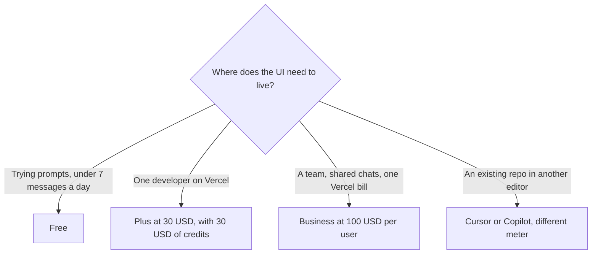

**[v0](/tools/v0/) is Vercel's AI for building interface and full-stack UI, with deploy to Vercel and a GitHub sync.** The surprising line on the pricing page is that the credit grant and the seat price match on the entry paid plan. On October 24, 2026, Plus was **$30 per user per month** and included **$30 of monthly credits**, plus **$2 of free daily credits** when you log in. Business was **$100 per user per month** and the credit lines we could read were the same $30 monthly and $2 daily. Free is **$0**, with a **7 message a day** limit.

We did not benchmark generations against Lovable or Bolt. [Lovable vs Bolt vs Replit](/blog/lovable-vs-bolt-vs-replit/) covers the prompt-to-app shelf. v0 is the Vercel-native seat on that shelf. This review is the invoice.

## The seats

| Plan | Price | Allowance printed |
|---|---|---|
| Free | $0 | Free access, deploy to Vercel, visual design mode, GitHub sync, 7 messages a day |
| Plus | $30 per user / month | Everything in Free, all models, $30 of included monthly credits per user, $2 of daily credits on login, option to buy more credits |
| Business | $100 per user / month | Everything in Plus, the same $30 monthly and $2 daily credit lines, shared credits, centralized billing on vercel.com, shared chats |

The seat card is [v0 pricing explained](/blog/v0-pricing-explained-2026/).

The page also lists token rates for v0 model tiers, in dollars per million tokens. We are not assigning those rates to "input" or "output" here, because the column headers did not survive the page text cleanly enough to repeat. If your forecast depends on a model rate, read the four columns on v0.app/pricing yourself. The seat price does not cap you at the included credits. Plus says you can purchase additional credits. Business says usage can be shared across the team.

A digit animation on the Plus card can look like a second price near $90. The price we are quoting is the **$30 per user per month** line next to the **$30 of included credits** sentence. If Vercel changes the card, the credit sentence is the one to trust alongside the seat.

## What $30 of credits means

Plus is easy to misread as "$30 of usage for $30," which is almost true until the daily $2 is included and until a heavy model spends the grant in a few sessions. The daily $2 is a login grant. It is not a promise that a forgotten tab keeps a $2 balance forever. Monthly credits are the pool. When they are gone, you buy more or you stop. Business does not, on the lines we read, hand you $100 of credits in exchange for the $100 seat. It hands you the same $30 credit grant plus team features: centralized billing, shared chats, and credits that can be purchased outside the monthly usage and shared.

That is the buying logic. If you are one person, Business is $70 a month for administration you may not need. If you are eight people, eight Plus seats are $240 and eight Business seats are $800, and the included model credit is still $30 each unless the shared-purchase line changes the math. Do the headcount on purpose. The [best AI coding assistants](/blog/best-ai-coding-assistants-2026/) page is where v0's neighbors sit: editors that complete code inside a repository, not a generator that deploys a new app to Vercel.

[Lovable](/tools/lovable/) charges for a shared credit pool and does not charge per seat. [Bolt](/tools/bolt-new/) is the other in-browser builder. [Cursor](/tools/cursor/) is an editor subscription for people who already have a codebase. Using v0 to scaffold and Cursor to maintain can be a real workflow. Using all four every month is how a prototype budget becomes a platform budget. [Which AI subscription is worth paying for](/blog/which-ai-subscription-is-worth-paying-for/) is the filter: one job, one meter.

## Who it is for

v0 is for developers and product people who want the generated UI on Vercel's stack, with GitHub in the loop. Free is enough to see whether the output matches how your team writes components. Plus is the individual subscription when 7 messages a day is the blocker and $30 of credits covers the real sessions. Business is for a company that wants one Vercel billing relationship, shared chats, and an admin boundary.

It is a weak fit for a backend-heavy system, a mobile app, or a repo that is not going to live near Vercel. The generator can still draft a screen. The subscription is hardest to justify when nobody deploys.

Students: the pricing navigation includes a students link. We did not record a student price on October 24. Open that page before you tell a class that Plus is free.

## Who should pay

**Stay on free** while 7 messages a day answer the question. **Pay for Plus** when you are deploying what you generate and the $30 credit grant matches a week of real use you have already watched. **Pay for Business** when the company needs shared billing and shared chats, and you have accepted that the included credits do not scale with the jump from $30 to $100. **Buy extra credits** when a launch week exceeds the grant. **Do not buy Business** for a solo account "to get all models." Plus already says all models.

## FAQ

### How much does v0 cost?

Free is $0 with 7 messages a day. Plus is $30 per user per month. Business is $100 per user per month. Checked October 24, 2026.

### How many credits are included?

Plus includes $30 of monthly credits per user and $2 of daily credits on login. The Business lines we read include the same $30 and $2, with extra credits purchasable and shareable.

### Does free include deploy?

The free card lists deploy to Vercel, visual editing, and GitHub sync, inside the 7-message daily limit.

### Is Business a bigger credit pack?

Not on the credit sentences we could read. The price is higher. The included monthly credit line is still $30. You are paying for team controls and shared usage, then buying more credits if the work needs them.

### Can I use v0 without a Vercel habit?

You can generate UI anywhere you can paste code. The product's paid story includes deploy to Vercel and billing on vercel.com. If that deploy path is irrelevant, compare an editor subscription before you take the seat.

## Last verified

October 24, 2026, from v0's pricing page. Model token rates are listed there and were not copied into this review without their column headers. Recheck the $30 credit sentence if the seat price moves. The two numbers matching is the detail that makes Plus easy to explain, and easy to misunderstand once you add a team.

**Sources:** [v0 pricing](https://v0.app/pricing), [v0](https://v0.app).

[v0](/tools/v0/) is in the [coding directory](/tools/category/coding/). Directory pages may use affiliate links. A purchase through them may earn us a commission at no extra cost to you.
