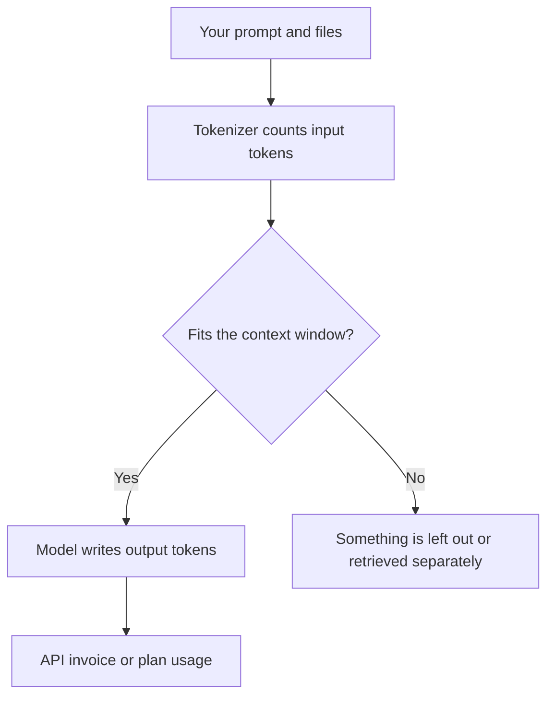

**An AI token is a piece of text the model counts.** A prompt, an attached file, and the reply are all tokens. Many APIs bill input tokens and output tokens separately. A chat subscription usually hides the count behind a usage limit. The count is still what filled the limit.

A token is often shorter than a word. This site does not publish a words-per-token conversion. The ratio depends on the tokenizer and the language. The practical limit on how many tokens fit in one request is the [context window](/blog/what-is-a-context-window-2026/).

Prices below are US list prices excluding tax. DeepSeek's API rates are from its docs as recorded October 16, 2026. Chat plans are from the same directory check.

## What spends tokens

| What you send or receive | How it is usually counted | Why the bill moves |
|---|---|---|
| Your instructions | Input tokens | A long standing prompt is resent on every call |
| A pasted contract, transcript, or codebase | Input tokens | This is often the largest line |
| The model's reply | Output tokens | Long answers and "think step by step" drafts cost more |
| A repeated prefix the vendor caches | Input, sometimes at a lower rate | [DeepSeek](/tools/deepseek/) publishes a cache-hit rate |
| Images, audio, or tool results | Tokens or a separate meter | Read the model card. Do not assume text rates |

If the material does not fit, retrieval is the usual fix. That pattern is [what RAG is](/blog/what-is-rag-explained-2026/). A subscription tier that says "more usage" is a larger allowance of tokens or requests. It is not automatically a larger window.

## A published token price, and plans that hide the count

[DeepSeek](/tools/deepseek/) is the directory example with a posted per-token API price. The chat app is free. The API, for `deepseek-flash`, per 1 million tokens, as recorded October 16, 2026:

| | Off-peak | Peak |
|---|---|---|
| Input, cache hit | $0.003 | $0.006 |
| Input, cache miss | $0.15 | $0.30 |
| Output | $0.60 | $1.20 |

Peak hours on that page are 01:00–04:00 and 06:00–10:00 UTC on weekdays, excluding Chinese public holidays. The product review is [DeepSeek review](/blog/deepseek-review-2026/). These rates are one vendor's card. They are not a conversion you can apply to Claude or ChatGPT.

Consumer plans in this directory bill the seat, then enforce a usage cap:

| Product | What you pay | What the page says about the meter |
|---|---|---|
| [Claude](/tools/claude/) | Pro is $20/month, or $17 billed annually. Max starts at $100 | More usage on paid plans. Context windows of up to 1 million tokens, depending on the model |
| [ChatGPT](/tools/chatgpt/) | Plus is $20/month. Go is $8. Pro starts at $100 | Plan limits on messages, uploads, and tools. No per-token consumer price on the directory page |
| [Gemini](/tools/gemini/) | Google AI Plus is $4.99/month. Pro is $19.99 | "2x" and "4x" usage versus the free plan. The page does not list a token price |
| [Bolt.new](/tools/bolt-new/) | Free includes 1 million tokens a month, with a 300,000 daily limit. Pro starts at $25/month | A token allowance is the plan, not a chat seat |

Claude's million-token figure is a ceiling that depends on the model. It is explained in [what a context window is](/blog/what-is-a-context-window-2026/). Max is a usage tier. The split is [Claude Pro vs Max](/blog/claude-pro-vs-max-2026/).

## How to read an invoice without a conversion chart

Count the thing the vendor counts. If the invoice says input and output, a short answer to a long document is an input-heavy call. A long draft from a short prompt is output-heavy. Resending the same system instructions on every call is a repeated input. Caching, where the vendor offers it, is the discount for that repetition. DeepSeek's cache-hit line is the concrete example above.

A chat product that never shows a token count can still run out. The message is usually "usage limit," not "you spent 40,000 tokens." When that happens, the levers are a shorter prompt, a smaller attachment, retrieval instead of a paste, or a higher plan. Pasting the same 80-page PDF into every question spends the allowance on pages the question did not need.

Temperature and sampling change which tokens the model picks. They do not change the definition of a token. That setting is [what temperature means](/blog/what-is-temperature-in-ai-models-2026/). The model itself is [what an LLM is](/blog/what-is-an-llm-2026/).

## FAQ

### Is a token a word?

Often it is a piece of a word, a word, or punctuation. English prose is not a fixed ratio. We do not publish one. Use the tokenizer or the usage panel in the product you pay for.

### Do ChatGPT Plus and Claude Pro charge per token?

The directory prices are monthly seats: Plus at $20, Claude Pro at $20 or $17 on annual billing. Usage limits still apply. Per-token billing is an API product. DeepSeek publishes those rates. OpenAI and Anthropic API cards are separate from the chat plans on these pages.

### Why did a short question cost so much?

The attachment, the conversation history, or a long hidden instruction was part of the input. The question you typed is rarely the whole request.

### Do images count as tokens?

Some APIs bill image input and output in tokens. Others use credits or GPU time. Read the line for the model you called. A text rate does not cover an image rate.

## Last verified

October 16, 2026 for the DeepSeek API table, Claude, ChatGPT, Gemini, and Bolt.new figures. Published October 24, 2026.

**Sources:** [DeepSeek API pricing](https://api-docs.deepseek.com/quick_start/pricing), [Claude pricing](https://claude.com/pricing), [ChatGPT pricing](https://openai.com/chatgpt/pricing/).

*Published by Andrew for [AI Tools Optimizer](https://aitoolsoptimizer.com).*

[Claude](/tools/claude/), [ChatGPT](/tools/chatgpt/), and [DeepSeek](/tools/deepseek/) are in the [chatbots directory](/tools/category/chatbots-assistants/). Directory pages may use affiliate links. A purchase through them may earn us a commission at no extra cost to you.
