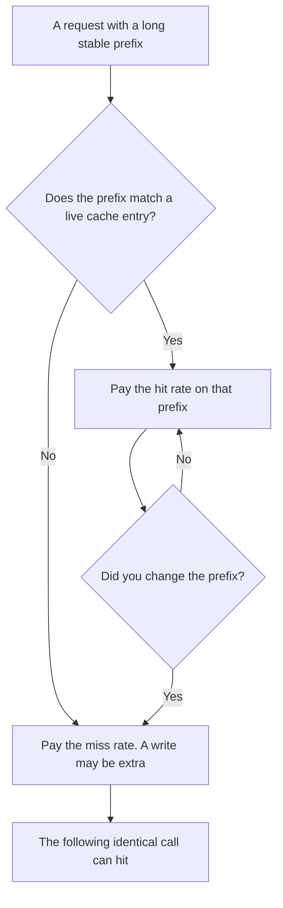

**A context cache stores a repeated prefix of a prompt so the next request can reuse that work instead of paying full price to read the same tokens again.** It is a serving feature on an API bill. It is not the product setting that remembers your name next week. That setting is [what AI memory is](/blog/what-is-ai-memory-2026/).

The unit being stored is [what an AI token is](/blog/what-are-ai-tokens-explained-2026/). The box those tokens must fit in is [what a context window is](/blog/what-is-a-context-window-2026/). If the material does not belong in the prompt at all, retrieval is [what RAG is](/blog/what-is-rag-explained-2026/).

Prices are US list prices excluding tax. DeepSeek's Flash rows are from the directory page checked October 16, 2026, and the October 24 review of the same docs. v0's cache columns are from the pricing page read October 24, 2026. Published October 24, 2026. This page does not score answer quality.

## Hit, miss, write, read

| Event | What happened | What you should expect to pay |
|---|---|---|
| Cache miss | The prefix was not already stored, or it no longer matched | The vendor's normal input rate |
| Cache hit | The prefix matched what the vendor still holds | A lower input rate, when the card has one |
| Cache write | The vendor stored the prefix for later | Sometimes a separate, higher rate. Sometimes bundled into the miss |
| Cache expired | The vendor dropped the prefix | The next call is a miss, even if your text did not change |
| You edited the system prompt | The prefix changed | A miss, until the new prefix is stored |

The prefix is the part that must be byte-for-byte the same. A system prompt, a tool catalog, or a project file you send every turn is a candidate. The user's new sentence is not. If you rewrite the whole prompt to "keep it fresh," you manufacture misses.

## Two cards this directory can actually quote

[DeepSeek](/tools/deepseek/) publishes hit and miss on one model card. For deepseek-flash, off-peak, a cache hit is $0.003 per million input tokens and a cache miss is $0.15. Peak doubles both, to $0.006 and $0.30. Output stays $0.60 off-peak and $1.20 at peak, cache or not. The October 24 review notes that $0.15 / $0.003 is a 50× gap on that off-peak input pair. Peak hours on the directory page are 01:00–04:00 and 06:00–10:00 UTC on weekdays. The worked examples live in [DeepSeek review](/blog/deepseek-review-2026/).

A product that sends a stable system prompt and only changes the user turn can land on the cheap rate for the stable part, if the cache hits. A product that shuffles the prompt every call pays the miss and will not understand why the invoice moved. The cache does not discount output tokens on this card.

[v0](/tools/v0/) prints four columns: input, cache write, cache read, and output. On the October 24 page, v0 Mini is $0.20 input, $0.25 cache write, $0.02 cache read, and $1.20 output, per million tokens. v0 Pro is $2, $2.50, $0.20, and $10. The write column is higher than the plain input column. The read column is the discount. The first time you store a large project, you can pay extra. The repeat is the point. The full grid, including Max and Max Fast, is [v0 pricing explained](/blog/v0-pricing-explained-2026/).

Those are two shapes. DeepSeek's recorded table is hit versus miss. v0's recorded table adds an explicit write. Do not paste one vendor's ratio onto the other.

[Claude](/tools/claude/) and [ChatGPT](/tools/chatgpt/) seat prices are not cache rates. Pro is $20 a month on both, with Claude also listed at $17 billed annually. The Claude Code review notes that Claude's API pricing page lists cache reads and writes. This article does not reprint those API dollars, because that review did not print them. Use the DeepSeek and v0 tables when you need a number you can show finance today. Seat math is [Claude Pro vs Max](/blog/claude-pro-vs-max-2026/) and [ChatGPT Go vs Plus vs Pro](/blog/chatgpt-go-vs-plus-vs-pro-2026/).

## What a cache will not do

**It will not remember a user.** Memory is a product feature that stores facts across chats. A cache is a prefix the server may drop. Turning memory off does not turn the cache off, and the reverse is also true.

**It will not make a huge prompt free.** You still send it. You still occupy the window. A cache hit changes the rate on the matched prefix. A miss bills the window you used.

**It will not fix a slow tool.** If the wait is a database call, the cache never sees it. Latency versus the queue is [what AI latency vs throughput is](/blog/what-is-ai-latency-vs-throughput-2026/).

**It is not quantization.** Quantization stores weights in fewer bits. A cache stores a prompt prefix. The other technique is [what quantization is](/blog/what-is-quantization-in-ai-2026/).

## FAQ

### Is a context cache the same as a KV cache?

People use both phrases for the serving trick that avoids recomputing a prefix. KV cache is the usual engineering name for the stored attention state. "Context cache" is the name that shows up on a pricing page as hit, miss, write, or read. If the invoice says cache and your diagram says KV, confirm they are the same line item before you forecast.

### How long does the cache last?

As long as that vendor keeps it. This directory does not record a universal TTL. A hit you saw at noon is not a contract that the 2 a.m. job will hit. Log the hit rate. Do not assume it.

### Should I cache every call?

Cache the prefix that repeats and is large enough to matter. Caching a one-sentence prompt can cost a write and save nothing. v0's write rate, which is above its input rate on the recorded Mini row, is the reason to do that math first.

### Does ChatGPT Plus include a context cache I can see?

Plus is a seat. This page does not claim a user-visible cache meter on Plus. If you need a hit rate in a dashboard, you are on an API that prints one, and you should log it. The habit of logging cost per request is [what AI observability is](/blog/what-is-ai-observability-2026/).

## Last verified

October 16, 2026 for the DeepSeek directory table. October 24, 2026 for the DeepSeek review's 50× note and for v0's cache columns. Published October 24, 2026.

**Sources:** [DeepSeek API docs](https://api-docs.deepseek.com/), [v0 pricing](https://v0.dev/pricing), [Claude pricing](https://claude.com/pricing).

*Published by Andrew for [AI Tools Optimizer](https://aitoolsoptimizer.com).*

[DeepSeek](/tools/deepseek/) is in the [chatbots and assistants directory](/tools/category/chatbots-assistants/). Directory pages may use affiliate links. A purchase through them may earn us a commission at no extra cost to you.
