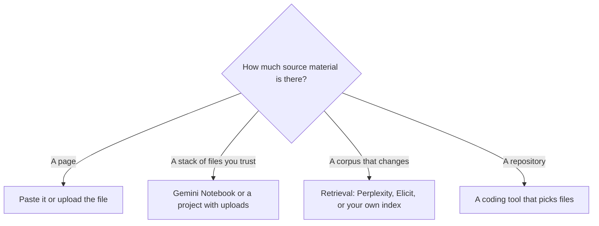

**A context window is the amount of text a model can consider in one request.** It includes your prompt, the files or passages attached to that request, and the reply the model is writing. When the material is longer than the window, the model does not quietly "know the rest." Something is left out, summarized, or retrieved separately.

People meet the limit as a product behavior: a long PDF that the answer ignores, a chat that forgets the brief from an hour ago, or an API bill that jumped because every call resent a huge prompt. The window is the cause. A bigger subscription is sometimes the fix, and often it is not.

This glossary does not invent a token count for every model. Where this site has recorded a figure from a vendor page, it is labeled. Elsewhere, read the model card. A token is a piece of text the model counts, often shorter than a word. We are not publishing a words-per-token conversion, because that ratio depends on the tokenizer and the language.

## What actually fits

| What you are trying to include | What usually works | What breaks |
|---|---|---|
| A question and a paragraph of instructions | Any current chat plan | Nothing about the window |
| One contract, paper, or transcript you paste | A chat with file upload, if the file fits | A scan with no text layer, or a file the plan's upload cap rejects before the window matters |
| A folder of sources you trust | A notebook or a retrieval product | Pasting the folder into one prompt |
| A codebase | A coding assistant that selects files | Dumping the whole repo into chat on every message |
| "Everything in our wiki, forever" | A product that searches the wiki per question | Hoping memory or a long window replaced search |

The retrieval pattern is [what RAG is](/blog/what-is-rag-explained-2026/). The notebook habit is [how to study with Gemini Notebook](/blog/gemini-notebook-study-workflows/). The assistant comparison, which is about the product and not the window size, is [ChatGPT vs Gemini vs Claude](/blog/chatgpt-vs-gemini-vs-claude-2026/).

## Figures this directory has recorded

Use these as examples of how vendors publish the limit. They are not a ranking.

| Source recorded here | What it says | Recorded |
|---|---|---|
| [Claude](/tools/claude/) tool page | Context windows of up to 1 million tokens, depending on the model | October 16, 2026 |
| [DeepSeek](/tools/deepseek/) API notes in the [DeepSeek review](/blog/deepseek-review-2026/) | Flash and Pro list a 1 million token context and a maximum output of 384,000 tokens | The review's pricing read |
| [ChatGPT](/tools/chatgpt/) and [Gemini](/tools/gemini/) pages in this directory | No single context-window number we are willing to reprint from those pages | Read the current model card in the product |

Claude's "up to 1 million" is a ceiling that depends on the model, not a promise that every Free chat holds a million tokens. Plans change usage limits separately from the window. Pro is $20 a month, or $17 billed annually. Max starts at $100 a month. Max is a usage tier. It is not a larger window you should assume without reading the model card. That distinction is [Claude Pro vs Max](/blog/claude-pro-vs-max-2026/).

DeepSeek's published window is a reason the API shows up in long-document jobs. The bill is per token, with peak and off-peak rates in the review. A 1 million token window you fill on every call is a large invoice even at a low rate. Filling it "because it fits" is the mistake.

## What the window does not include

**Memory across chats.** Some products store preferences or summaries between conversations. That store is not the same object as the window. If a fact matters, put it in the request or in a file the product will retrieve.

**The whole internet.** A model with web search is retrieving pages, then reading what the search returned. The window still caps that request. Search is why [Perplexity](/tools/perplexity/) can answer from sources you did not paste. Pro is $17 a month billed annually. The research workflow is [how to use Perplexity for market research](/blog/how-to-use-perplexity-for-market-research-2026/).

**Quality.** A larger window lets more text in. It does not make the model attend equally to the middle of a long paste. For a paper or a contract, ask about a section, or use a tool that retrieves passages. For study notes you uploaded, Notebook is the tighter design because the source list is yours.

**Output length.** Vendors also cap how long the reply can be. DeepSeek's recorded output cap is 384,000 tokens. A short answer limit is why a "summarize this book in one reply" prompt comes back thin. Ask for a section.

## How to work inside the limit

1. Say which source is authoritative. A prompt that says "use only the attached file" is easier to check than a prompt that mixes the file with the model's background.
2. Split a long document by section if the answer is about one clause.
3. Move a repeating corpus into a product built for it: Notebook for uploads, Consensus or Elicit for papers, Perplexity for the web, a coding tool for a repo.
4. Watch the usage meter if you are on an API. Input tokens include the material you resend.

[ChatGPT](/tools/chatgpt/) Plus at $20 a month is enough for everyday files if the upload fits your plan. Go is $8 a month. Pro starts at $100. Buy the higher plan when the limit you hit is usage, and confirm on the model card if the limit you hit is the window. The ladder is [ChatGPT Go vs Plus vs Pro](/blog/chatgpt-go-vs-plus-vs-pro-2026/).

## FAQ

### Is a context window the same as memory?

No. The window is one request. Memory, if the product has it, is a store between requests. Important facts belong in the request or in a retrieved file.

### How many pages fit in a context window?

It depends on the model and on how dense the pages are. We are not printing a universal page count. If the product truncates the upload, you are past the practical limit regardless of the marketing number.

### Will a bigger plan raise the window?

Sometimes the plan changes which model you can select, and models publish different windows. Sometimes the plan only raises how often you can send. Read both lines before you upgrade.

### What is a token?

A token is a chunk of text the provider counts for the window and, on APIs, for the bill. English words often split into more than one token. The provider's tokenizer is the counter that matters.

## Last verified

October 16, 2026 for the Claude tool-page wording and for ChatGPT and Claude plan prices. DeepSeek's 1 million token figure is the one recorded in the DeepSeek review. Published October 24, 2026.

**Sources:** [Claude pricing](https://claude.com/pricing), [DeepSeek API docs](https://api-docs.deepseek.com/), [ChatGPT pricing](https://chatgpt.com/pricing/).

[Claude](/tools/claude/), [ChatGPT](/tools/chatgpt/), and [Gemini](/tools/gemini/) are in the [chatbots and assistants directory](/tools/category/chatbots-assistants/). Directory pages may use affiliate links. A purchase through them may earn us a commission at no extra cost to you.
