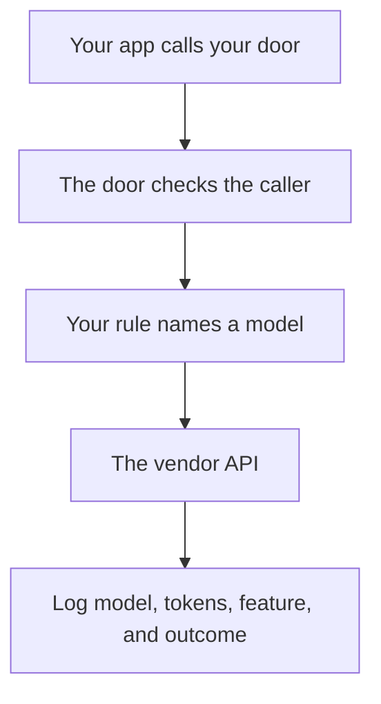

**A model gateway is one controlled door that application code calls, instead of each feature holding its own key to each model.** The door checks who is calling, writes a log, and sends the request to a model your rules already named. The rule that picks the model is [what AI routing is](/blog/what-is-ai-routing-2026/). The gateway is the place that rule is allowed to run.

The call on the far side of the door is [what an API for AI tools is](/blog/what-is-an-api-for-ai-tools-2026/). The log you read after a bad week is [what AI observability is](/blog/what-is-ai-observability-2026/). The tag on the dollar is [what AI cost attribution is](/blog/what-is-ai-cost-attribution-2026/).

Prices below are US list prices from directory pages checked October 16, 2026. Published October 24, 2026. The directory does not list a standalone model-gateway product or its price. This page does not invent one. We did not score gateways.

## What the door is for

| Job at the door | What "done" looks like | What is a different product |
|---|---|---|
| One key the app holds | Features call your door. The vendor key stays server-side | A shared key pasted into a browser |
| A log of model, tokens, and feature id | You can open last Tuesday's spend | A chat transcript with no ids |
| A route you wrote | Easy tasks and hard tasks can use different models | A hidden picker with no name in the log |
| A kill switch | You can stop one feature without redeploying every client | Hoping the vendor dashboard is enough at 2 a.m. |

A chatbot tab is not a gateway. [ChatGPT](/tools/chatgpt/) Plus at $20 a month is a seat a person uses. Business at $20 a user a month billed annually, for two or more users, adds admin controls and does not train on business data by default. That is an account boundary. It is not a door your own product calls. The ladder is [ChatGPT Go vs Plus vs Pro](/blog/chatgpt-go-vs-plus-vs-pro-2026/).

## What people mistake for a gateway

**The editor's model picker.** [Cursor](/tools/cursor/) can choose models with Cost, Balance, or Intelligence modes. The directory says Cursor Router is launching for Teams and Enterprise and does not print a separate router price. New individual Plus is $8 a month, or $80 a year, on The X Subscription. A picker inside one product is a door for that product's users. Your own app still needs its own door if customers hit your backend. The invoice is [Cursor pricing explained](/blog/cursor-pricing-explained-2026/).

**Two seats and a habit.** [Claude](/tools/claude/) Pro is $20 a month, or $17 billed annually. Using Claude for long documents and another seat for short replies is a person routing by hand. Useful. It is not a gateway your service can call. The review is [Claude review](/blog/claude-review-2026/).

**A raw vendor key.** [DeepSeek](/tools/deepseek/) Flash is $0.30 per million input tokens and $1.20 per million output tokens at peak, and half of that off-peak, on the directory card. Peak hours recorded there are 01:00–04:00 and 06:00–10:00 UTC on weekdays. Calling that API from the app is a direct line, not a gateway, until you put auth and a log in front of it. DeepSeek is a China-based company. Check the docs before customer data takes that path. The review is [DeepSeek review](/blog/deepseek-review-2026/).

**A drawn workflow.** [Zapier](/tools/zapier/) Professional is $19.99 a month billed annually for 750 tasks. A Zap that calls a model is a door for that one path. It is a reasonable first door for an internal tool. It is a weak door for a product with its own users, its own quotas, and its own audit. The three-tool map is [Zapier vs Make vs n8n](/blog/zapier-vs-make-vs-n8n/).

## What to log before you add a second model

Log the caller, the feature id, the model name, token counts if the vendor returns them, and whether a person accepted the output. Keep the vendor key on the server. Rotate it when someone who had it leaves. The person who still approves a customer-facing send is [what human-in-the-loop AI is](/blog/what-is-human-in-the-loop-ai-2026/).

A gateway that hides the model name makes the next incident harder. Write the model into the log. Then run the same tasks again when you change the route. That repeatable check is [what an AI eval harness is](/blog/what-is-ai-eval-harness-2026/).

A shadow copy of traffic, used to compare a new model without showing it to users, is [what a shadow deployment for AI is](/blog/what-is-a-shadow-deployment-for-ai-2026/). The gateway is a natural place to fork that copy, once the log exists. Do not fork customer content into a tool your review has not allowed.

## FAQ

### Is a gateway the same as routing?

Routing is the rule. The gateway is the door that can enforce the rule, hold the keys, and write the log. You can route by hand with no gateway. You can also build a door that only proxies one model. The useful version does both.

### Do I need one on day one?

One server-side key and a log with a feature id is the small version. A separate gateway product is the later version, when more than one app calls models and you can no longer find the keys. The directory does not price that later product.

### Does a gateway make answers better?

It makes the call accountable. Quality still depends on the model, the prompt, and the source you passed in. A door in front of a bad prompt is a logged bad prompt.

### Can the gateway store prompts for training?

Only under a policy you wrote. Default to storing what you need for debug and cost, for a period you named, and no more. The instruction the user does not see is [what a system prompt is](/blog/what-is-a-system-prompt-2026/). Treat stored prompts as production data.

## Last verified

October 16, 2026 for ChatGPT, Claude, Cursor, DeepSeek, and Zapier prices named above. No standalone gateway price is on the directory cards. Published October 24, 2026.

**Sources:** [Cursor pricing](https://cursor.com/help/account-and-billing/pricing), [DeepSeek API docs](https://api-docs.deepseek.com/), [ChatGPT pricing](https://chatgpt.com/pricing).

*Published by Andrew for [AI Tools Optimizer](https://aitoolsoptimizer.com).*

[Zapier](/tools/zapier/) is in the [automation and agents directory](/tools/category/automation-agents/). Directory pages may use affiliate links. A purchase through them may earn us a commission at no extra cost to you.
