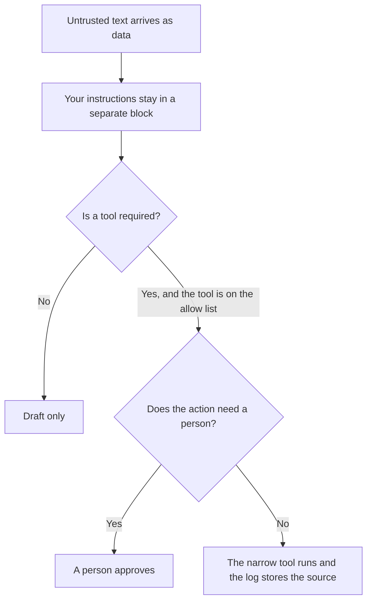

**A prompt injection defense is the set of controls that keep text you did not write, inside a page, a file, or a ticket, from overriding your instructions or triggering a tool.** The risk itself is [what prompt injection is](/blog/what-is-prompt-injection-2026/). This page names the defenses and the impact of skipping them. It does not provide payloads, bypass steps, or test strings.

Your instructions live in [what a system prompt is](/blog/what-is-a-system-prompt-2026/). The product checks around a bad action are [what AI guardrails are](/blog/what-is-ai-guardrails-2026/). A page that searches before it answers is [what retrieval-augmented chat is](/blog/what-is-retrieval-augmented-chat-2026/). If that search can run more than once, read [what agentic RAG is](/blog/what-is-agentic-rag-2026/) before you add tools to the loop.

Prices below are US list prices from directory pages checked October 16, 2026. Published October 24, 2026. We did not test defenses, and we did not score security products.

## The lanes, at the level a buyer can specify

| Control | What it is for | What it does not do |
|---|---|---|
| Separate instructions from data | The model is told which block is policy and which block is a document | It does not make a document trustworthy |
| Least privilege on tools | The bot can read the help center, and it cannot send mail or move money | It does not fix a poisoned article |
| A person before a write | Sending, paying, deleting, and permission changes wait | It does not review every harmless draft |
| An owner on the corpus | Only named people can edit the articles the bot retrieves | It does not catch a quiet edit unless someone looks |
| A log you can open | You can see which document and which tool were used | It does not undo the action by itself |

Treat retrieved text as data the model may quote. Treat your policy as the only instructions. When those two ideas are mixed in one blob, the document can look like the boss. The fix is the product boundary, then the article, then a check that the boundary held. Publishing example attacks so "the team can see" turns a private note into a recipe. Do not do that here, and do not paste one into a ticket that the model will later read.

## What to buy, and what stays a policy

**A seat that drafts the policy, and does not enforce it.** [Claude](/tools/claude/) Pro is $20 a month, or $17 billed annually. [ChatGPT](/tools/chatgpt/) Plus is $20 a month. Business is $20 a user a month billed annually for two or more users, and does not train on business data by default. Use a business seat when the policy text is confidential. The seat will not install a defense. The ladder is [ChatGPT Go vs Plus vs Pro](/blog/chatgpt-go-vs-plus-vs-pro-2026/).

**A bot on articles you maintain.** [Chatbase](/tools/chatbase/) Hobby is $32 a month billed yearly for 700 message credits. The directory says you can set guardrails and test before going live. Those settings are yours to configure against your policy. They are not a certificate that untrusted text is harmless. The build steps for the corpus are [how to build a knowledge-base chatbot](/blog/how-to-build-a-knowledge-base-chatbot-2026/).

**A wiki with an editor list.** [Notion AI](/tools/notion-ai/) Business is $20 a seat a month. The handbook is only as safe as the people who can edit it. Custom Agents are extra, at $10 per 1,000 credits. An agent that can post to Slack should be off until a person has approved that path. The card is [Notion AI pricing explained](/blog/notion-ai-pricing-explained-2026/).

The record of which article was allowed is [what a system of record for AI is](/blog/what-is-a-system-of-record-for-ai-2026/). The trace of a tool call is [what AI observability is](/blog/what-is-ai-observability-2026/).

## How to check the defense without teaching an attack

Use documents your own team wrote for the purpose of the check, stored where customers cannot read them. Confirm three outcomes: the assistant still follows the policy you set, it still refuses a tool that is not on the allow list, and a person still has to approve a send. If a check fails, fix the control and the article. Do not widen the test into a catalog of tricks. A public write-up of a bypass is out of scope for this site.

The quality habit, for ordinary wrong answers, is [what AI eval testing is](/blog/what-is-ai-eval-testing-2026/). Security checks and quality checks can share a log. They should not share a trophy. Passing a spelling test says nothing about tool permissions.

## FAQ

### Is a stronger system prompt the defense?

It is one layer, and it is the layer untrusted text tries to crowd out. Pair it with tool limits and a human gate. A longer prompt is not a permission system.

### Should we show employees example attacks?

No. Show them the rule: documents are data, tools are allow-listed, and sends wait for a person. Example attacks travel into the corpus and into screenshots.

### Does a vendor "jailbreak filter" replace this?

A filter can be one control. You still need least privilege, corpus owners, and logs. Ask the vendor what they block and what they log. Do not ask them for a bypass demo in a shared channel.

### What do we log?

The document id, the tool name, and whether a person approved the action. You do not need the full customer file in a second system. Retention follows the privacy review you already have.

## Last verified

October 16, 2026 for Claude, ChatGPT, Chatbase, and Notion prices named above. Published October 24, 2026. This article does not include attack procedures.

**Sources:** [Claude pricing](https://claude.com/pricing), [ChatGPT pricing](https://chatgpt.com/pricing), [Chatbase pricing](https://www.chatbase.co).

*Published by Andrew for [AI Tools Optimizer](https://aitoolsoptimizer.com).*

[Chatbase](/tools/chatbase/) is in the [customer support directory](/tools/category/customer-support/). Directory pages may use affiliate links. A purchase through them may earn us a commission at no extra cost to you.
