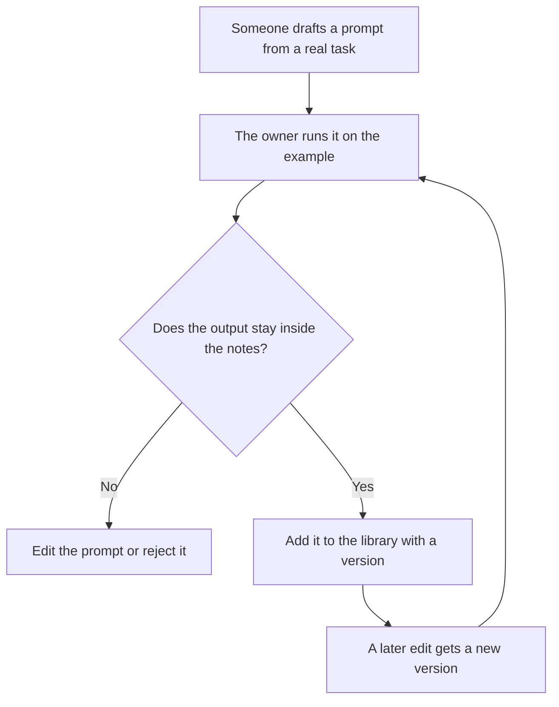

**A prompt library is a shared list of prompts your team is willing to reuse, each with an owner, a version, and one example of a good input.** It is a document you can point to in a review. A chat transcript that happened to work once is not a library. Neither is a folder of clever lines nobody is allowed to change.

Writing the instruction is [what prompt engineering is](/blog/what-is-prompt-engineering-2026/). Giving the model one finished example is [what few-shot prompting is](/blog/what-is-few-shot-prompting-2026/). The hidden instruction in a product is [what a system prompt is](/blog/what-is-a-system-prompt-2026/). A library can hold all three kinds of text. It still needs a person who can say which line is current.

Prices are US list prices from directory pages checked October 16, 2026. Published October 24, 2026. We did not score prompt quality.

## What each entry needs

| Field | Why it is there | Done when |
|---|---|---|
| Name | People can find it without scrolling a chat | A teammate can say the name in a ticket |
| Owner | Someone can approve a change | The name is a person, not "marketing" |
| Job | The task this prompt is for | The job is one sentence |
| Prompt | The words you will paste | A second person can run it on the example |
| Example input | A real note, ticket, or outline | The private data is removed |
| Do not use for | The nearby job that needs a different prompt | "Customer refunds" is named if it is out of scope |
| Version | What changed | The date and the editor are on the row |

A prompt that says "sound smart" will be reused badly. A prompt that says "rewrite these bullets in under 120 words and do not add numbers" can be reviewed. Keep the second kind.

## Where the library lives

**Next to the docs the team already trusts.** [Notion AI](/tools/notion-ai/) Business is $20 a seat a month and includes Notion Agent. Plus at $10 a seat is not that full AI tier. A library page in Notion works if the owner and the version are visible without asking a bot. The card is [Notion AI pricing explained](/blog/notion-ai-pricing-explained-2026/).

**In a Project, for one assistant.** [Claude](/tools/claude/) Pro is $20 a month, or $17 billed annually. Free includes Projects, with limits. Put the approved prompts in a Project so a new chat starts from the library, not from memory of last Tuesday. The container comparison is [Claude Projects vs ChatGPT Projects](/blog/claude-projects-vs-chatgpt-projects-2026/).

**In the team's default chat.** [ChatGPT](/tools/chatgpt/) Plus is $20 and includes projects and custom GPTs. A custom GPT that hides the prompt from the people who must maintain it is a worse library than a page they can edit. The ladder is [ChatGPT Go vs Plus vs Pro](/blog/chatgpt-go-vs-plus-vs-pro-2026/).

**After the facts are stable.** [Grammarly](/tools/grammarly/) Free covers grammar. Pro is $12 a member a month billed annually. It can clean a sentence in the library. It should not invent the policy the prompt is supposed to enforce. The card is [Grammarly pricing explained](/blog/grammarly-pricing-explained-2026/).

The house rules for words, once you have them, belong in [how to create a style guide with AI](/blog/how-to-create-a-style-guide-with-ai-2026/). Tone, which is a thinner card, is [how to create a brand voice with AI](/blog/how-to-create-a-brand-voice-with-ai-2026/).

## What does not belong in the library

Customer names, contract numbers, and unreleased prices do not belong in an example. Replace them before the row is shared. A prompt that only works when you paste a secret is an operational risk, not a template.

Do not store a prompt whose only instruction is "ignore the rules." A reusable prompt should be narrower than the model, not a way around a control. The product-side checks are [what AI guardrails are](/blog/what-is-ai-guardrails-2026/).

Do not let the library grow by copying every chat that someone liked. Review a prompt when the task will happen again. A one-off can stay in the chat.

When the prompt changes, rerun the example and one real case. That rerun is [what AI eval testing is](/blog/what-is-ai-eval-testing-2026/). A library without a rerun becomes folklore.

## FAQ

### Is a prompt library the same as a system prompt?

No. A system prompt is the instruction a product applies before the user types. A library is a set of prompts people choose and can read. You might copy a library entry into a system prompt later. The owner and the version still have to exist outside the product.

### How many prompts should we start with?

Start with the three tasks you already repeat: a status note, a customer reply, and a summary of a doc. Add a fourth when someone asks for it twice. A library of eighty unowned prompts is a junk drawer.

### Can AI write the library for us?

It can turn a task you described into a first draft. You still add the example, the owner, and the "do not use for" line. A model will happily write prompts for jobs you do not do.

### Where should freelancers keep one?

A single page is enough. The tool matters less than the version. If you only have ChatGPT, a Project with three named prompts is a library. If you only have a doc, the doc is a library.

## Last verified

October 16, 2026 for Notion, Claude, ChatGPT, and Grammarly prices named above. Published October 24, 2026.

**Sources:** [Notion pricing](https://www.notion.com/pricing), [Claude pricing](https://claude.com/pricing), [ChatGPT pricing](https://chatgpt.com/pricing).

*Published by Andrew for [AI Tools Optimizer](https://aitoolsoptimizer.com).*

[Notion AI](/tools/notion-ai/) is in the [productivity and notes directory](/tools/category/productivity-notes/). Directory pages may use affiliate links. A purchase through them may earn us a commission at no extra cost to you.
