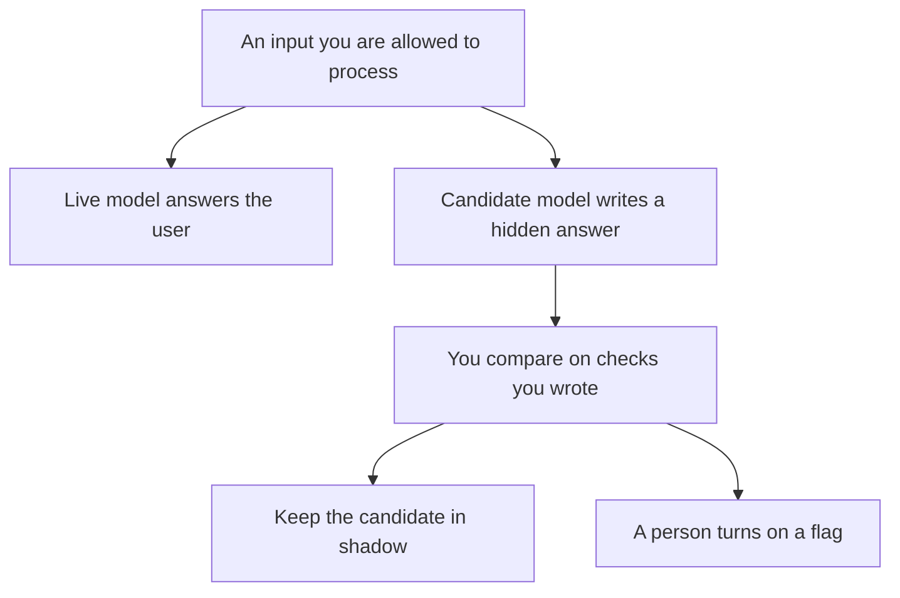

**A shadow deployment for AI runs a candidate model on the same inputs as the live model, stores the candidate's output, and does not show that output to the user.** You compare the two. You promote the candidate only when the comparison matches a bar you wrote down. Until then, the user still sees the live answer.

This page is the rollout pattern. It is not a guide to probing, bypassing, or attacking a model. A planned test of rules you already wrote, on inputs you are allowed to use, is [what AI red teaming is](/blog/what-is-ai-red-teaming-2026/). The switch that later shows the new model to a slice of users is [what AI feature flags are](/blog/what-is-ai-feature-flags-2026/).

Prices below are US list prices from directory pages checked October 16, 2026. Published October 24, 2026. We did not score models against each other.

## What "shadow" commits you to

| Piece | Live path | Shadow path |
|---|---|---|
| Who sees the text | The user | Only people allowed to read the comparison |
| Which model | The one you already shipped | The candidate |
| What you store | Whatever your retention policy already allows | The same policy, plus a label that this output was not served |
| When it becomes real | It already is | After a person promotes it, usually behind a flag |
| What failure means | A user-visible defect | A row in the comparison, if you actually look |

Shadow traffic costs money. You pay for two calls. A candidate that is "free to try" inside a demo is not free at production volume. The unit is [what AI tokens are](/blog/what-are-ai-tokens-explained-2026/). The bill tag is [what AI cost attribution is](/blog/what-is-ai-cost-attribution-2026/).

## How this differs from a staging test

A staging test uses examples you collected. A shadow run uses today's inputs, which include cases you did not think to save. Both are useful. Staging is where you start, because it is cheaper and easier to delete. Shadow is how you catch the input shape that only shows up on a Tuesday.

The file that runs the staging checks is [what an AI eval harness is](/blog/what-is-ai-eval-harness-2026/). The definition of the task list is [what AI eval testing is](/blog/what-is-ai-eval-testing-2026/). If both paths fail the same way, the model swap is not the fix. The prompt or the source is.

Do not send customer content to a second vendor because a shadow run seemed like a good week to "try something." The privacy review that allowed the live model has to allow the candidate too. The door both calls should pass through is [what a model gateway is](/blog/what-is-a-model-gateway-2026/).

## Seats that help you read the comparison, not seats that are the shadow

**The long comparison.** [Claude](/tools/claude/) Pro is $20 a month, or $17 billed annually. Put the rubric in a Project and paste pairs you are allowed to review. The model can mark gaps. You decide the promotion. The container is [Claude Projects vs ChatGPT Projects](/blog/claude-projects-vs-chatgpt-projects-2026/).

**The team's default chat.** [ChatGPT](/tools/chatgpt/) Plus is $20. Business is $20 a user a month billed annually, for two or more users, and does not train on business data by default. A personal Plus seat is a different promise from Business. Do not paste a shadow log of customer text into a consumer plan your security review rejected. The ladder is [ChatGPT Go vs Plus vs Pro](/blog/chatgpt-go-vs-plus-vs-pro-2026/).

**The diff in git, if the candidate is your own code path.** [GitHub Copilot](/tools/github-copilot/) Pro is $10. [Cursor](/tools/cursor/) Plus is $8 a month, or $80 a year, for new customers. A person merges. The shadow run is still an environment decision, not an editor feature. The team controls are [Cursor vs GitHub Copilot for teams](/blog/cursor-vs-github-copilot-for-teams-2026/).

**A path that stores the row.** [Zapier](/tools/zapier/) Professional is $19.99 a month billed annually for 750 tasks. It can append a comparison row to a sheet. It should not promote a model because a cell said "similar." The person who promotes is [what human-in-the-loop AI is](/blog/what-is-human-in-the-loop-ai-2026/).

## What to compare

Compare on checks you can point at: did it follow the refund policy you pasted, did it refuse to invent a date, did it stay inside the schema. A vibe that the new answer "sounds better" is a note, not a promotion criterion. A confident wrong fact is [what an AI hallucination is](/blog/what-is-ai-hallucination-2026/).

Keep the shadow output out of the user interface, the email sender, and the ticket reply box. If a bug shows it to a user, treat that as an incident. The write-up is [how to write a postmortem with AI](/blog/how-to-write-a-postmortem-with-ai-2026/).

## FAQ

### Is shadow the same as a canary?

A canary shows the new behavior to a small set of real users. A shadow shows it to nobody. Canary comes after shadow, and it uses a flag. Skip shadow only when you cannot lawfully duplicate the input, or when a second call is too expensive for the risk you are taking.

### Do I shadow every prompt tweak?

Shadow customer-facing changes and anything that can send, file, or charge. A wording tweak on an internal draft a person always edits can ship behind a staff flag. You still keep the old wording.

### What if the candidate is cheaper and worse?

Leave it in shadow and keep the live model. A lower sticker with a higher failure rate on the policy check is a defect. Record both the price and the failure rate before anyone calls it a savings.

### Can I shadow with customer data in a new vendor?

Only if the review that covers the live vendor covers the new one, and the retention of hidden outputs is written down. A trial key in a personal account is not that review.

## Last verified

October 16, 2026 for Claude, ChatGPT, GitHub Copilot, Cursor, and Zapier prices named above. Published October 24, 2026.

**Sources:** [Claude pricing](https://claude.com/pricing), [ChatGPT pricing](https://chatgpt.com/pricing), [GitHub Copilot](https://github.com/features/copilot).

*Published by Andrew for [AI Tools Optimizer](https://aitoolsoptimizer.com).*

[Claude](/tools/claude/) is in the [chatbots and assistants directory](/tools/category/chatbots-assistants/). Directory pages may use affiliate links. A purchase through them may earn us a commission at no extra cost to you.
