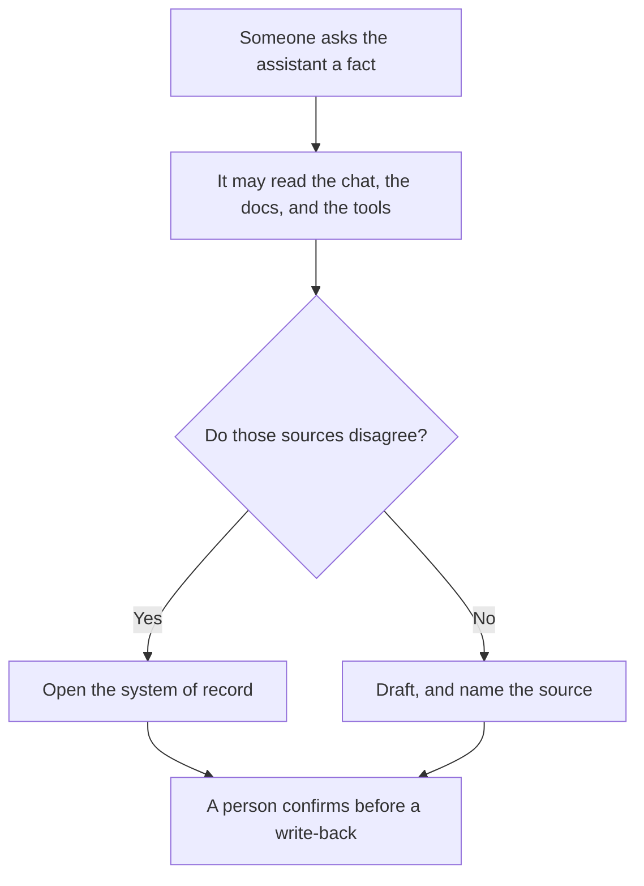

**A system of record is the place your team has agreed a fact is allowed to be true.** The CRM holds the customer. The ticket holds the incident. The HR system holds the start date. An AI feature does not become that place because it answered in a confident paragraph. When the chat, the doc, and the ticket disagree, the system of record is the one you open to settle it.

Saved notes in a chat are [what AI memory is](/blog/what-is-ai-memory-2026/). Pulling passages from files you uploaded is [what RAG is](/blog/what-is-rag-explained-2026/). Neither one is the authority. They are ways to read. The system of record is the decision about which reading wins.

Prices are US list prices from directory pages checked October 16, 2026. Published October 24, 2026. We did not audit any vendor's data model.

## Which box is allowed to win

| Fact | A typical system of record | The AI layer may |
|---|---|---|
| Who the customer is, and the plan they pay for | The CRM | Draft a summary. It may not invent a renewal date |
| What the incident was | The ticket | Draft a timeline from the ticket. It may not close it |
| What the policy says | The policy doc you marked current | Quote it. It may not "update" it by chatting |
| What shipped | The changelog or the release record | Shorten it. It may not add a feature |
| What a meeting decided | The notes a person approved | Propose bullets. A person files the decision |

A write-back is the dangerous direction. Reading the CRM to draft a recap is useful. Letting the model change the CRM because a sentence sounded final is how the record rots. The person on that write is [what human-in-the-loop AI is](/blog/what-is-human-in-the-loop-ai-2026/).

## Tools that are usually the record, and tools that usually are not

**The workspace, when the page is the policy.** [Notion AI](/tools/notion-ai/) Business is $20 a seat a month and can search connected apps. That search is a convenience. The system of record is the page your team agreed is current, not every page the agent can see. Plus at $10 a seat does not include the full Agent tier. The card is [Notion AI pricing explained](/blog/notion-ai-pricing-explained-2026/).

**The CRM, when the fact is a customer.** [HubSpot](/tools/hubspot/) has a free CRM. Starter was listed from $7 a seat a month as a limited-time offer on October 16, 2026. Treat $7 as a promotion recorded that day, not as a permanent list price. The customer row is the record. A draft email about the customer is not.

**The task system, when the fact is work status.** [ClickUp Brain](/tools/clickup-brain/) is an add-on from $9 a user a month for Brain². The task is the record. A weekly summary is a view. The comparison with the docs tool is [Notion AI vs ClickUp Brain](/blog/notion-ai-vs-clickup-brain-2026/).

**The assistant, almost never.** [Claude](/tools/claude/) Pro is $20 a month, or $17 billed annually. It can read a long file and draft. The file you maintain is the record. The chat is a scratch pad. Teams that paste the scratch pad into the CRM without checking are skipping the only step that matters.

**The glue, which must name the direction.** [Zapier](/tools/zapier/) Professional is $19.99 a month billed annually for 750 tasks. A Zap that copies an approved field into a sheet is fine. A Zap that copies a model paragraph into the CRM on every run needs an approval. The map is [Zapier vs Make vs n8n](/blog/zapier-vs-make-vs-n8n/).

Tracing what the model did after the fact is [what AI observability is](/blog/what-is-ai-observability-2026/). Observability tells you which route ran. It does not decide which database is right.

## A rule you can write down

Pick one system per fact. Write it in a table the new hire can find. When an AI feature is proposed, the proposal names the system it may read and whether it may write. "It will figure out the source" is not a design.

If two systems already disagree, fix that before you add a bot. The bot will pick one at random and sound sure. That confidence is [what an AI hallucination is](/blog/what-is-ai-hallucination-2026/) wearing your logo.

The checks that stop a write you did not allow are [what AI guardrails are](/blog/what-is-ai-guardrails-2026/).

## FAQ

### Is the vector database the system of record?

No. A vector index is a copy you built so search can find passages. The source document is the record. Rebuild the index when the document changes. Do not edit the index by hand and call it the policy. The definition is [what a vector database is](/blog/what-is-a-vector-database-2026/).

### Can a chatbot be the system of record for a small team?

Only if you are willing to treat that chat as the place you audit, export, and correct. Most teams are not. Put the decision in a page or a ticket, then let the chat draft from it.

### What about meeting notes?

The approved notes can be the record of what was decided. The transcript is evidence. [How to write a status update with AI](/blog/how-to-write-a-status-update-with-ai-2026/) is the weekly view. It does not replace the ticket.

### Who owns the table?

The team that suffers when the fact is wrong. Sales owns the customer row. Support owns the ticket. The AI project does not get a shadow copy "so the bot is faster" unless that copy is labeled a cache and can be thrown away.

## Last verified

October 16, 2026 for Notion, HubSpot's recorded Starter offer, ClickUp Brain, Claude, and Zapier prices named above. Published October 24, 2026.

**Sources:** [Notion pricing](https://www.notion.com/pricing), [HubSpot](https://www.hubspot.com), [Claude pricing](https://claude.com/pricing).

*Published by Andrew for [AI Tools Optimizer](https://aitoolsoptimizer.com).*

[Notion AI](/tools/notion-ai/) is in the [productivity and notes directory](/tools/category/productivity-notes/). Directory pages may use affiliate links. A purchase through them may earn us a commission at no extra cost to you.
