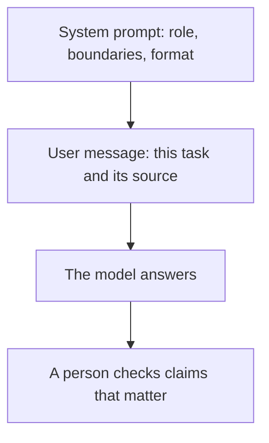

**A system prompt is the instruction that arrives before the user's message.** It tells the model the role, the boundaries, and the format for this product or this agent. You write one when you build a bot or call an API. In a consumer chat app, the vendor writes it, and you write the message underneath.

The words you type are still the job. How to write those words is [what prompt engineering is](/blog/what-is-prompt-engineering-2026/). A system prompt can ask for a shape. It cannot add a fact the model and the attached files do not have.

Prices are US list prices excluding tax from directory pages checked October 16, 2026, except where a later article on this site read a pricing page on October 24, 2026. Published October 24, 2026.

## Where a system prompt sits

| Place | Who writes it | What you still write |
|---|---|---|
| [Claude](/tools/claude/) or [ChatGPT](/tools/chatgpt/) chat | The vendor, plus any custom instructions you saved | The task and the source for this turn |
| A project or a custom GPT-style setup | You, once, as standing rules | Each new request |
| A support agent such as [Chatbase](/tools/chatbase/) | You, as the agent's instructions, on top of the vendor's | The help articles the agent may quote |
| An automation agent such as [Lindy](/tools/lindy/) | You, as the agent's job | The trigger and the tools it may call |
| An API request | You, in a system field beside the user message | The user message itself |

Custom instructions in a chat product are a system prompt you are allowed to see. They apply across chats until you change them. They are a poor place for a one-off fact. Put the price, the policy, or the notes in the user message, or in a file the product can read. How much fits is the [context window](/blog/what-is-a-context-window-2026/).

## What belongs in it

| Put this in the system prompt | Leave this for the user message or a file |
|---|---|
| "You draft support replies from the attached help center. If the article is silent, say so." | Today's ticket |
| The tone a brand already approved | A new campaign offer that expires Friday |
| The output shape: a table with owner and date | The meeting transcript |
| Which tools the agent may call | The customer's name and order |

A long system prompt spends tokens on every call. The meter is [what AI tokens are](/blog/what-are-ai-tokens-explained-2026/). Adjectives such as "be world-class" add tokens and leave the facts unchanged. A boundary does more: "quote the article, and stop when it ends."

Asking for a format with no example in the user message is [what zero-shot prompting is](/blog/what-is-zero-shot-prompting-2026/). Showing the steps you want is [what chain-of-thought prompting is](/blog/what-is-chain-of-thought-prompting-2026/). Both can live under a short system prompt. They do not replace it.

## A system prompt in a product you pay for

Chatbase's instructions are the system prompt for a site agent. Hobby is $40 a month, or $32 billed yearly, with 700 message credits, from the pricing page read October 24, 2026. The instructions tell the agent how to behave. The training files are the source. Mixing a refund policy into the instructions, and also into a PDF, produces two versions. Keep the policy in the file and the behavior in the instructions. The build order is [how to build a support chatbot with Chatbase](/blog/how-to-build-a-chatbot-with-chatbase-2026/).

Lindy is the case where the system prompt is the job description of an agent that runs while you are away. The October 24, 2026 pricing page read for [Lindy review](/blog/lindy-review-2026/) starts paid use at $29.99 per user per month for 3,000 credits. A vague job description spends those credits on the wrong work. Name the trigger, the source, and the handoff.

Claude Pro at $20 a month, or $17 billed annually, and ChatGPT Plus at $20, are where an individual saves standing rules. Free tiers accept the same structure. Pay when the cap blocks the work.

When the model must call a calculator, a CRM, or a search tool, that permission is [what function calling is](/blog/what-is-function-calling-in-ai-2026/). The system prompt can name the rule. The tool definition is a separate object in the API.

## FAQ

### Is a system prompt the same as a custom instruction?

In a chat app, custom instructions are the part of the system prompt the product lets you edit. The vendor still sends its own rules around them. In an API, the system field is yours, inside the provider's usage policy.

### Can a system prompt stop hallucinations?

It can require a quote and an abstention when the source is silent. You still read the quote. The failure mode is [what an AI hallucination is](/blog/what-is-ai-hallucination-2026/).

### Should every teammate share one system prompt?

Share the rules that are actually company rules: voice, privacy, and what to do when the source is missing. Keep personal preferences in the user message. A shared prompt that tries to cover every department becomes a prompt nobody can debug.

### Do I need a paid plan to set one?

Chat products include custom instructions on free tiers, with usage limits. An agent product bills when the agent runs. The system prompt itself is text. The invoice is the inference around it.

## Last verified

October 16, 2026 for Claude and ChatGPT plan prices. October 24, 2026 for the Chatbase and Lindy figures cited from pricing pages read that day. Published October 24, 2026.

**Sources:** [Claude pricing](https://claude.com/pricing), [OpenAI ChatGPT pricing](https://openai.com/chatgpt/pricing/), [Chatbase pricing](https://www.chatbase.co/pricing).

*Published by Andrew for [AI Tools Optimizer](https://aitoolsoptimizer.com).*

[Claude](/tools/claude/) and [ChatGPT](/tools/chatgpt/) are in the [chatbots directory](/tools/category/chatbots-assistants/). Directory pages may use affiliate links. A purchase through them may earn us a commission at no extra cost to you.
