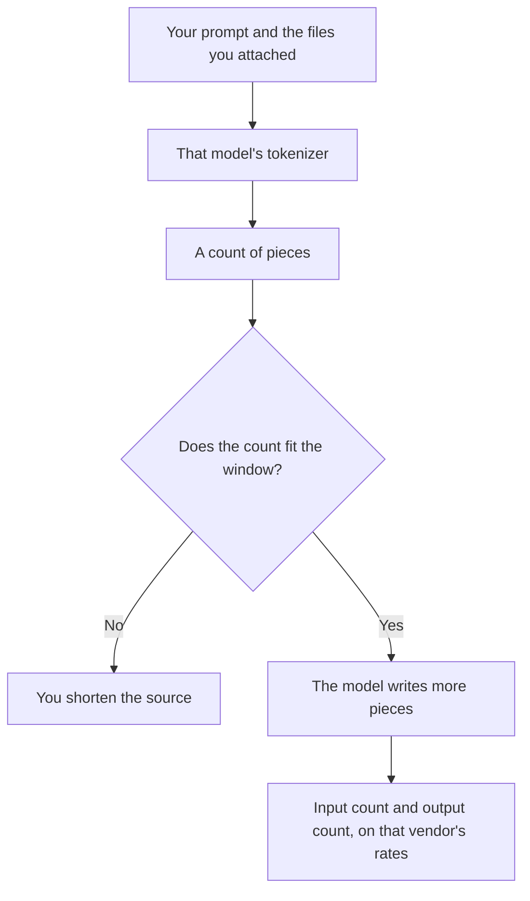

**A tokenizer is the program that splits text into the pieces a model counts, before the model writes anything.** Those pieces are tokens. The model does not read "words" as your invoice does. It reads the tokenizer's inventory. Two models can split the same paragraph into different counts, so a price per million tokens is not comparable until you know which tokenizer ran.

The unit on the bill is [what AI tokens are](/blog/what-are-ai-tokens-explained-2026/). How many of them fit in one request is [what a context window is](/blog/what-is-a-context-window-2026/). The thing being counted is [what an LLM is](/blog/what-is-an-llm-2026/).

This page does not publish a token count for a sample sentence. A rule of thumb you did not run through that vendor's tokenizer is a guess. Prices below are US list prices from directory pages checked October 16, 2026. Published October 24, 2026.

## What the split is doing

| You see | The tokenizer is doing | What it is not |
|---|---|---|
| A sentence | Cutting it into pieces from a fixed inventory | Counting words, or syllables |
| A price per million tokens | Charging input pieces and output pieces, often at different rates | A price per email or per page |
| A context limit | A cap on pieces in one request, prompt plus answer | A cap on minutes of your time |
| Code, JSON, or a name in another script | Often more pieces than the same idea in plain English | A sign the model is "worse" |
| An image on an image API | Sometimes a different token, billed on that card | The same meter as a chat paragraph |

The output is tokenized too. A long answer costs more than a short one on the same model, even when the prompt was identical. Asking for brevity is a cost control. It is also an editing choice. The person who checks the short answer is [what human-in-the-loop AI is](/blog/what-is-human-in-the-loop-ai-2026/).

## Why the same paragraph is not one price

[ChatGPT](/tools/chatgpt/) Plus is $20 a month. Go is $8. Free includes text chat with limits on tools. Those seats do not show you a tokenizer. You feel the meter as a usage cap, not as a line item. The ladder is [ChatGPT Go vs Plus vs Pro](/blog/chatgpt-go-vs-plus-vs-pro-2026/).

[Claude](/tools/claude/) Pro is $20 a month, or $17 billed annually. The directory records a context window up to 1 million tokens depending on the model. That is a capacity number, not a promise that your file will be cheap. A long contract still has to fit, and a long answer still spends the seat's usage. The long-document comparison is [Claude vs Gemini for long documents](/blog/claude-vs-gemini-for-long-documents-2026/).

[DeepSeek](/tools/deepseek/) is where the tokenizer becomes an invoice. Flash is $0.30 per million input tokens and $1.20 per million output tokens at peak, and half of that off-peak, on a cache miss. A worked sketch in the review uses those rates. Your tokenizer and your cache behavior decide the real invoice. The review is [DeepSeek review](/blog/deepseek-review-2026/). The cache, which is not the tokenizer, is [what a context cache is](/blog/what-is-a-context-cache-2026/).

[Gemini](/tools/gemini/) Free comes with a Google account. Google AI Plus is $4.99 a month. Google AI Pro is $19.99. You are buying usage of a hosted assistant, not a token line you can audit from the seat. If you call an API, use that API's tokenizer and that API's price. Do not divide a seat price by an imagined token count and call it a rate.

Image models can use a different meter. GPT-Image-2.5 Sunburst, on the [ChatGPT Images](/tools/dall-e/) page, is $8 per million image input tokens and $30 per million image output tokens on standard processing. Do not compare that to a chat token. The warning is the same one on [Leonardo pricing](/blog/leonardo-ai-pricing-explained-2026/): a credit in an image app is not a chat token.

## What to do with the idea

Paste the real prompt into the vendor's own counter when the bill matters. If they do not publish a counter, run one small job and read the usage line. Then multiply. A blog post that says "about 750 words is 1,000 tokens" is a sketch for English prose on one family of models. It is a bad sketch for code, for JSON, and for a language the inventory splits finely.

A shorter prompt is not always a better prompt. Cutting the source that the answer must follow is how you get a fluent invention. The failure mode is [what an AI hallucination is](/blog/what-is-ai-hallucination-2026/). Keep the facts. Cut the preamble.

## FAQ

### Is a token a word?

Often it is a piece of a word, a word, or a bit of punctuation. The inventory belongs to that model. This page will not give you a words-to-tokens ratio to paste into a budget.

### Do I need to know the tokenizer to use ChatGPT?

No. You need it when you are comparing API prices, fitting a file into a window, or explaining a bill. A Plus seat hides the meter inside a usage cap.

### Can I change the tokenizer?

Not on a hosted model. The tokenizer ships with the model. Choosing another model is choosing another tokenizer, another window, and another price.

### Does quantization change the token count?

No. Quantization changes how weights are stored. The prompt is still split the same way. The definition is [what quantization is](/blog/what-is-quantization-in-ai-2026/).

## Last verified

October 16, 2026 for the seat prices and the DeepSeek and Sunburst rates named above. Published October 24, 2026. The definition of a tokenizer does not depend on those prices.

**Sources:** [DeepSeek API docs](https://api-docs.deepseek.com/), [Claude pricing](https://claude.com/pricing), [ChatGPT pricing](https://chatgpt.com/pricing).

*Published by Andrew for [AI Tools Optimizer](https://aitoolsoptimizer.com).*

[Claude](/tools/claude/) is in the [chatbots and assistants directory](/tools/category/chatbots-assistants/). Directory pages may use affiliate links. A purchase through them may earn us a commission at no extra cost to you.
