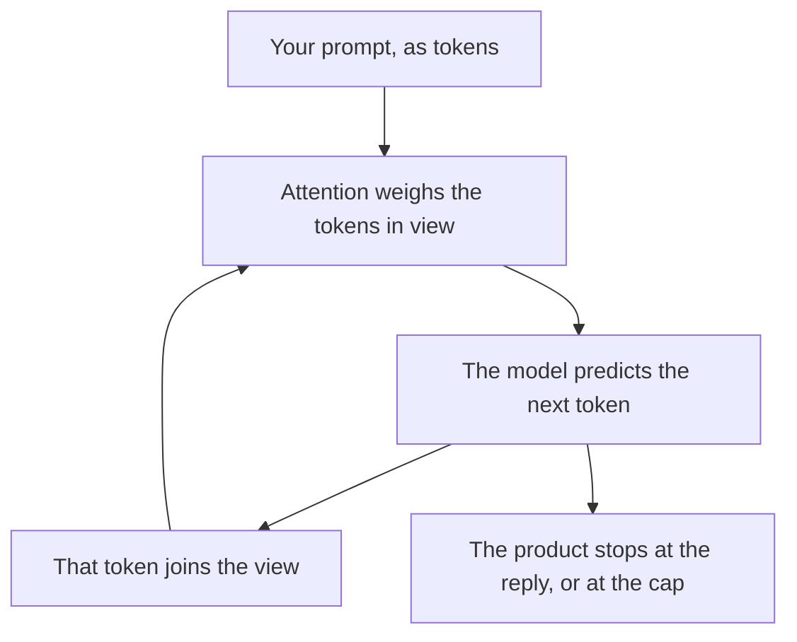

**A transformer is a model design that predicts the next piece of text by looking at the other pieces it can currently see.** Those pieces are tokens. The looking is called attention. Almost every chat product you can buy in 2026 is a product wrapped around a transformer, or around several of them. The product name on the invoice is the wrapper. The transformer is the part that continues the text.

You do not need the design to write a prompt. You need it when a vendor says "our model" and you are trying to tell a context limit from a brand name. The product category is [what an LLM is](/blog/what-is-an-llm-2026/). The meter on the text is [what AI tokens are](/blog/what-are-ai-tokens-explained-2026/).

Prices below are US list prices excluding tax from directory pages checked October 16, 2026. Published October 24, 2026. This page does not rank model quality.

## The word, on a product page and in the design

| You read | It usually means | What to do with it |
|---|---|---|
| "Transformer" | The design: attention over tokens, next-token prediction | A description of the architecture, and a weak shopping criterion by itself |
| "LLM" or "model" | A trained transformer you can call | The thing the plan meters |
| "Context window" | How many tokens the model can see at once | The cap on the file you paste. See [what a context window is](/blog/what-is-a-context-window-2026/) |
| "Multimodal" | The same idea extended past text, to images or audio | A capability list, explained in [what multimodal AI is](/blog/what-is-multimodal-ai-2026/) |
| A product name (ChatGPT, Claude, Gemini) | An app: the model, the tools, the memory, the price | The thing you subscribe to |

Attention is a weighting, and a weighting can focus on the wrong sentence. That is one reason a long prompt still needs you to put the constraint in a place the model will use. The craft is [what prompt engineering is](/blog/what-is-prompt-engineering-2026/).

## What you are paying for when you "buy a transformer"

You are paying for access to a trained model, a usage cap, and the product around it. The training run already happened. Your prompt is inference. That split is [what AI inference versus training is](/blog/what-is-ai-inference-vs-training-2026/).

| Product | What the plan is actually selling | Price to know |
|---|---|---|
| [ChatGPT](/tools/chatgpt/) | Chat, tools, and model access on a consumer or business plan | Go is $8/month. Plus is $20. Pro starts at $100 |
| [Claude](/tools/claude/) | The same shape, on Anthropic's models | Pro is $20/month, or $17 billed annually |
| [Gemini](/tools/gemini/) | Google's models inside the Gemini app and, on higher plans, Workspace | Google AI Plus is $4.99/month. Pro is $19.99 |
| [DeepSeek](/tools/deepseek/) | A chat, plus a published API rate | Chat is free. The API lists from $0.15 per 1 million input tokens on the off-peak cache-miss rate recorded October 16, 2026 |

The three-way product comparison is [ChatGPT vs Gemini vs Claude](/blog/chatgpt-vs-gemini-vs-claude-2026/). A model you can download and run is a distribution choice on top of the same design family. That choice is [what open-source AI is](/blog/what-is-open-source-ai-2026/).

## What the design does to your bill and your errors

**Longer context costs more and can still miss a line.** A bigger window lets you attach more. Attention over a huge window is a reason to put the rule at the top and the source next to the question. Buying a "long context" plan is a cap increase. It is a weak substitute for a shorter, cleaner prompt.

**The model continues text. It does not look up a file unless a tool does.** A transformer completes a sequence. Search, calculators, and your wiki are tools the product may call. When the product searches first, you are in [retrieval-augmented chat](/blog/what-is-retrieval-augmented-chat-2026/). When it only continues, a citation can be a continuation that looks like a link.

**Fine-tuning changes the continuation. It does not change the design.** Extra training on your examples shifts what the next token tends to be. The design stays a transformer. The project is [what fine-tuning is](/blog/what-is-fine-tuning-ai-2026/). Most teams should change the prompt and the corpus before they change the weights.

**"Transformer" is a poor tie-breaker between two chat subscriptions.** Both products are transformers. Choose on the cap, the tools, the data terms, and whether your editors can live in the interface. A design diagram will not tell you which seat to cancel.

## FAQ

### Are all modern AI chatbots transformers?

The mainstream text models behind ChatGPT, Claude, Gemini, and the open-weight models people run in 2026 are transformers or close variants. A product can add tools, search, and memory around that core. The chatbot is the product. The transformer is the model.

### Does a bigger transformer mean a better answer?

A larger model can handle more kinds of phrasing, and it can still be wrong about your file. Size is a lab fact. Your test is a task you already know the answer to. Run that task on the plan you would actually buy.

### What is attention, in one sentence?

Attention is how the model, at each step, assigns weight to the tokens it can see, so some of your prompt influences the next token more than others.

### Should I learn the math before I buy a seat?

No. Learn the cap, the price, and the data terms. Learn the math when you are training or serving a model yourself. A buyer who can explain tokens and context will already avoid the expensive mistakes.

## Last verified

October 16, 2026 for the plan prices. Published October 24, 2026.

**Sources:** [OpenAI ChatGPT pricing](https://openai.com/chatgpt/pricing/), [Claude pricing](https://claude.com/pricing), [Google AI plans](https://gemini.google/subscriptions/).

*Published by Andrew for [AI Tools Optimizer](https://aitoolsoptimizer.com).*

[ChatGPT](/tools/chatgpt/), [Claude](/tools/claude/), and [Gemini](/tools/gemini/) are in the [chatbots directory](/tools/category/chatbots-assistants/). Directory pages may use affiliate links. A purchase through them may earn us a commission at no extra cost to you.
