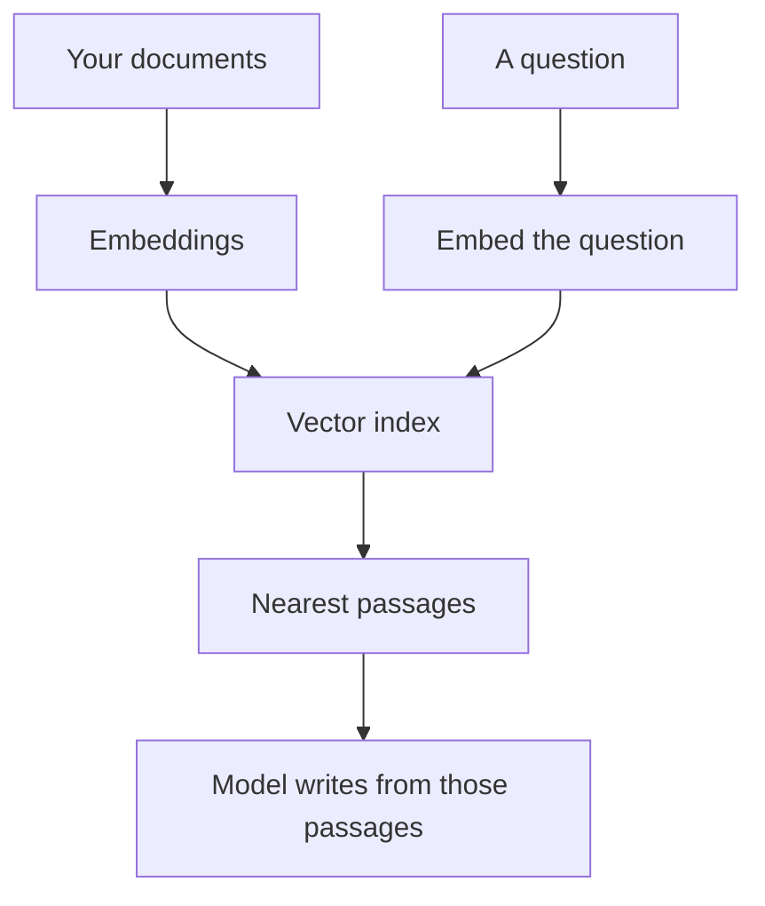

**A vector database stores numeric fingerprints of your text, called embeddings, so a search can return passages that are similar to a question.** The database is the index. The model still writes the answer. Together, that pattern is [what RAG is](/blog/what-is-rag-explained-2026/). The fingerprint itself is [what embeddings are](/blog/what-is-embeddings-in-ai-2026/).

You need to stand up a vector database when you are building retrieval into your own product. You do not need one to use Perplexity, a notebook, or a site bot. Those products hide the index.

This directory does not list a standalone vector-database vendor, and this page does not invent a hosting price for one. Prices below are for products that search a corpus for you. They are US list prices excluding tax from directory pages checked October 16, 2026.

## What the index is doing

| Step | What happens | What you see |
|---|---|---|
| Ingest | Documents are split into passages and turned into embeddings | An upload, a help center, or a crawl |
| Store | The vectors and the original text sit in an index | Nothing, until you ask |
| Query | The question is embedded and compared with the stored vectors | A search |
| Generate | A model writes from the passages that came back | An answer, useful only if you can open the passage |

Similarity is not truth. The nearest passage can be off-topic, outdated, or a partial match. If the index returns nothing useful, the honest product behavior is to say so. A model that fills the gap is producing the failure described in [what an AI hallucination is](/blog/what-is-ai-hallucination-2026/).

## When the index is someone else's product

| Corpus | Product that hides the index | Price to know |
|---|---|---|
| Files you upload | [Gemini Notebook](/tools/gemini-notebook/) | Free with a Google account. Google AI Plus is $4.99/month for higher limits |
| Your help center, in front of customers | [Chatbase](/tools/chatbase/) | Hobby is $32/month billed yearly, or $40 monthly |
| The public web | [Perplexity](/tools/perplexity/) | Pro is $17/month billed annually |
| Papers, as extracted rows | [Elicit](/tools/elicit/) | Plus is $11/user/month billed annually on the non-Industry card |
| A wiki the team already writes | [Notion AI](/tools/notion-ai/) | Business is $20/seat/month for full Notion AI |

Chatbase is the clearest "you bring the corpus" case in this directory. The setup is [how to build a chatbot with Chatbase](/blog/how-to-build-a-chatbot-with-chatbase-2026/). Perplexity's plan detail is [Perplexity pricing explained](/blog/perplexity-pricing-explained-2026/). Notion's seat detail is [Notion AI pricing explained](/blog/notion-ai-pricing-explained-2026/).

If the corpus is one document, paste it. A vector index earns its complexity when the material is larger than a [context window](/blog/what-is-a-context-window-2026/) or changes often enough that you will not re-paste it.

## What to ask before you buy or build one

**What is stored, and what is excluded?** A help center index that includes draft pages will answer with drafts. Scope is a product decision.

**Can a person open the passage?** A similarity score without the text is not checkable. Keep the original chunk next to the vector.

**What happens on a miss?** Route to a person, or say the answer is not in the corpus. Do not let the model invent a policy.

**Who can read the index?** Customer content and employee handbooks are different risk levels. Read the data terms on the plan you will buy, not the enterprise paragraph you will not.

**What is the meter?** Seats, messages, and storage are different invoices. Chatbase's Hobby plan meters message credits. A raw vector host, if you adopt one later, will meter storage and queries. Get that quote from the vendor. This page does not supply one.

Building the index yourself also means choosing an embedding model and a chunk size. Those parameters change what "similar" means. They belong in the vendor's current docs, not in a guessed recipe here.

## FAQ

### Is a vector database the same as RAG?

RAG is the full loop: retrieve passages, then generate. A vector database is one way to do the retrieve step. Keyword search can also retrieve. Many products use both.

### Do I need one for ChatGPT or Claude?

Not for normal chat. Paste the source, or use a product that searches. [ChatGPT](/tools/chatgpt/) Plus is $20/month. [Claude](/tools/claude/) Pro is $20/month, or $17 billed annually. Those seats are not a vector database.

### Is "semantic search" the same phrase?

Often, yes. Semantic search means matching by meaning, using embeddings, rather than only by shared keywords. The store for those embeddings is what people mean by a vector database.

### Will a vector database stop wrong answers?

It can surface a relevant passage. The summary can still misread the passage. Open the passage. The check is the same one you would make with any cited answer.

## Last verified

October 16, 2026 for the product prices named above. Published October 24, 2026. No standalone vector-database price is stated here, because this directory has not recorded one.

**Sources:** [Chatbase pricing](https://www.chatbase.co/pricing), [Perplexity pricing](https://www.perplexity.ai/pro), [Notion pricing](https://www.notion.com/pricing).

*Published by Andrew for [AI Tools Optimizer](https://aitoolsoptimizer.com).*

[Perplexity](/tools/perplexity/) and [Elicit](/tools/elicit/) are in the [research directory](/tools/category/research-search/). Directory pages may use affiliate links. A purchase through them may earn us a commission at no extra cost to you.
