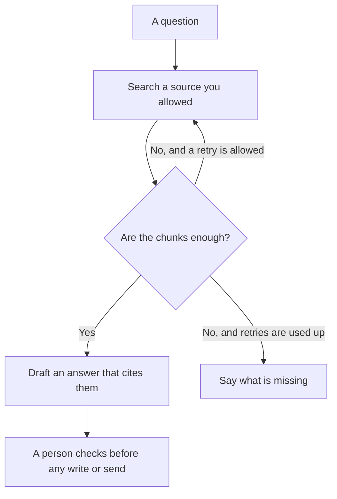

**Agentic RAG is retrieval-augmented generation where the model can decide to search again, switch sources, or stop, instead of taking one retrieval pass and answering.** Classic RAG fetches a handful of chunks, then writes. An agentic loop can notice the chunks were thin and look somewhere else you already allowed. It can also loop, spend, and sound sure. The allowance is the product decision. The loop is not wisdom.

The one-pass version is [what RAG is](/blog/what-is-rag-explained-2026/). A chat that searches and then answers is [what retrieval-augmented chat is](/blog/what-is-retrieval-augmented-chat-2026/). Whether the chunks were the right chunks is [what retrieval evaluation is](/blog/what-is-retrieval-evaluation-2026/). The checks on a bad action are [what AI guardrails are](/blog/what-is-ai-guardrails-2026/).

Prices below are US list prices from directory pages checked October 16, 2026. Published October 24, 2026. We did not score answer quality.

## One pass, or a loop

| Pattern | What happens | What you should measure |
|---|---|---|
| One-pass RAG | Retrieve, then answer, then stop | Did the chunks support the sentence |
| Agentic RAG | The model may retrieve again, call a tool you allowed, or stop | How many searches, which source, and whether a person must approve a write |
| A chat with web search | The product searches the open web on a schedule it controls | Citations you can open |
| An agent with a send button | The loop can become an email or a record change | The human gate before the send |

A second search is useful when the first corpus was the wrong folder. A second search is expensive when the model is curious and the meter is per call. Cap the retries in the product, not in a prompt you hope it obeys. The split between a fixed diagram and an agent that chooses is [AI orchestration versus automation](/blog/what-is-ai-orchestration-vs-automation-2026/).

## Tools that already sit on one side of this line

**Cited web search, with a cap.** [Perplexity](/tools/perplexity/) Free uses top models with a weekly limit. Pro is $17 a month billed annually and adds Computer, files, and model choice. The card does not print the month-to-month Pro dollar. Max is $167 a month billed annually. A research question that needs one cited pass does not need an open-ended loop. The sibling choice against a drafting seat is [Claude vs Perplexity for research](/blog/claude-vs-perplexity-for-research-2026/). The review is [Perplexity review](/blog/perplexity-review-2026/).

**A long file you already have.** [Claude](/tools/claude/) Pro is $20 a month, or $17 billed annually. Put the file in a Project and ask for page cites. That is closer to one-pass reading than to an agent that wanders. The long-document habit is [Claude vs Gemini for long documents](/blog/claude-vs-gemini-for-long-documents-2026/).

**A Project with tools.** [ChatGPT](/tools/chatgpt/) Plus is $20 a month. Business is $20 a user a month billed annually for two or more users, and does not train on business data by default. Turn on only the tools the task needs. A research draft does not need a send-email action. The container is [Claude Projects vs ChatGPT Projects](/blog/claude-projects-vs-chatgpt-projects-2026/).

**A wiki the team maintains.** [Notion AI](/tools/notion-ai/) Business is $20 a seat a month and includes Notion Agent. Custom Agents bill extra at $10 per 1,000 credits after a trial. An agent that answers from the handbook is only as current as the page. The card is [Notion AI pricing explained](/blog/notion-ai-pricing-explained-2026/).

The person who stops the loop is [what human-in-the-loop AI is](/blog/what-is-human-in-the-loop-ai-2026/). Untrusted text inside a retrieved page is a separate risk, named in [what prompt injection is](/blog/what-is-prompt-injection-2026/). The defensive layer, without attack steps, is [what a prompt injection defense is](/blog/what-is-a-prompt-injection-defense-2026/).

## What to write down before you allow a retry

Write the allowed sources, the maximum number of searches, and the actions that still need a person. "Search the help center twice, then say you do not know" is a policy. "Figure it out" is a budget. Log each search. If you cannot see the count, you cannot explain the bill. The tag on that bill is [what AI cost attribution is](/blog/what-is-ai-cost-attribution-2026/).

## FAQ

### Is agentic RAG just an agent?

An agent is the broader idea: a model that can take steps. Agentic RAG is that idea pointed at retrieval. If the steps include sending mail or changing a record, you have left "answer from documents" and you need an approval.

### When is one-pass RAG enough?

When the corpus is small, trusted, and the question is the kind of question that corpus answers. A refund policy in a help center is usually one pass. A question that might live in three systems is where a bounded retry earns its cost.

### Can the model decide the corpus?

Only among sources you listed. Letting it pick the open web plus your HR folder in one loop mixes public pages with private text. Split those jobs.

### How do I know the extra search helped?

Score whether the final citations support the sentence, and whether the first pass would have been enough. That measurement is retrieval evaluation. A longer trace is not a better answer.

## Last verified

October 16, 2026 for Perplexity, Claude, ChatGPT, and Notion prices named above. Perplexity's month-to-month Pro dollar was not on the card. Published October 24, 2026.

**Sources:** [Perplexity pricing](https://www.perplexity.ai/hub/pricing), [Claude pricing](https://claude.com/pricing), [Notion AI](https://www.notion.com/product/ai).

*Published by Andrew for [AI Tools Optimizer](https://aitoolsoptimizer.com).*

[Perplexity](/tools/perplexity/) is in the [research and search directory](/tools/category/research-search/). Directory pages may use affiliate links. A purchase through them may earn us a commission at no extra cost to you.
