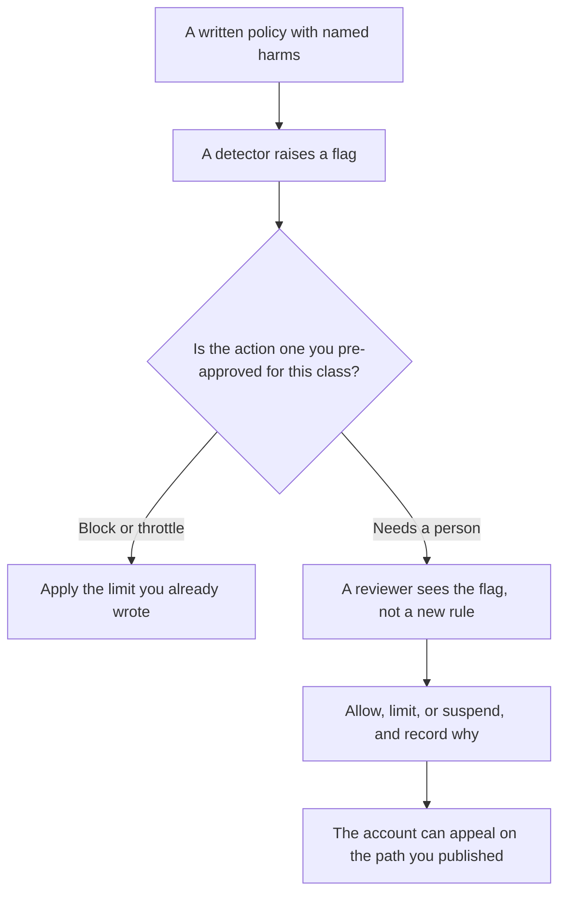

**AI abuse detection is the product control that flags an account, a session, or a piece of content because it matches a harm you already defined in policy.** The output is a flag, a limit, or a queue for a person. It is not a write-up of how to break a system. This page names the classes of harm and the review you owe. It does not include payloads, bypass steps, or procedures for evading a control.

The check that blocks a bad answer before it ships is [what AI guardrails are](/blog/what-is-ai-guardrails-2026/). A scheduled test of rules you already wrote is [what AI red teaming is](/blog/what-is-ai-red-teaming-2026/). Training-time refusals are [what AI safety and alignment are](/blog/what-is-ai-safety-alignment-2026/). The person who still decides a close call is [what human-in-the-loop AI is](/blog/what-is-human-in-the-loop-ai-2026/).

Published October 24, 2026. We did not rate any vendor's safety program. Seat prices below are context for who operates the product. They are not a detection score.

## What you write before you turn a detector on

| Policy class you can name | What a flag is allowed to mean | What stays out of a public doc |
|---|---|---|
| Spam and bulk unsolicited messages | This account crossed a rate or a pattern you defined | How to look like a normal user |
| Fraud and scams aimed at your customers | A reviewer should look at this session | Scripts that imitate your brand |
| Attempts to pull another customer's data | The tool call left the permission you set | How the call was shaped |
| Sexual exploitation of minors | Report and preserve under your legal process | Any description of the material |
| Non-consensual intimate imagery | Block, review, and follow the law you named | How the image was made |
| Automated collection that breaks your terms | Throttle or suspend the key | How to rotate around the throttle |

A detector without a policy is a score. A policy without a reviewer is a ban you cannot explain. Write both before you automate the consequence.

## How this differs from a guardrail

A guardrail watches one input or one output and blocks, rewrites, or escalates it. Abuse detection watches behavior over time: many accounts, many requests, a pattern that a single message does not show. You can have both. A guardrail that refuses one dangerous answer does not, by itself, tell you that a key is scraping your help center all night.

The repeatable cases you score in a lab are [what AI eval testing is](/blog/what-is-ai-eval-testing-2026/). Production flags are a different list. Do not paste private flag details into a public eval set.

## Who operates it, and what the seat costs

**The assistant your staff use.** [ChatGPT](/tools/chatgpt/) Business is $20 a user a month billed annually, with a two-user minimum, or $25 monthly, on the directory card checked October 16, 2026. [Claude](/tools/claude/) Pro is $20 a month, or $17 billed annually. Those seats are not an abuse program. If staff paste customer data into a personal account, that is a policy problem your detection on the company product will not see.

**A bot on your help center.** [Chatbase](/tools/chatbase/) Hobby is $32 a month billed yearly. [Intercom Fin](/tools/intercom-fin/) is $0.99 per outcome with a $49 monthly base that includes 50 outcomes, from Fin's help center read October 24, 2026. A bot that answers customers needs a handoff when the question is outside the articles, and a way to pause it. Pausing Fin stops new outcomes. That is a billing control and a safety control. The build order is [how to build an FAQ chatbot from docs](/blog/how-to-build-an-faq-chatbot-from-docs-2026/).

Log the flag, the policy class, and the reviewer. Leave the exploit detail in the private ticket. The log shape is [what structured logging for AI is](/blog/what-is-structured-logging-for-ai-2026/).

## FAQ

### Is abuse detection the same as content moderation?

Moderation reviews content against a rule. Abuse detection also covers accounts and traffic: a key that is allowed to chat and is not allowed to harvest. One team can own both. The queues should say which decision they are making.

### Can we publish our detector rules?

Publish the harms and the appeal path. Keep the exact thresholds and any private test detail off the public page. A threshold you post becomes a target. A harm you hide becomes a surprise ban.

### What about a false positive?

A person can reverse it, and the reversal is logged. An automatic ban with no appeal will punish a real customer who wrote an odd sentence. The cost of that mistake belongs in the policy, next to the harm you were trying to stop.

### Should the model decide the suspension?

The model, or a classifier, can raise the flag. The suspension rule is one you wrote: which classes auto-limit, which wait for a person, and how long you keep the sample. A model that invents a new punishment is not a detector. It is an unreviewed policy.

## Last verified

October 16, 2026 for ChatGPT Business, Claude Pro, and Chatbase. October 24, 2026 for Fin's outcome price, from Fin's help center. Published October 24, 2026.

**Sources:** [ChatGPT pricing](https://chatgpt.com/pricing/), [Claude pricing](https://claude.com/pricing), [Fin pricing: outcomes](https://fin.ai/help/en/articles/13975800-fin-pricing-outcomes).

*Published by Andrew for [AI Tools Optimizer](https://aitoolsoptimizer.com).*

[Intercom Fin](/tools/intercom-fin/) is in the [customer support directory](/tools/category/customer-support/). Directory pages may use affiliate links. A purchase through them may earn us a commission at no extra cost to you.
