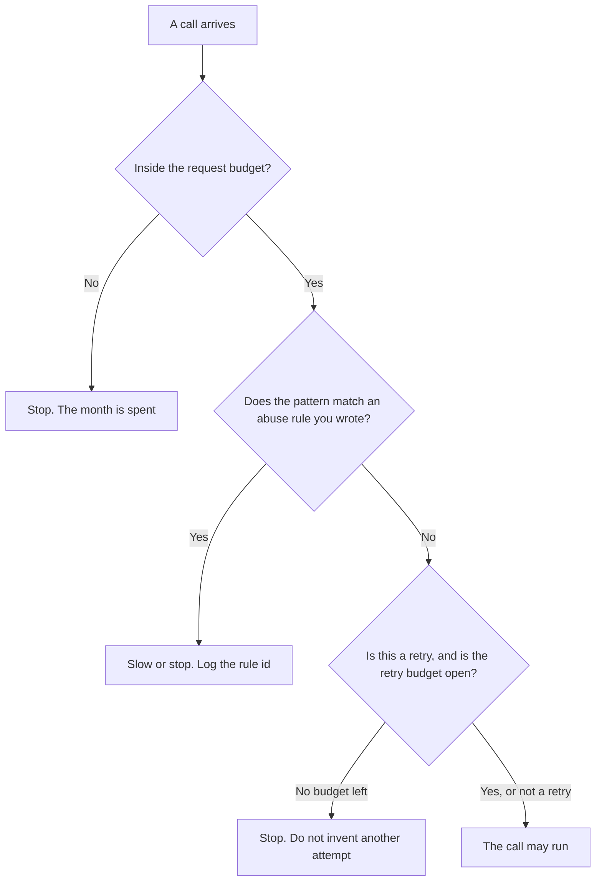

**An AI abuse rate limit is a rule that slows or stops a caller because the pattern looks like abuse, even when that caller has not spent the monthly request budget.** A budget counts how much you bought. A retry budget counts how many times a failed call may run again. An abuse limit watches the shape of the traffic: one key across many accounts, a burst that ignores the error, or a prompt that keeps asking for another tenant's data.

The monthly cap is [what an AI request budget is](/blog/what-is-ai-request-budget-2026/). The repeat of a failed call is [what an AI retry budget is](/blog/what-is-ai-retry-budget-2026/). The switch that opens when a tool keeps failing is [what an AI tool circuit breaker is](/blog/what-is-ai-tool-circuit-breaker-2026/).

Claude's prices below are from claude.com/pricing on October 24, 2026. ChatGPT and Perplexity prices are from directory pages checked October 16, 2026, because chatgpt.com/pricing and perplexity.ai/pro returned HTTP 403 that day. Cursor's price is from the same October 16 directory record. Published October 24, 2026. We did not measure how often a limit fires.

## What the limit is allowed to use

| Signal you can name | The limit may | The limit may not |
|---|---|---|
| Calls per minute from one key | Slow or stop that key | Spend the rest of a different team's monthly budget |
| The same failing prompt, repeated | Stop after the retry budget you wrote | "Try a friendlier wording" and send it again |
| A request for another tenant's records | Refuse, and log the key | Answer from the other tenant because the question was specific |
| A human's normal workday | Leave it alone if it stays inside the budget and the pattern rules | Treat a long Project as abuse because it is long |

A 429 from the vendor is their limit. Your abuse rule is the one you can show an auditor. If you only have the vendor's message, you do not yet have a rule. Write the pattern in words a second person can check: which key, which window, which action.

## Where the rule is written

**The long policy.** [Claude](/tools/claude/) Pro is $17 a month with the annual discount, $200 billed up front, or $20 billed monthly, on the October 24 pricing page. Put the abuse rules in a Project next to an example of a blocked call. The review is [Claude review](/blog/claude-review-2026/).

**One rule, from a paste.** [ChatGPT](/tools/chatgpt/) Plus is $20 a month on the October 16 directory card. Go is $8 and may include ads. Free can format a single rule. Discard a rule that says "block anything suspicious" and does not name the pattern. The review is [ChatGPT review](/blog/chatgpt-review-2026/).

**The code that enforces it.** [Cursor](/tools/cursor/) Plus is $8 a month, or $80 a year, on the October 16 directory card. The limit belongs in the gateway, in a diff you review. A generated change that deletes the tenant check is a defect. The ladder is [Cursor pricing explained](/blog/cursor-pricing-explained-2026/).

**A search product, which is not your gateway.** [Perplexity](/tools/perplexity/) Pro is $17 a month billed annually on the October 16 card. It answers from the web with citations. It does not apply the key rules on your private API. The invoice is [Perplexity pricing explained](/blog/perplexity-pricing-explained-2026/).

A prompt that holds the line:

"Turn the patterns I pasted into abuse rules. Each rule needs a key, a window, and a stop action. Do not add a pattern. If a window is missing, write Window missing and stop."

## What not to delegate

Do not let the model decide that a customer "seems abusive." That decision is the rule, or a person. Do not raise the monthly budget because the abuse limit fired. Those are different dials. Do not log the full prompt if the prompt holds a customer identifier. Log the key, the rule id, and the time. The strip step is [what AI PII redaction is](/blog/what-is-ai-pii-redaction-2026/).

## FAQ

### How is an abuse rate limit different from a request budget?

The request budget is how much you are allowed to spend in a period. The abuse limit can stop a caller who has budget left, because the pattern is one you forbade. A quiet caller can spend the budget. A noisy one can be stopped on the first minute.

### How is it different from a retry budget?

A retry budget counts another attempt after a failure you defined, such as a timeout. An abuse limit counts a pattern you defined as not allowed, including a retry loop that ignores the error. When the retry budget is zero, the right action is to stop, not to rephrase the call.

### Should the model write the threshold?

It may format a threshold you already chose. A number it picked because "most APIs use 60" is not your limit. Leave the cell blank and write the number from the incident or the vendor's published cap.

### What do you tell the caller?

The rule id and the window, if your policy allows that much. A paragraph about why the system "felt" the call was unsafe is not an explanation. The circuit breaker article is the failure path. This article is the pattern path.

## Last verified

October 24, 2026 for Claude. October 16, 2026 for ChatGPT, Cursor, and Perplexity. No separate abuse-limit product fee is recorded in the directory. Published October 24, 2026.

**Sources:** [Claude pricing](https://claude.com/pricing), [ChatGPT pricing](https://chatgpt.com/pricing/), [Cursor pricing](https://cursor.com/help/account-and-billing/pricing), [Perplexity pricing](https://www.perplexity.ai/pro).

*Published by Andrew for [AI Tools Optimizer](https://aitoolsoptimizer.com).*

[Claude](/tools/claude/) is in the [chatbots and assistants directory](/tools/category/chatbots-assistants/). Directory pages may use affiliate links. A purchase through them may earn us a commission at no extra cost to you.
