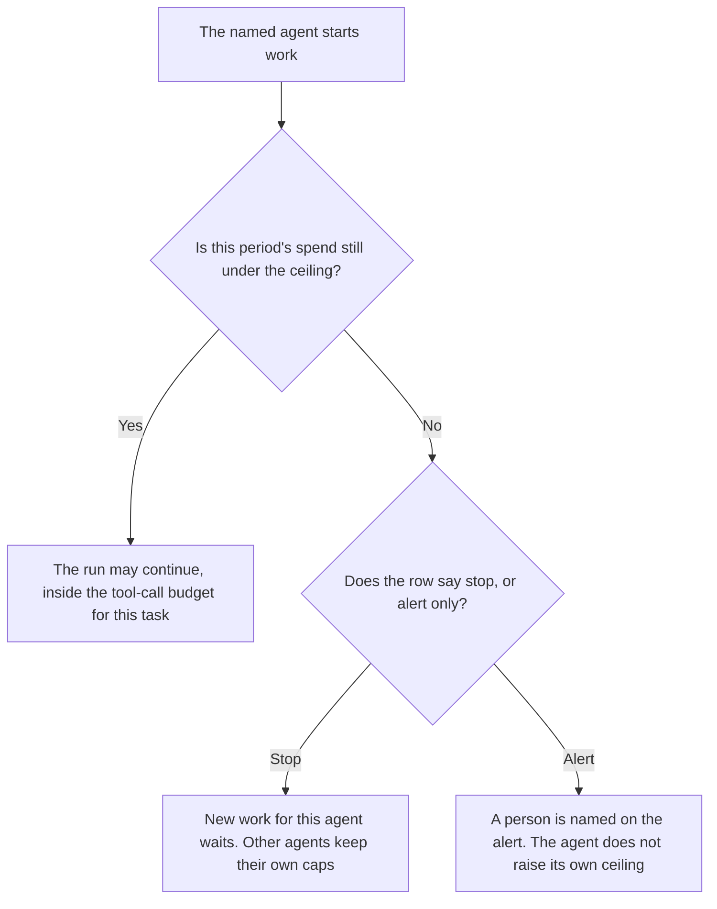

**An AI agent budget cap is the ceiling on one named agent for a period you set: dollars, tokens, or both, and what that agent does when it hits the ceiling.** The team-wide ceiling is [what an AI budget cap is](/blog/what-is-ai-budget-caps-2026/). The cap on calls for a user, a feature, or a day is [what an AI request budget is](/blog/what-is-ai-request-budget-2026/). The count of tool calls one task may make is [what an AI tool call budget is](/blog/what-is-ai-tool-call-budget-2026/). Silence that ends a run is [what an AI agent idle timeout is](/blog/what-is-ai-agent-idle-timeout-2026/).

This page is one agent. A cap with no agent name is a team number that every agent can spend. That is a different document.

Claude's prices are from claude.com/pricing on October 24, 2026. Cursor and Zapier prices are from directory pages checked October 16, 2026. Notion's Business price is from that same directory date. A live fetch of Zapier's pricing page returned HTTP 401 on October 24, 2026, so the Zapier figure stays on the directory record. Published October 24, 2026. We did not measure spend. The directory does not list an agent-budget product fee.

## What the cap names

| Piece | Who sets it | A blank means |
|---|---|---|
| Agent id | You | The ceiling applies to nobody, or to everybody. Either way it is the wrong page |
| Period | You: a day, a task, a month | The counter never resets on purpose |
| Ceiling | Finance or the owner, in a unit you can read on the invoice | Do not convert tokens to dollars with a rate you invented |
| On hit | Alert only, or stop new work | An alert nobody owns does not stop the agent |

A tool-call budget can trip while dollars remain. A dollar cap can trip on the second call if the model is expensive. Keep both rows if you use both. Do not add them into one "limit."

Which team the dollars belong to, after the fact, is [what AI cost attribution is](/blog/what-is-ai-cost-attribution-2026/). Attribution explains the bill. The cap decides whether the next run starts.

## Where the row is kept

**The definition.** [Claude](/tools/claude/) Pro is $17 a month billed annually, $200 up front, or $20 monthly. The Project holds the agent id, the ceiling, and the on-hit action. The review is [Claude review](/blog/claude-review-2026/).

**The check next to the agent, if it lives in a repo.** [Cursor](/tools/cursor/) Plus is $8 a month, or $80 a year. You review the diff that reads the cap. The ladder is [Cursor pricing explained](/blog/cursor-pricing-explained-2026/).

**A Zap that notifies a person when a counter you already store crosses the ceiling.** [Zapier](/tools/zapier/) Professional is $19.99 a month billed annually, with 750 tasks a month, on the October 16 card. The Zap does not decide the ceiling. The invoice is [Zapier pricing explained](/blog/zapier-pricing-explained-2026/).

**The register of agents and caps.** [Notion AI](/tools/notion-ai/) Business is $20 a seat a month. One row per agent. The invoice is [Notion AI pricing explained](/blog/notion-ai-pricing-explained-2026/).

A prompt that holds the line:

"Draft the agent budget cap from the agent id, the period, the ceiling, and the on-hit action I pasted. If the ceiling is missing, write Ceiling not set. Do not convert units. Do not raise the number."

## What not to delegate

Do not ask the model what the agent "should" be allowed to spend. Do not share one cap across every agent because the spreadsheet was shorter. Do not turn a stop into an alert because a demo was running. The owner changes the row. The agent does not.

## FAQ

### How is this different from a team budget cap?

The team cap is the ceiling finance agreed for a team, a key, or a product. This cap is one agent inside that number. An agent can stop while the team still has budget. The team can hit its cap while one agent's row still shows room. Both stops are real. Do not disable the agent row because the team chart looks fine.

### How is this different from a request budget?

A request budget limits calls or spend for a user, a feature, or a day. An agent budget cap limits one named agent. A person can be under their request budget while the agent they triggered is over its cap. Refuse the agent run. Do not borrow from the person's remaining calls unless the row says so.

### How is this different from a tool-call budget?

The tool-call budget counts calls inside one task. The agent budget cap is the period total for that agent, which may be dollars. A task can exhaust its call count on the first minute of a fresh dollar period. Write both. A single integer cannot mean both.

### Who may raise the ceiling?

The owner named on the row, with finance if the unit is dollars. A failed task is not a reason to edit the cap in the same hour. If the period was wrong, fix the period and say so. Do not delete the old ceiling.

## Last verified

October 24, 2026 for Claude. October 16, 2026 for Cursor, Zapier, and Notion. Published October 24, 2026. Zapier's pricing page returned HTTP 401 on October 24.

**Sources:** [Claude pricing](https://claude.com/pricing), [Cursor pricing](https://cursor.com/help/account-and-billing/pricing), [Zapier pricing guide](https://zapier.com/blog/zapier-pricing/), [Notion pricing](https://www.notion.com/pricing).

*Published by Andrew for [AI Tools Optimizer](https://aitoolsoptimizer.com).*

[Zapier](/tools/zapier/) is in the [automation and agents directory](/tools/category/automation-agents/). Directory pages may use affiliate links. A purchase through them may earn us a commission at no extra cost to you.
