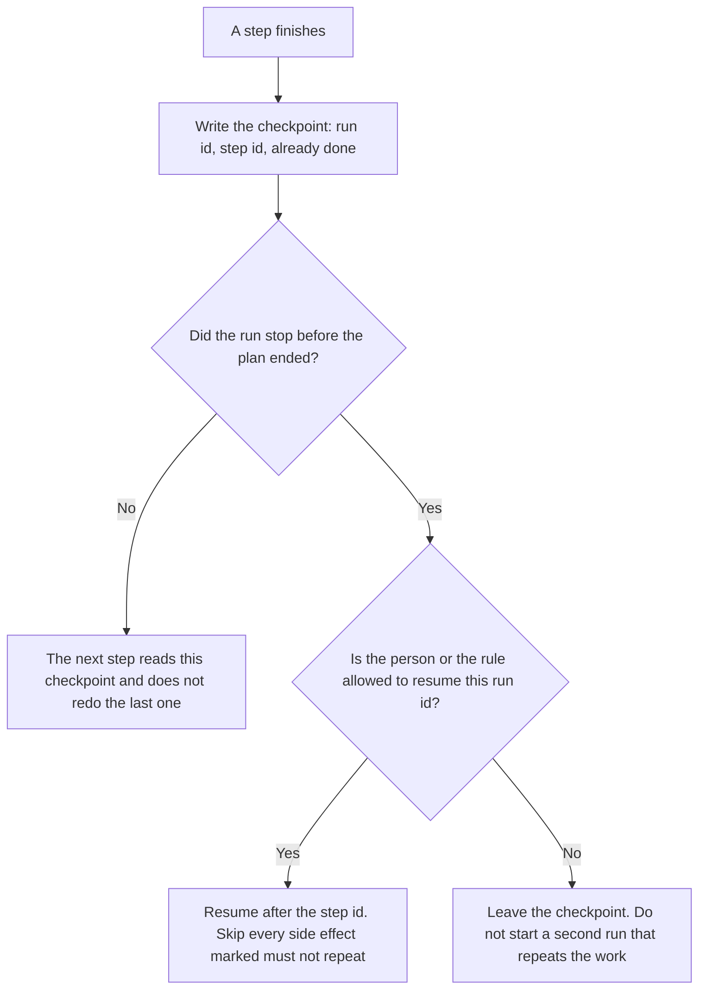

**An AI agent checkpoint is a saved point in one named run: the step id, what that run already did, and which side effects must not run again if the run resumes.** The ceiling on what that agent may spend is [what an AI agent budget cap is](/blog/what-is-ai-agent-budget-cap-2026/). Silence that ends a run is [what an AI agent idle timeout is](/blog/what-is-ai-agent-idle-timeout-2026/). Shrinking the context so the next step still fits is [what AI context compaction is](/blog/what-is-ai-context-compaction-2026/).

A side effect that must happen once, even when a call is retried, is [what AI idempotency is](/blog/what-is-ai-idempotency-2026/). A checkpoint records that the side effect already happened. The idempotency key is how the tool refuses a second charge. They are a pair. Neither one replaces the other.

Claude's prices are the October 24, 2026 read of claude.com/pricing recorded in [Claude pricing explained](/blog/claude-pricing-explained-2026/). Cursor, Notion, and Zapier prices are from directory pages checked October 16, 2026. A live fetch of Zapier's pricing page returned HTTP 401 on October 24, 2026, in the budget-cap article, so the Zapier figure stays on the directory record. Published October 24, 2026. We did not measure resume rates. The directory does not list a checkpoint fee.

## What the save has to name

| Piece | Who sets it | A blank means |
|---|---|---|
| Run id | The system, from a run you started | A resume can attach to the wrong task |
| Step id | You, in the plan | "Continue" has no place to continue from |
| Already done | Written when the step finishes | A resume sends the email again |
| Must not repeat | You, for each side effect | The model treats a payment as a draft |
| Who may resume | A person, or a rule you wrote | Any later prompt can restart the run |

Compaction can drop text the model was using. It does not record that a tool already charged a card. If you compact and you do not checkpoint, the next step can look new. Put the side-effect line in the checkpoint, not only in the transcript.

A budget cap can stop a run that has a valid checkpoint. The checkpoint does not raise the cap. When the cap resets, resume from the step id. Do not replay the steps marked already done.

## Where the row is kept

**The definition of what a checkpoint must contain.** [Claude](/tools/claude/) Pro is $17 a month billed annually, $200 up front, or $20 monthly. The Project holds the field list for this agent. The review is [Claude review](/blog/claude-review-2026/).

**The diff, if the resume logic lives in a repo.** [Cursor](/tools/cursor/) Plus is $8 a month, or $80 a year. You review the diff. The model does not merge it. The ladder is [Cursor pricing explained](/blog/cursor-pricing-explained-2026/).

**The register of run ids.** [Notion AI](/tools/notion-ai/) Business is $20 a seat a month. One row per run you still might resume. The invoice is [Notion AI pricing explained](/blog/notion-ai-pricing-explained-2026/).

**A notice when a run stops with a checkpoint waiting.** [Zapier](/tools/zapier/) Professional is $19.99 a month billed annually, with 750 tasks a month, on the October 16 card. The Zap tells a person. It does not resume the agent. The invoice is [Zapier pricing explained](/blog/zapier-pricing-explained-2026/).

A prompt that holds the line:

"Draft the checkpoint from the run id, the step id, and the side effects I pasted as already done. If a side effect is missing, write Side effect not recorded. Do not mark a step finished. Do not resume the run."

## What not to delegate

Do not ask the model where it "probably" left off. Do not delete a checkpoint because the transcript is long. Do not let a resume skip the idempotency key because the checkpoint says the email was sent. The owner of the agent decides who may resume. A saved blob is not permission.

## FAQ

### How is this different from a budget cap?

The cap decides whether the agent may spend more in this period. The checkpoint decides which steps already happened. An agent can be under its cap and still must not resend a message. An agent can have a perfect checkpoint and still be stopped because the cap is spent. Write both.

### How is this different from an idle timeout?

The timeout ends a run that has gone quiet. The checkpoint is the note you keep so a later resume does not repeat work. A timeout without a checkpoint throws away the only record of what finished. A checkpoint without a timeout can leave a run open until the cap or a person stops it.

### How is this different from context compaction?

Compaction shortens what the model can see. A checkpoint names what the tools already did. You can compact a transcript and keep the checkpoint. You should not treat the compacted summary as the list of side effects. If the summary drops a charge, the checkpoint still has to say the charge happened.

### Who may resume a run?

The person or the rule named on the checkpoint. A new chat that pastes the old transcript is not a resume unless it carries the run id and skips the finished side effects. If the run id is missing, start a new run and say the old one was not resumed.

## Last verified

October 24, 2026 for Claude, via the pricing article. October 16, 2026 for Cursor, Notion, and Zapier. Published October 24, 2026. Zapier's pricing page returned HTTP 401 on October 24, as recorded in the budget-cap article.

**Sources:** [Claude pricing](https://claude.com/pricing), [Cursor pricing](https://cursor.com/help/account-and-billing/pricing), [Notion pricing](https://www.notion.com/pricing), [Zapier pricing guide](https://zapier.com/blog/zapier-pricing/).

*Published by Andrew for [AI Tools Optimizer](https://aitoolsoptimizer.com).*

[Zapier](/tools/zapier/) is in the [automation and agents directory](/tools/category/automation-agents/). Directory pages may use affiliate links. A purchase through them may earn us a commission at no extra cost to you.
