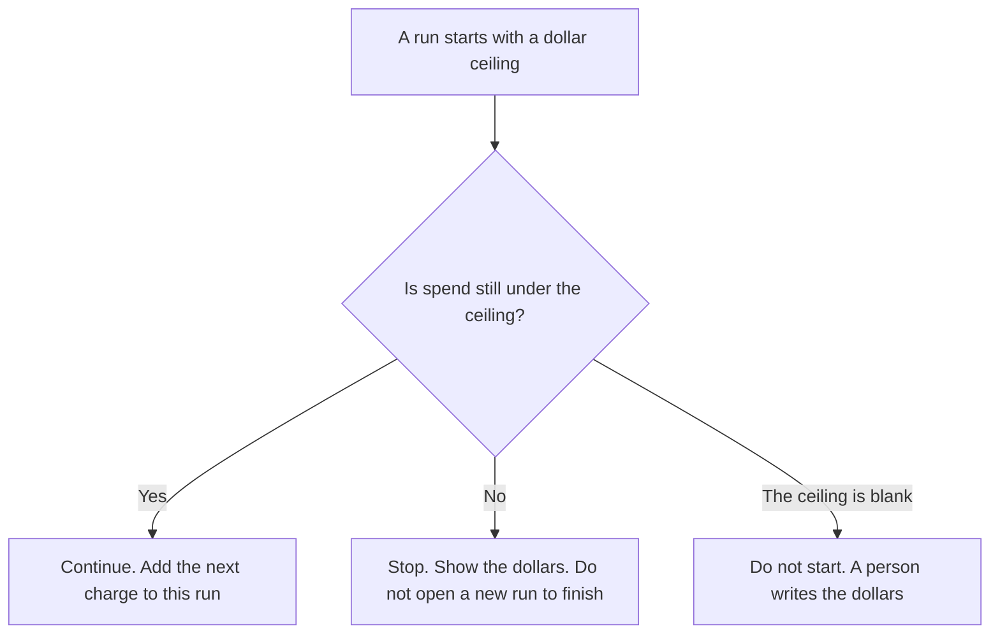

**An AI agent cost ceiling is the maximum dollars one run may spend before that run stops, written before the run starts.** When the spend reaches the number, the run stops and shows what it already spent. It does not continue because the monthly cap still has room. The count of tool calls in one task is [what an AI tool call budget is](/blog/what-is-ai-tool-call-budget-2026/). The ceiling on one named agent for a week or a month is [what an AI agent budget cap is](/blog/what-is-ai-agent-budget-cap-2026/). This page is one run, in dollars.

How many model requests a user, a feature, or a day may make is [what an AI request budget is](/blog/what-is-ai-request-budget-2026/). A request budget can be a count. A cost ceiling is money for this run. Stop on the first limit you hit.

Cursor's Plus price is the October 24, 2026 help-center figure recorded in [Cursor Business pricing explained](/blog/cursor-business-pricing-explained-2026/). Claude's prices, including Claude Code on paid plans, are from claude.com/pricing on October 24, 2026. Notion is the October 16 directory card. Published October 24, 2026. We did not measure spend. The directory does not list a cost-ceiling SKU.

## What the ceiling has to say

| Line | Who writes it | A blank means |
|---|---|---|
| The run | You name it | Every run shares one silent pool |
| The dollars | You, before it starts | The run spends until a person notices |
| What counts | You: model spend, tool spend, or both | A cheap tool hides an expensive model call |
| What stop looks like | You: halt and show the total | The run switches to a "cheaper" path and keeps going |
| Who may raise it | A person | The agent raises the ceiling because it is almost done |

A tool-call budget of eight calls can still be under the ceiling, or over it, depending on what each call costs. A monthly agent cap of $200 can still be under the line while this run was only allowed $5. Write all three numbers if you use all three. Do not let one stand in for the others.

Opening a second run to finish the same task is a way around the ceiling. The owner decides whether that second run exists, with its own number. The agent does not.

## Where the dollars are written

**The editor agent.** [Cursor](/tools/cursor/) Plus is $8 a month, or $80 a year, on the October 24 help page. A cloud agent can spend while you are not watching the diff. The ceiling is the number on that run. The ladder is [Cursor pricing explained](/blog/cursor-pricing-explained-2026/).

**The terminal agent.** [Claude Code](/tools/claude-code/) is included with paid Claude plans. Pro is $17 a month billed annually, $200 up front, or $20 monthly. The October 24 page says Claude Code shares the plan's usage with chat. That shared pool is not a per-run dollar stop. You still write the ceiling. The review is [Claude Code review](/blog/claude-code-review-2026/).

**The sentence that states the number.** [Claude](/tools/claude/) Pro is the same seat when you only need the policy sentence. The sentence is not the enforcer.

**The log a person reads after a stop.** [Notion AI](/tools/notion-ai/) Business is $20 a seat a month. The page stores the run id, the ceiling, and the total you recorded. Plus at $10 is not the full AI tier. The invoice is [Notion AI pricing explained](/blog/notion-ai-pricing-explained-2026/).

A prompt that holds the line:

"This run may spend at most the dollars I wrote. When you reach that amount, stop and list the charges. Do not start another run. Do not raise the number."

## What not to delegate

Do not let the model pick the ceiling after it has started. Do not treat a tool-call count as a dollar cap. Do not treat the monthly agent cap as permission for one run to spend the rest of the month. The owner writes the dollars first.

## FAQ

### How is this different from a tool-call budget?

The tool-call budget is how many tool invocations one task may make. The cost ceiling is how many dollars one run may spend. You can be under the count and over the dollars, or the other way around. Stop on the first limit. Use the tool-call page for the integer. Use this page for the money.

### How is this different from an agent budget cap?

The agent budget cap is the ceiling on one named agent for a period you set, such as a month. The cost ceiling is this run only. A run can hit $5 and stop while the agent still has budget left for the month. A quiet month can still contain one run that was never given a ceiling.

### How is this different from a request budget?

A request budget limits how many model requests a user, a feature, or a day may make. A cost ceiling limits the dollars of one run. Ten cheap requests can be inside the request budget and over the ceiling if you wrote a small dollar number. Write the unit on the page so the two are not averaged.

### Who may raise the ceiling mid-run?

The owner of the run, with a new number written down. The agent's claim that it is almost done is not a raise. A new number applies to the remainder you name. It does not rewrite what was already spent.

## Last verified

October 24, 2026 for Cursor's help page and for Claude, including Claude Code on paid plans. October 16, 2026 for Notion. No agent-cost-ceiling fee is recorded in the directory. Published October 24, 2026.

**Sources:** [Cursor pricing](https://cursor.com/help/account-and-billing/pricing), [Claude pricing](https://claude.com/pricing), [Claude Code](https://claude.com/product/claude-code), [Notion pricing](https://www.notion.com/pricing).

*Published by Andrew for [AI Tools Optimizer](https://aitoolsoptimizer.com).*

[Cursor](/tools/cursor/) is in the [coding directory](/tools/category/coding/). Directory pages may use affiliate links. A purchase through them may earn us a commission at no extra cost to you.
