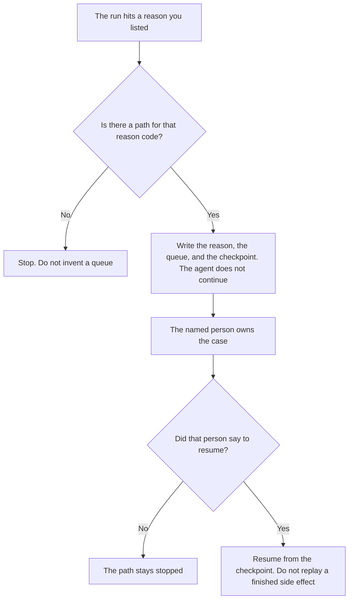

**An AI agent escalation path is the named route a run must take when it stops: the reason code, the queue, the person, and the rule that the agent does not continue.** The moment a support case leaves the model is [what AI human escalation is](/blog/what-is-ai-human-escalation-2026/). The grid of severity, owner, and clock for a help desk is [how to create a support escalation matrix with AI](/blog/how-to-create-a-support-escalation-matrix-with-ai-2026/). This page is the route for an agent run, including a run that is not a customer ticket.

The saved point the run must not replay is [what an AI agent checkpoint is](/blog/what-is-ai-agent-checkpoint-2026/). A path without a checkpoint can hand the case to a person and still let a resume repeat the side effect.

Claude's prices are the October 24, 2026 read of claude.com/pricing recorded in [Claude pricing explained](/blog/claude-pricing-explained-2026/). Notion, Zapier, and Cursor prices are from directory pages checked October 16, 2026. A live fetch of Zapier's pricing page returned HTTP 401 on October 24, 2026, so the Zapier figure stays on the directory record. Published October 24, 2026. We did not measure handoff time. The directory does not list an escalation-path fee.

## What the route has to name

| Line | Who writes it | A blank means |
|---|---|---|
| Reason code | You | "Something failed" can land in two queues |
| Queue | You | The case sits in the chat that stopped |
| Person or role | You | The agent keeps answering while it waits |
| Stop rule | You | A later step sends the mail after the handoff |
| What the person receives | You | The person gets a transcript and no reason |

A path is not a suggestion the model offers the user. If the reason code is missing, there is no path. Leave the run stopped and say Reason not set. Do not pick the queue that "usually" handles this.

A support matrix can be the queue for a customer reason. An internal agent that was about to delete a row needs its own reason, even if nobody is on a support ticket. Point at the matrix only when the reason is a support reason you already defined.

## Where the path is kept

**The definition of reason codes.** [Claude](/tools/claude/) Pro is $17 a month billed annually, $200 up front, or $20 monthly. The Project holds the codes so a run cannot invent one. The review is [Claude review](/blog/claude-review-2026/).

**The register.** [Notion AI](/tools/notion-ai/) Business is $20 a seat a month. One row per reason: queue, role, and stop rule. The invoice is [Notion AI pricing explained](/blog/notion-ai-pricing-explained-2026/).

**A notice when a run stops.** [Zapier](/tools/zapier/) Professional is $19.99 a month billed annually, with 750 tasks a month, on the October 16 card. The Zap tells the person named on the path. It does not choose the person. The invoice is [Zapier pricing explained](/blog/zapier-pricing-explained-2026/).

**The diff, if the route lives in a repo.** [Cursor](/tools/cursor/) Plus is $8 a month, or $80 a year. You review the diff that adds a reason. The ladder is [Cursor pricing explained](/blog/cursor-pricing-explained-2026/).

A prompt that holds the line:

"Draft the escalation-path row from the reason code, the queue, and the role I pasted. If the queue is missing, write Queue not set. Do not continue the run. Do not name a person I did not paste."

## What not to delegate

Do not ask the model who should "own this kind of thing." Do not let the agent send a customer message after the stop rule fired. Do not delete the checkpoint because a person has the case. The owner of the agent approves the path. A polite handoff paragraph is not a route.

## FAQ

### How is this different from human escalation?

Human escalation is the moment a support case leaves the model and a person owns it. The path is the route you wrote in advance: which reason, which queue, which stop. A support case can use a path. An agent that is not talking to a customer still needs one before it changes production. The glossary page is the moment. This page is the route.

### How is this different from a support escalation matrix?

The matrix maps severity to an owner and a clock for the help desk. The path can point at a row in that matrix when the reason is a support reason. A matrix without a stop rule can still leave the agent talking. A path without a severity is still a path for a non-support run. Do not paste the matrix into the agent and call it the path.

### How is this different from a checkpoint?

The checkpoint says what this run already did. The path says where the run goes when it must stop. You can checkpoint every step and still have no one to call. You can name a person and still replay a charge if the resume ignores the checkpoint. Use both on a side effect.

### Who may resume after a path fires?

The person or the role named on that reason. A new chat is not a resume. If the reason code is blank, nobody resumes it, because the path never started. The agent stays stopped.

## Last verified

October 24, 2026 for Claude, via the pricing article. October 16, 2026 for Notion, Zapier, and Cursor. Published October 24, 2026. Zapier's pricing page returned HTTP 401 on October 24.

**Sources:** [Claude pricing](https://claude.com/pricing), [Notion pricing](https://www.notion.com/pricing), [Zapier pricing guide](https://zapier.com/blog/zapier-pricing/), [Cursor pricing](https://cursor.com/help/account-and-billing/pricing).

*Published by Andrew for [AI Tools Optimizer](https://aitoolsoptimizer.com).*

[Zapier](/tools/zapier/) is in the [automation and agents directory](/tools/category/automation-agents/). Directory pages may use affiliate links. A purchase through them may earn us a commission at no extra cost to you.
