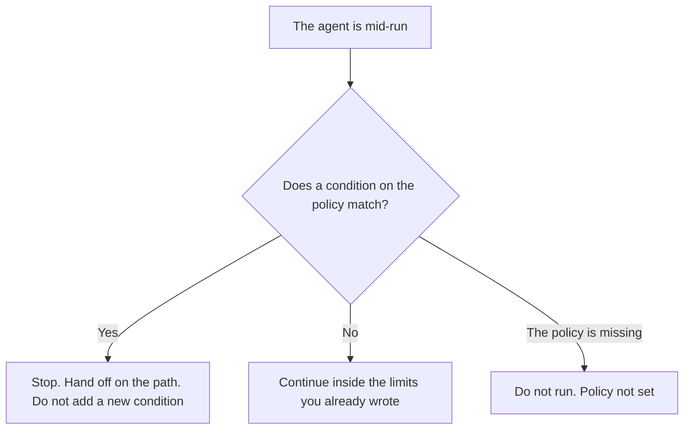

**An AI agent escalation policy is the document that lists the conditions under which an agent must stop and a person must take the run.** The conditions are written before the run starts. A refund over an amount you named, a missing tool result, a customer who asked for a person, a spend ceiling, or a rate-limit share that is already gone are the kind of lines the policy can hold. The agent does not add a condition mid-run.

The route after the stop, with a reason code and a queue, is [what an AI agent escalation path is](/blog/what-is-ai-agent-escalation-path-2026/). The moment a support case leaves the model is [what AI human escalation is](/blog/what-is-ai-human-escalation-2026/). Dollars that stop one run are [what an AI agent cost ceiling is](/blog/what-is-ai-agent-cost-ceiling-2026/). This page is the list of conditions, not the queue.

Claude's prices are the October 24, 2026 read of claude.com/pricing recorded in [Claude pricing explained](/blog/claude-pricing-explained-2026/). Notion and Zapier prices are from directory pages checked October 16, 2026. A live fetch of Zapier's pricing page returned HTTP 401 on October 24, 2026. Cursor's Plus price is the October 24 help-center figure recorded in [Cursor pricing explained](/blog/cursor-pricing-explained-2026/). Published October 24, 2026. We did not measure handoff time. The directory does not list an escalation-policy fee.

## What the policy has to list

| Line | Who writes it | A blank means |
|---|---|---|
| The condition | You | The agent decides in the moment |
| Stop or continue | You, and the default is stop when unsure | A guess looks like permission |
| Who is told | You, or Owner not set | The path has nobody to page |
| What the agent may still say | You, often nothing beyond the handoff | The agent keeps solving the case |
| When the policy was accepted | You | A draft is not in force |

The path says where the stopped run goes. The policy says which events require that stop. You can have a beautiful queue and no policy, which means the agent stops only when it feels like it. You can have a policy and a broken path, which means the run stops and nobody is told. Write both. Do not let one page pretend to be the other.

A support escalation matrix is a grid for human cases: severity, owner, and clock. It can be one input to this policy when the agent is on a help desk. It is not automatically the policy for a coding agent or a billing agent. Copy a condition across only when a person copies it.

## Where the policy is kept

**The sentence the agent must follow.** [Claude](/tools/claude/) Pro is $17 a month billed annually, $200 up front, or $20 monthly. Put the conditions in the Project. A later edit does not get to soften "stop" into "use your judgment." The review is [Claude review](/blog/claude-review-2026/).

**The page people can audit.** [Notion AI](/tools/notion-ai/) Business is $20 a seat a month on the October 16 card. The accepted date and the owner live on the page. Plus at $10 is not the full AI tier. The invoice is [Notion AI pricing explained](/blog/notion-ai-pricing-explained-2026/).

**The automation that might keep going.** [Zapier](/tools/zapier/) Professional is $19.99 a month billed annually, 750 tasks, on the October 16 card. A Zap that continues after a condition matches has ignored the policy. The task still counts. The invoice is [Zapier pricing explained](/blog/zapier-pricing-explained-2026/).

**The diff, if the condition is code.** [Cursor](/tools/cursor/) Plus is $8 a month, or $80 a year. You review a diff that deletes a stop. The individual ladder is [Cursor pricing explained](/blog/cursor-pricing-explained-2026/).

A prompt that holds the line:

"Compare this run to the escalation policy I pasted. If a condition matches, say Stop and quote the condition. If the policy is missing, write Policy not set. Do not invent a condition. Do not continue past a match."

## What not to delegate

Do not ask the model which cases "should" escalate. Do not let it shrink a dollar threshold so a run can finish. Do not treat a polite handoff sentence as proof the agent stopped. The owner named on the policy accepts the list.

## FAQ

### How is this different from an escalation path?

The path is the route after the stop: reason code, queue, person. The policy is the list of conditions that require the stop. A path with no policy is a hallway. A policy with no path is a stop that nobody hears.

### How is this different from human escalation?

Human escalation is the moment a support case leaves the model. The policy can require that moment, and it can also require a stop for a coding run, a spend ceiling, or a missing tool, where there is no customer on the line.

### How is this different from a cost ceiling?

The ceiling is one condition you might put on the policy: stop when this run's dollars hit a number. The policy can list other conditions that fire while the run is still cheap. Hitting the ceiling is not the only reason to stop.

### Who may change a condition?

The owner named on the page. A run that "made an exception" has violated the policy. Policy not set means the agent does not run.

## Last verified

October 24, 2026 for Claude and for Cursor's help page, via the posts cited above. October 16, 2026 for Notion and Zapier. Published October 24, 2026. Zapier's pricing page returned HTTP 401 on October 24. No escalation-policy fee is recorded in the directory.

**Sources:** [Claude pricing](https://claude.com/pricing), [Notion pricing](https://www.notion.com/pricing), [Zapier pricing](https://zapier.com/pricing), [Cursor pricing](https://cursor.com/help/account-and-billing/pricing).

*Published by Andrew for [AI Tools Optimizer](https://aitoolsoptimizer.com).*

[Claude](/tools/claude/) is in the [chatbots and assistants directory](/tools/category/chatbots-assistants/). Directory pages may use affiliate links. A purchase through them may earn us a commission at no extra cost to you.
