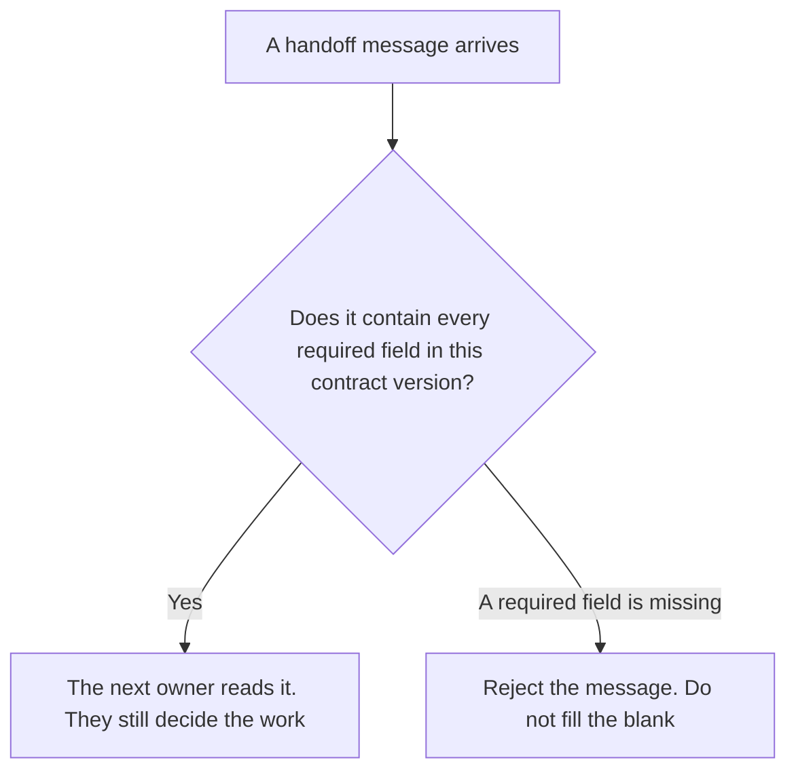

**An AI agent handoff contract is the agreement, written before the run, that names the fields a handoff must contain and what happens when one is missing.** The next owner rejects a message that breaks the contract. They do not guess the blank. The message itself, the payload, is [what an AI agent handoff protocol is](/blog/what-is-ai-agent-handoff-protocol-2026/). The list of conditions that stop a run is [what an AI agent escalation policy is](/blog/what-is-ai-agent-escalation-policy-2026/). The route after the stop is [what an AI agent escalation path is](/blog/what-is-ai-agent-escalation-path-2026/).

The contract is the promise. The protocol is the message that has to keep the promise. A complete-looking message that omits a required field is still a broken contract.

Claude's prices are the October 24, 2026 read of claude.com/pricing recorded in [Claude pricing explained](/blog/claude-pricing-explained-2026/). Notion and Cursor prices are from directory pages checked October 16, 2026. Cursor's Plus price was reconfirmed on the October 24 help page in [Cursor pricing explained](/blog/cursor-pricing-explained-2026/). Zendesk's seat prices are the ones the handoff-protocol article recorded from zendesk.com/pricing on October 24, 2026. Published October 24, 2026. We did not score handoffs. The directory does not list a handoff-contract fee.

## What the contract has to name

| Line | Who writes it | A blank means |
|---|---|---|
| The required fields | You | A shorter message looks valid |
| Which fields may be empty, and the token you use | You, or Field not set | The receiver invents a value |
| Who may send a handoff | A named role or agent | Any run can close itself by handing off |
| What a missing required field does | You: reject | A person accepts a partial story |
| The version of the contract | You | Two teams check different field lists |

The protocol page lists the kind of fields a payload carries: task id, what was done, what is open, what must not be repeated, who owns the next step. This page does not replace that list. It says the list is binding. If the contract says the task id is required and the message has a summary and no id, the message is invalid. A fluent summary is not an id.

The escalation policy says when the run must stop. The contract says the stop is not finished until the message meets the field list. A run can be inside the policy, because a person was supposed to take it, and still fail the contract, because the reason field is blank. Both checks stay.

## Where you would keep it

**The text of the contract.** [Claude](/tools/claude/) Pro is $17 a month billed annually, $200 up front, or $20 monthly. Keep the field list in a Project so a later edit cannot drop a required line without a person noticing. The review is [Claude review](/blog/claude-review-2026/).

**The page the next owner opens.** [Notion AI](/tools/notion-ai/) Business is $20 a seat a month on the October 16 card. Link the contract version and the date. Plus at $10 is not the full AI tier. The invoice is [Notion AI pricing explained](/blog/notion-ai-pricing-explained-2026/).

**A support seat, if the handoff is a ticket.** [Zendesk AI](/tools/zendesk-ai/) prices in the protocol article are from zendesk.com/pricing on October 24, 2026. This page does not add a new Zendesk dollar. A ticket that omits a required field is a rejected handoff, not a solved ticket. The protocol article is the payload. This article is the rule that rejects a short payload.

**The diff, if the check lives in code.** [Cursor](/tools/cursor/) Plus is $8 a month, or $80 a year, on the October 24 help page. You review a diff that makes a required field optional. The individual ladder is [Cursor pricing explained](/blog/cursor-pricing-explained-2026/).

A prompt that holds the line:

"Restate the handoff contract from the field list I pasted. If a field's rule is missing, write Field not set. Do not mark a field optional. Do not fill an example value."

## What not to delegate

Do not let the model decide a field is optional because most messages omit it. Do not accept a handoff because the prose is clear. Do not merge two contract versions in one message. The owner of the contract accepts a change to the field list.

## FAQ

### How is this different from a handoff protocol?

The protocol is the payload: the fields that travel. The contract is the agreement that a payload missing a required field is invalid. You can have a protocol and still have no contract, which means a short message gets through.

### How is this different from an escalation policy?

The policy lists the conditions that stop a run. The contract lists the fields the stop must carry. A run can meet the policy and still be rejected because the message is incomplete.

### What should a receiver do with a missing field?

Reject it, and leave the field as Field not set. Guessing a task id, a reason, or a next owner breaks the contract even if the guess is often right.

### Who may change the field list?

The owner named on the contract. A generated shorter list is not a new version. The version number changes only when that owner says it does.

## Last verified

October 24, 2026 for Claude, for Cursor's help page, and for the Zendesk figures via the handoff-protocol article. October 16, 2026 for Notion. Published October 24, 2026. No handoff-contract fee is recorded in the directory.

**Sources:** [Claude pricing](https://claude.com/pricing), [Notion pricing](https://www.notion.com/pricing), [Cursor pricing](https://cursor.com/help/account-and-billing/pricing), [Zendesk pricing](https://www.zendesk.com/pricing/).

*Published by Andrew for [AI Tools Optimizer](https://aitoolsoptimizer.com).*

[Claude](/tools/claude/) is in the [chatbots and assistants directory](/tools/category/chatbots-assistants/). Directory pages may use affiliate links. A purchase through them may earn us a commission at no extra cost to you.
