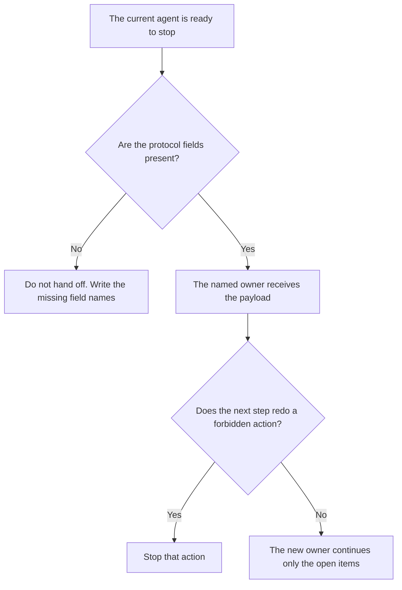

**An AI agent handoff protocol is the list of fields that must travel when one agent stops and another agent, or a person, takes the task: what was done, what is open, what must not be repeated, and who owns the next step.** A customer chat that moves to a human is [what an AI conversation handoff is](/blog/what-is-ai-conversation-handoff-2026/). The policy for when a person must take over is [what AI human escalation is](/blog/what-is-ai-human-escalation-2026/). The store that keeps state between sessions is [what an AI agent memory store is](/blog/what-is-ai-agent-memory-store-2026/). The protocol is the message. The store is not a substitute for the message.

Claude's prices are from claude.com/pricing on October 24, 2026. Zendesk prices below are from zendesk.com/pricing on October 24, 2026. Intercom and Notion prices are from directory pages checked October 16, 2026. Published October 24, 2026. We did not score handoffs. This page does not invent a protocol fee.

## The fields the next owner must see

| Field | The next owner can do | A missing field means |
|---|---|---|
| Task id and the schema version of this message | Find the same task | Do not guess which ticket |
| What already ran, including tool calls | Avoid repeating a charge or a send | List it as Not recorded |
| What is still open | Continue only those items | Status unknown, stop |
| What must not be redone | Leave that action alone | Do not "try again to be safe" |
| The next owner | A person or a named agent | Owner missing. Do not pick one |

A summary paragraph is not a protocol. "I looked into it and the customer seems upset" drops the task id and the actions already taken. The connector shape some tools use to pass context is [what the Model Context Protocol is](/blog/what-is-model-context-protocol-2026/). A connector can carry the payload. It does not decide which fields are required. You do.

## Where the payload is written

**The draft of the message.** [Claude](/tools/claude/) Pro is $17 a month billed annually, $200 up front, or $20 monthly. Paste the actions and the open items. Ask for the fields, not a story. The review is [Claude review](/blog/claude-review-2026/).

**A support queue.** [Zendesk AI](/tools/zendesk-ai/) Suite Team is $55 an agent a month paid yearly on the October 24 pricing page, and Support Team is $19 on that same yearly view. The handoff inside a ticket still needs the fields. A macro is not the protocol. The invoice is [Zendesk AI pricing explained](/blog/zendesk-ai-pricing-explained-2026/).

**An outcome-priced agent.** [Intercom Fin](/tools/intercom-fin/) is $49 a month base including 50 outcomes, then $0.99 an outcome, on the October 16 card. A handoff to a person should be visible as a handoff, not as a resolved outcome you did not define. The invoice is [Intercom Fin pricing explained](/blog/intercom-fin-pricing-explained-2026/).

**The page the owner opens.** [Notion AI](/tools/notion-ai/) Business is $20 a seat a month if the protocol template lives there. The template is the checklist. The chat is not the record.

A prompt that holds the line:

"Fill the handoff fields from the log I pasted. If a field is not in the log, write Missing. Do not recommend a next action that the log does not already name. Do not mark the task done."

## What not to delegate

Do not let the receiving agent invent the open items. Do not store the payload only in a memory the next session might not load. Do not call a friendly summary a complete handoff.

## FAQ

### How is this different from a conversation handoff?

A conversation handoff is the customer-visible transfer, often from a bot to a person, with the transcript. This protocol is the required payload for any move of work, including one agent to another, where no customer is watching. A support chat can need both. The transcript does not replace the "do not redo" list.

### How is it different from memory?

Memory is what a later session might recall. A handoff is a message you send now, with fields you can check. If the memory store is down, the handoff message should still be enough to continue or to stop safely.

### Can the protocol be a PDF?

It can be a page, a ticket comment, or a JSON object. The form matters less than the fields and the owner. A PDF nobody opens is a failed handoff even if every field is in it.

### Who may accept the handoff?

The owner named in the payload. A model that says "I'll take it from here" has not accepted anything. A person, or a system your policy names, accepts.

## Last verified

October 24, 2026 for Claude and Zendesk. October 16, 2026 for Intercom Fin and Notion. No handoff-protocol fee is recorded in the directory. Published October 24, 2026.

**Sources:** [Claude pricing](https://claude.com/pricing), [Zendesk pricing](https://www.zendesk.com/pricing/), [Intercom Fin](https://fin.ai), [Notion pricing](https://www.notion.com/pricing).

*Published by Andrew for [AI Tools Optimizer](https://aitoolsoptimizer.com).*

[Claude](/tools/claude/) is in the [chatbots and assistants directory](/tools/category/chatbots-assistants/). Directory pages may use affiliate links. A purchase through them may earn us a commission at no extra cost to you.
