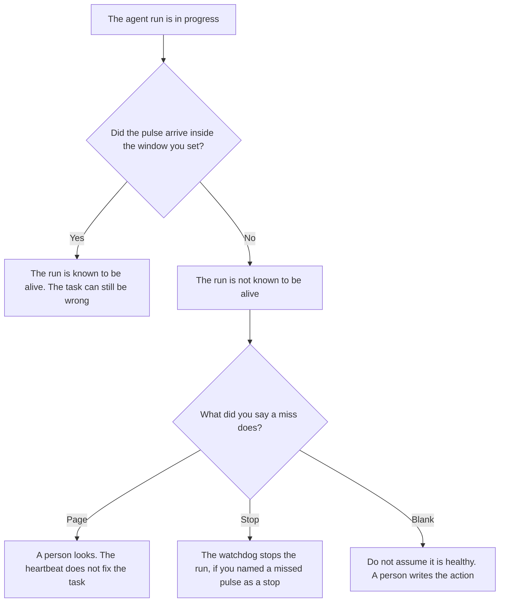

**An AI agent heartbeat is a signal the run must emit on a clock you already set, so a missing signal means the run is not known to be alive.** The signal can be a timestamp, a step id, and nothing else. It does not prove the task was wise. It proves the process could still speak. Silence of actions, with no tool call and no message, is [what an AI agent idle timeout is](/blog/what-is-ai-agent-idle-timeout-2026/). A stop for a dollar ceiling, a loop, or a forbidden tool is [what an AI agent watchdog is](/blog/what-is-ai-agent-watchdog-2026/).

A save of a step that already changed something is [what an AI agent checkpoint is](/blog/what-is-ai-agent-checkpoint-2026/). A checkpoint can exist with no heartbeat. A heartbeat can fire on a run that has not checkpointed yet. The route when a person must take the work is [what an AI agent escalation path is](/blog/what-is-ai-agent-escalation-path-2026/).

Cursor's company seats and Plus price are from the help center recorded October 24, 2026 in [Cursor Business pricing explained](/blog/cursor-business-pricing-explained-2026/). Claude's prices are from claude.com/pricing that day. ChatGPT's Plus price is from the October 24 plan page recorded in [ChatGPT pricing explained](/blog/chatgpt-pricing-explained-2026/). GitHub Copilot's Business price is the October 16 directory card, restated in the watchdog article. Published October 24, 2026. We did not time how fast a missed pulse is noticed. No heartbeat fee is listed on those pages.

## What the heartbeat has to say

| Line | Who writes it | A blank means |
|---|---|---|
| How often the pulse must arrive | You, as a number of seconds or minutes | Any gap can look healthy |
| What the pulse contains | You: at least a timestamp and a run id | A log line with no run id is not a pulse |
| Who watches for a miss | You | The run is the only thing that knows it stalled |
| What a miss does | You: page a person, or let the watchdog stop the run | A miss is only a log line nobody reads |
| The clock | You | A tool's own timeout is mistaken for this pulse |

A tool call that is still running is not idle, so an idle timeout does not fire. The process can still be stuck inside that call and unable to emit a pulse. That is why the heartbeat exists beside the idle clock. The tool's own deadline remains [what an AI tool timeout is](/blog/what-is-ai-tool-timeout-2026/). Three clocks can be true at once: the tool has not timed out, the run is not idle, and the heartbeat is late.

The pulse does not contain the tool's output. If you put customer text in the heartbeat, you have built a second log. Keep the pulse small. A missed pulse is not by itself an incident report. The escalation path says who reads it.

## Where the clock is kept

**The definition of the window.** [Claude](/tools/claude/) Pro is $17 a month billed annually, $200 up front, or $20 monthly. The Project holds the window, the payload, and the miss action. The review is [Claude review](/blog/claude-review-2026/).

**The diff, if the pulse lives next to the agent loop.** [Cursor](/tools/cursor/) Plus is $8 a month, or $80 a year, on the October 24 help page. You review a diff that lengthens the window. Teams seats on that page are $30, $100, or $200 a seat a month. The ladder is [Cursor pricing explained](/blog/cursor-pricing-explained-2026/).

**One run's note, from a paste.** [ChatGPT](/tools/chatgpt/) Plus is $20 a month. Discard a version that adds a quality judgment to the pulse. The ladder is [ChatGPT pricing explained](/blog/chatgpt-pricing-explained-2026/).

**The company seat, if the agent is in the editor.** [GitHub Copilot](/tools/github-copilot/) Business is the October 16 directory card the watchdog article already cites. This page does not add a new Copilot dollar. Read that card before you quote a seat.

A prompt that holds the line:

"Draft the heartbeat row from the window, the payload, and the miss action I pasted. If the window is missing, write Window not set. Do not invent a timeout. Do not say the task succeeded."

## What not to delegate

Do not ask the model how often a healthy agent should speak. Do not treat a checkpoint as a pulse. Do not ignore a miss because a tool call is "probably still working." The owner of the run sets the window. A generated log line is not a heartbeat.

## FAQ

### How is this different from an idle timeout?

Idle timeout ends a run after a stretch with no new action: no tool call started, no message, no state write. A heartbeat is a signal the run must send even while a tool call is in flight. A stuck tool is not idle, and it can still miss a pulse. Write both clocks.

### How is this different from a watchdog?

The watchdog stops the run, or pages a person, when a condition you named is true. A missed heartbeat can be one of those conditions. The heartbeat is the pulse. The watchdog is the stop. A pulse with no watcher is a log. A watchdog with no pulse can still stop on a dollar ceiling.

### How is this different from a checkpoint?

A checkpoint records that a step already changed something, so a retry does not do it twice. A heartbeat records that the process could speak at a time you required. A run can pulse before it has anything to checkpoint. A checkpoint can be written by a run that then goes silent. Keep both when the run can change the world.

### Who may change the window?

The person named on the row. Lengthening the window is a new version, with a date. A late pulse under the old window stays a miss. The model does not widen the window after a stall.

## Last verified

October 24, 2026 for Cursor's help page, for Claude, and for ChatGPT's plan page, via the posts cited above. October 16, 2026 for the GitHub Copilot figure as used on the watchdog page. Published October 24, 2026.

**Sources:** [Cursor pricing](https://cursor.com/help/account-and-billing/pricing), [Claude pricing](https://claude.com/pricing), [ChatGPT and Codex pricing](https://learn.chatgpt.com/docs/pricing).

*Published by Andrew for [AI Tools Optimizer](https://aitoolsoptimizer.com).*

[Cursor](/tools/cursor/) is in the [coding directory](/tools/category/coding/). Directory pages may use affiliate links. A purchase through them may earn us a commission at no extra cost to you.
