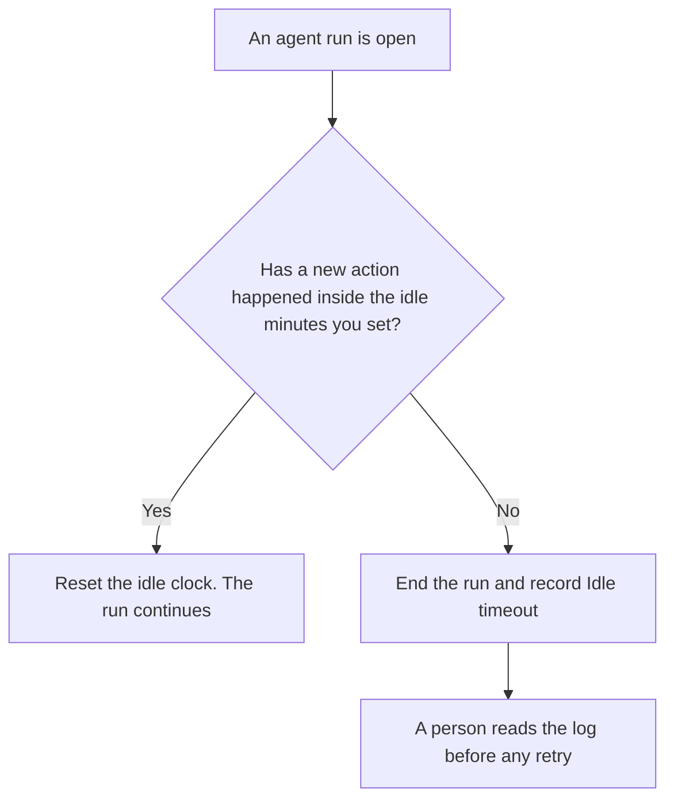

**An AI agent idle timeout is a clock that ends an agent run when the run has produced no new action for a number of minutes you already set.** Idle means silence: no tool call started, no message emitted, no state write. A tool call that is still running is not idle. That call has its own clock, which is [what an AI tool timeout is](/blog/what-is-ai-tool-timeout-2026/). A stop for a dollar ceiling, a tool-call count, or a forbidden tool is [what an AI agent watchdog is](/blog/what-is-ai-agent-watchdog-2026/).

How much prior context the run may keep is a different budget. That one is [what an AI session memory budget is](/blog/what-is-ai-session-memory-budget-2026/). This page is the silence clock only.

Cursor's company seats and Plus price are from the help center recorded October 24, 2026. Claude's prices are from claude.com/pricing that day. ChatGPT's Plus price is from learn.chatgpt.com/docs/pricing that day. GitHub Copilot's Business price is the October 16 directory card. Published October 24, 2026. We did not time how fast a stop fires. No idle-timeout fee is listed on those pages.

## What counts as idle

| What the run is doing | Idle? | Why |
|---|---|---|
| Waiting, with no call in flight and no new message | Yes, the clock runs | Silence is the condition |
| A tool call still inside its own timeout | No | The call is an action. Do not double-count it as idle |
| The model emitting tokens | No | Output is an action |
| A person has not answered a permission prompt | Your policy says | Write it down. Do not let the model decide |

If you did not write the minutes, you do not have an idle timeout. You have a run that ends when the vendor does. Record Vendor default, not measured, rather than inventing a number. A watchdog can include this clock as one of its stop conditions. The idle rule is still the silence rule. It does not absorb the dollar ceiling.

## Where you would set it

**The editor agent.** [Cursor](/tools/cursor/) Plus is $8 a month, or $80 a year, on the October 24 help page. Teams seats are $30, $100, or $200 a seat a month on that page. A cloud agent that can sit quietly is the run this clock is for. The company-seat article is [Cursor business pricing explained](/blog/cursor-business-pricing-explained-2026/).

**A scheduled Claude task.** [Claude](/tools/claude/) Pro is $17 a month billed annually, $200 up front, or $20 monthly. Scheduling is on that Pro list. A schedule without an idle clock can leave a task open. The review is [Claude review](/blog/claude-review-2026/).

**The sentence that states the minutes.** [ChatGPT](/tools/chatgpt/) Plus is $20 a month. Use it to phrase the rule. It does not sit on the agent. The ladder is [ChatGPT pricing explained](/blog/chatgpt-pricing-explained-2026/).

**The company coding seat.** [GitHub Copilot](/tools/github-copilot/) Business is $19 a user a month on the October 16 card. The seat does not fill in your minutes. The invoice is [GitHub Copilot Business pricing explained](/blog/github-copilot-business-pricing-explained-2026/).

A prompt that holds the line:

"Write the idle-timeout rule from the minutes I pasted, and state that a tool call still in flight is not idle. If the minutes are missing, write Minutes not set. Do not add a dollar limit. That belongs on the watchdog."

## What not to delegate

Do not let the model pick the minutes. Do not treat a stopped idle run as a failed task. It is a run that went quiet. Do not auto-retry. A person starts the next run, after reading the last action.

## FAQ

### How is this different from a watchdog?

The watchdog enforces whatever stop you named: dollars, tool-call count, a forbidden tool, or this clock. The idle timeout is only the silence clock. You can run a watchdog that does not include idle, and you can have an idle clock that is the only stop. Name which one fired.

### How is this different from a tool timeout?

The tool timeout ends one call that ran too long. The idle timeout ends a run that has done nothing new. A long call should be covered by the tool clock, and it should not also trip idle while it is in flight. If your system cannot tell those apart, write that gap on the page. Do not pretend they are one timer.

### How is this different from a session memory budget?

The memory budget limits how much prior context the run keeps. The idle timeout limits how long the run may sit without an action. A run can be under the memory budget and still go idle. A run can be busy and over the memory budget. They trip for different reasons.

### Who sets the minutes?

The person who owns the agent in that environment. Put the number in the config a reviewer can see. A chat message that says "about ten minutes" is not the config.

## Last verified

October 24, 2026 for Cursor's help center, for Claude, and for ChatGPT's plan page. October 16, 2026 for GitHub Copilot. Published October 24, 2026.

**Sources:** [Cursor pricing](https://cursor.com/help/account-and-billing/pricing), [Claude pricing](https://claude.com/pricing), [ChatGPT and Codex pricing](https://learn.chatgpt.com/docs/pricing), [GitHub Copilot](https://github.com/features/copilot).

*Published by Andrew for [AI Tools Optimizer](https://aitoolsoptimizer.com).*

[Cursor](/tools/cursor/) is in the [coding directory](/tools/category/coding/). Directory pages may use affiliate links. A purchase through them may earn us a commission at no extra cost to you.
