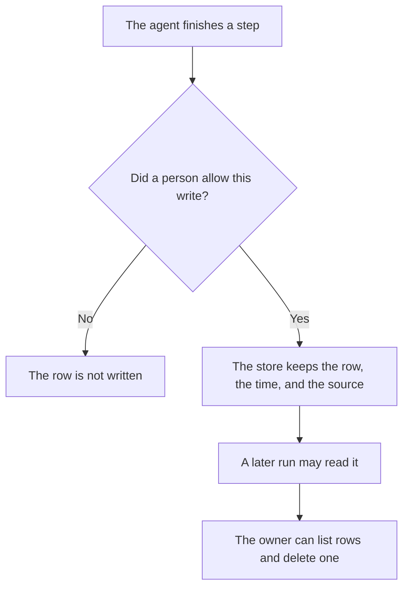

**An AI agent memory store is a store an agent can read on a later run, and write during this one, where a person can list the rows and delete one.** Product memory that saves a note about the user is [what AI memory is](/blog/what-is-ai-memory-2026/). That note is about you. The agent memory store is about the work: the account id a person approved, the last tool status, the open task. If you cannot list the rows, the agent has a hidden transcript, not a store.

The tape of a single run is [what AI session replay for agents is](/blog/what-is-ai-session-replay-for-agents-2026/). The ask before a tool writes a row is [what an AI tool permission prompt is](/blog/what-is-ai-tool-permission-prompt-2026/). The folder you curate yourself, which the agent should not silently edit, is [what a system of record for AI is](/blog/what-is-a-system-of-record-for-ai-2026/).

Claude's prices are from claude.com/pricing on October 24, 2026. Notion, ChatGPT, and OpenClaw figures are from directory pages checked October 16, except OpenClaw's $0 software line, which the project site still stated on October 24. chatgpt.com/pricing returned HTTP 403 that day. Published October 24, 2026. We did not score what agents remember. No separate memory-store fee is recorded in the directory.

## What may be stored

| Row | A person may approve it when | It does not belong in the store when |
|---|---|---|
| An id the next run must reuse | The id is already in the system of record, and the row points at it | The agent invented an id |
| A status | It matches the last tool result on the tape | It is a guess about why the task failed |
| A preference the user stated | The user can see and delete it | It was inferred from a document they uploaded once |
| A secret | Almost never | The row would have to hold the secret itself. Point at a vault, or do not store it |

Replay answers "what happened in that run." The memory store answers "what is this agent allowed to assume next time." Mixing them means a one-time tool error becomes a fact. Write a retention date on the row. A status from a finished project should expire.

Grok Bot's docs, fetched October 24, 2026, say a Bot keeps stable preferences, role context, and summaries of prior work, and that conversations stay separate per Bot while files and browser sessions are shared. That is a vendor's memory model, not a definition of your store. Ask the Bot to check the current source for a decision, which is the same page's instruction. The price of access is [Grok Bot pricing explained](/blog/grok-bot-pricing-explained-2026/).

## Where the rows live

**A Project you can open.** [Claude](/tools/claude/) Pro is $17 a month billed annually, $200 up front, or $20 monthly. A Project holds files you put there. That is a curated folder. Call it the memory store only if the agent writes rows you can see and delete. The review is [Claude review](/blog/claude-review-2026/).

**The wiki, if that is the record.** [Notion AI](/tools/notion-ai/) Business is $20 a seat a month. The page is the row. A chat memory that disagrees with the page loses. The invoice is [Notion AI pricing explained](/blog/notion-ai-pricing-explained-2026/).

**One list, from a paste.** [ChatGPT](/tools/chatgpt/) Plus is $20 a month on the October 16 card. The product's own memory feature, on that card, is a saved note about you. Do not treat it as the agent's work log. The review is [ChatGPT review](/blog/chatgpt-review-2026/).

**Hardware you run.** [OpenClaw](/tools/openclaw/) is $0 for the software. The October 16 directory says state and memory stay on your hardware by default, with prompts going to the providers you configure. The schema of that store is your install's. The invoice is [OpenClaw pricing explained](/blog/openclaw-pricing-explained-2026/).

A prompt that holds the line:

"List the rows I pasted. Mark any row that is a guess rather than a source I named. Do not add a row. Do not store a secret that appears in the paste. Say Secret present instead."

## What not to delegate

Do not let the agent write a customer fact the CRM does not have. Do not use the store as the only copy of a decision. Do not skip deletion rights because the agent "needs continuity." Continuity without deletion is a record you cannot correct.

## FAQ

### How is this different from AI memory?

AI memory, on the other page, is a note the chat product saves about the user. An agent memory store is rows about the work, written so a later run can read them, with a person who can delete a row. A product can have both. They should not share one unlabeled bucket.

### How is this different from session replay?

Replay is the tape of one run. The store is what survives into the next run. A tape can be evidence for a row. The row should cite the tape, not replace it.

### Can the store hold the whole transcript?

It can, and then it is a transcript archive. That is allowed if the retention rule says so. It is a poor memory store, because the next run will not know which line is current. Prefer a row with a source and a date.

### Who may delete a row?

The owner named on the store. The agent does not delete a row because a newer chat contradicted it. A person deletes it, or a retention date deletes it.

## Last verified

October 24, 2026 for Claude, Grok Bot's overview, and OpenClaw's project site. October 16, 2026 for Notion and ChatGPT. Published October 24, 2026.

**Sources:** [Claude pricing](https://claude.com/pricing), [Grok Bot overview](https://docs.x.ai/grok-bot/overview), [Notion pricing](https://www.notion.com/pricing), [ChatGPT pricing](https://chatgpt.com/pricing/), [OpenClaw](https://openclaw.ai).

*Published by Andrew for [AI Tools Optimizer](https://aitoolsoptimizer.com).*

[OpenClaw](/tools/openclaw/) is in the [automation and agents directory](/tools/category/automation-agents/). Directory pages may use affiliate links. A purchase through them may earn us a commission at no extra cost to you.
