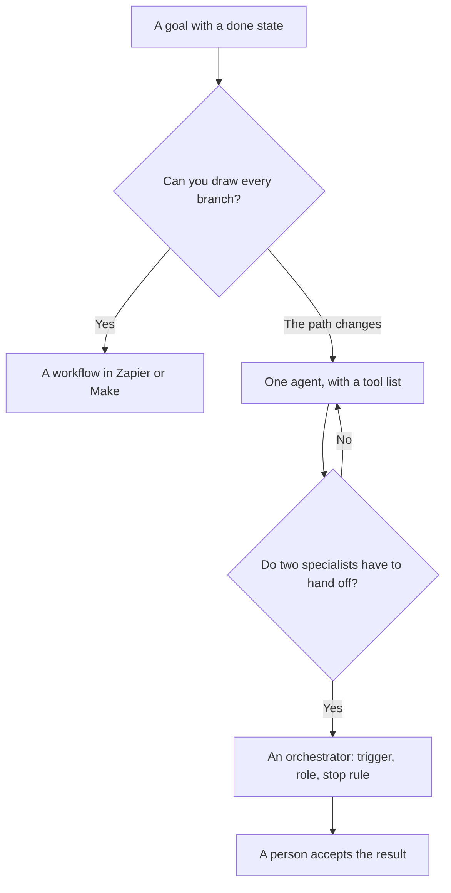

**AI agent orchestration is the layer that decides which step runs next, which agent or workflow runs it, and when the work stops.** One agent takes a goal and uses tools. An orchestrator assigns goals to more than one worker, or to a mix of agents and fixed workflows, and collects the result. If you cannot name the handoff, you have a chatbot with extra steps, and you are calling it a platform.

A single agent is [what an AI agent is](/blog/what-is-an-ai-agent-2026/). A workflow you drew in advance is a different object: the path does not change. Orchestration is how those pieces get a turn. The tool-call underneath an agent step is [what function calling is](/blog/what-is-function-calling-in-ai-2026/).

Prices are US list prices excluding tax from directory pages checked October 16, 2026. Published October 24, 2026. We did not score how often a multi-agent setup finishes the task.

## One worker, or a conductor

| Setup | Who decides the next step | A directory match | Price to know |
|---|---|---|---|
| You drew every branch | The diagram you saved | [Zapier](/tools/zapier/) or [Make](/tools/make/) | Zapier Professional is $19.99/month annually for 750 tasks. Make Core is from $9/month annually for 10,000 credits |
| One agent, several tools | That agent, inside limits you set | [Lindy](/tools/lindy/) | Team is from $49.99/month for 5,000 credits |
| A teammate that runs when a trigger fires | The trigger, then the agent | [Notion AI](/tools/notion-ai/) Custom Agents | Business is $20/seat/month. Custom Agent credits are $10 per 1,000 after the trial |
| Several role-shaped agents on one job | A product that routes among them | [Relevance AI](/tools/relevance-ai/) | Pro is $19/month billed annually |
| A person in the middle | You | A chat, plus a checklist | The cheapest orchestrator, and the right one until the handoff is boring |

n8n's cloud plans were shown in euros on October 16, 2026: Starter at €20/month billed annually for 2,500 executions. This page does not convert that euro price into dollars. The workflow comparison is [Zapier vs Make vs n8n](/blog/zapier-vs-make-vs-n8n/). The agent products that sit beside fixed workflows are [Zapier alternatives for AI workflows](/blog/zapier-alternatives-for-ai-workflows-2026/).

## What an orchestrator has to name

**The done state.** "Research the account" is a mood. "A one-page brief with three public facts, each with a link, or 'not found'" is a done state. The orchestrator stops when that page exists. An agent that keeps browsing is a meter.

**The handoff.** Agent A drafts. Agent B checks the draft against a policy doc. A person sends. Write those three roles down before you connect accounts. A tool that can both draft and send will do both the first time the prompt is loose.

**The tool list.** Each worker should have the minimum tools. A research step that can also edit the CRM will edit the CRM. Function calling is the mechanism. Your allow-list is the control.

**The stop.** A maximum number of steps, a maximum spend, and a human on anything that leaves the building: an email, a refund, a code merge. Notion's Custom Agents run on credits after the trial. Lindy's Team plan is a credit pool. Zapier counts tasks. Pick the meter you can read on a Thursday.

Building one agent before you orchestrate two is [how to create an AI agent without coding](/blog/how-to-create-an-ai-agent-without-coding/). Notion's credit line is [Notion AI pricing explained](/blog/notion-ai-pricing-explained-2026/).

## Where orchestration adds cost and hides a simple Zap

**Two agents are doing one workflow.** If the path never changes, draw it in Zapier or Make. You will pay for tasks you can count. You will also see the branch. An agent bill for a path you could have drawn is the expensive version of a flowchart.

**The handoff drops the source.** Agent A found a link. Agent B wrote a paragraph without the link. Require the link in the object that passes between them. A retrieval step that does not travel with the draft is how a sourced fact becomes a vibe. The chat version of that failure is [what retrieval-augmented chat is](/blog/what-is-retrieval-augmented-chat-2026/).

**Nobody owns the failure.** When three agents touch a customer email, the person who sends it still owns it. Put that name in the design. An orchestrator is an assignment system. It is a weak alibi.

**Credits stack.** A workflow product plus an agent product plus a chat seat is three meters for one brief. Start with the diagram. Add an agent at the step where the path actually changes.

## FAQ

### Is orchestration the same as an AI agent?

An agent does a job. Orchestration assigns jobs, passes the output, and stops the set. One agent can be enough. Orchestration starts when you need a handoff you can point at.

### Should I buy a multi-agent platform first?

Buy it when you already have two steps and the handoff is failing in a document. A platform demo with five agents on a blank workspace produces a bill and a transcript. The first build is one trigger, one worker, one human stop.

### Do Zapier and Make count as orchestration?

They orchestrate steps you drew. They are the right orchestrator when the branches are known. They are a poor fit when the next step depends on reading an unstructured mess and choosing a tool. That is the agent case.

### How do I keep an orchestrated system from emailing a customer?

Leave "send" off the tool list until a person clicks send. A draft in a doc is the safe output. A connected inbox is a later project, with a named owner.

## Last verified

October 16, 2026 for Zapier, Make, n8n, Lindy, Notion, and Relevance AI prices. Published October 24, 2026.

**Sources:** [Zapier pricing](https://zapier.com/pricing), [Make pricing](https://www.make.com/en/pricing), [Lindy pricing](https://www.lindy.ai/pricing), [Notion AI](https://www.notion.com/product/ai).

*Published by Andrew for [AI Tools Optimizer](https://aitoolsoptimizer.com).*

[Zapier](/tools/zapier/) and [Lindy](/tools/lindy/) are in the [automation directory](/tools/category/automation-agents/). Directory pages may use affiliate links. A purchase through them may earn us a commission at no extra cost to you.
