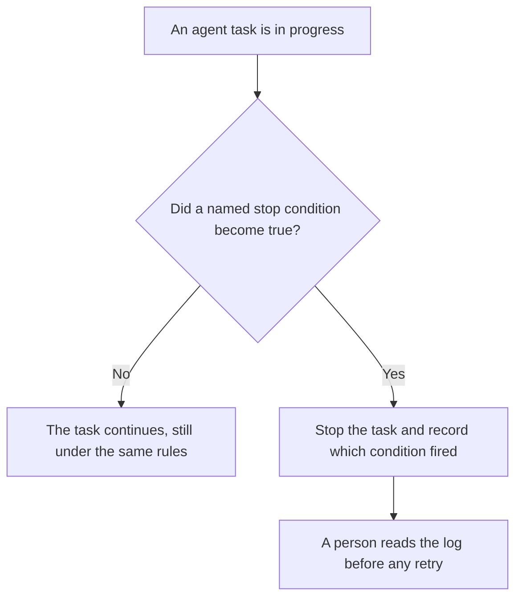

**An AI agent watchdog is a check that runs beside a live agent task and stops that task, or pages a person, when a condition you already named is true.** Typical conditions are a tool-call loop, a dollar ceiling, a minute limit, or a tool the run was told not to use. The watchdog does not decide the task was wise. It only enforces the stop. A bill that looks wrong after the fact is [what an AI cost anomaly alert is](/blog/what-is-ai-cost-anomaly-alert-2026/). The record of what the agent did is [what AI session replay for agents is](/blog/what-is-ai-session-replay-for-agents-2026/).

The yes before one tool call is [what an AI tool permission prompt is](/blog/what-is-ai-tool-permission-prompt-2026/). Passing the work to a person is [what an AI agent handoff protocol is](/blog/what-is-ai-agent-handoff-protocol-2026/).

Cursor's company seats are from the help center fetched October 24, 2026. Claude's seat prices are from claude.com/pricing that day. GitHub Copilot and ChatGPT prices are from directory pages checked October 16, 2026. chatgpt.com/pricing returned HTTP 403 on October 24. Published October 24, 2026. We did not time how fast a stop fires.

## What the watchdog is allowed to do

| The condition you wrote | The watchdog may | The watchdog may not |
|---|---|---|
| More than N tool calls in this task | Stop the task and say why | Raise N because the task "looks close" |
| A dollar or token ceiling for this run | Stop when the meter you named crosses it | Estimate a cheaper model and keep going |
| A wall-clock limit | Stop and hand the log to a person | Mark the task done |
| A tool that is forbidden for this run | Stop before that call | Ask the person later and call it anyway |

A watchdog with no named condition is a log. A log does not stop a loop. Write the number, the tool name, or the clock limit before the run starts. If the condition is "if it seems stuck," you do not have a condition. You have a hope.

## Where you would put one

**The editor agent.** [Cursor](/tools/cursor/) Teams seats are $30, $100, or $200 a seat a month on the October 24 help page, matching the usage tier. A cloud agent that can keep editing is the run a watchdog is for. Plus at $8 a month, or $80 a year, is an individual plan and the same page says it does not include Cloud Agents. The individual ladder is [Cursor pricing explained](/blog/cursor-pricing-explained-2026/).

**A long Claude task.** [Claude](/tools/claude/) Pro is $17 a month with annual billing, $200 up front, or $20 monthly, on the October 24 pricing page. Scheduling a task is on that Pro list. A schedule without a stop condition is how a task runs again. The review is [Claude review](/blog/claude-review-2026/).

**The company coding seat.** [GitHub Copilot](/tools/github-copilot/) Business is $19 a user a month on the October 16 card. The watchdog is still your rule. The seat does not ship one with a number filled in. The invoice is [GitHub Copilot Business pricing explained](/blog/github-copilot-business-pricing-explained-2026/).

**The sentence that names the stop.** [ChatGPT](/tools/chatgpt/) Plus is $20 a month on the October 16 card. Use it to phrase the condition. It does not sit on the agent and halt the call.

A prompt that holds the line:

"Write the watchdog rule from the limit I pasted: the tool-call count, the dollar ceiling, or the minute limit. If a number is missing, write Limit not set. Do not add a limit I did not write."

## What not to delegate

Do not let the model pick the ceiling. Do not treat a green log as proof the stop works. Run one task you expect to trip the rule, and read that it stopped. Do not retry automatically. A retry is a new task, and a person starts it.

## FAQ

### How is this different from a cost anomaly alert?

The alert looks at spend after it has moved, often across tasks. The watchdog is inside one live run, and it stops that run. You can have both. An alert does not unwind the calls that already happened. A watchdog is there so the next call does not.

### How is this different from a permission prompt?

The prompt asks a person about one call before it runs. The watchdog watches the run after calls have started, against a limit you set in advance. A yes on one call does not raise the ceiling.

### Does the watchdog decide the task succeeded?

No. It decides a stop condition fired, or that it did not. Success is a person reading the result. A stopped run is not a failed product. It is a run that hit the rule.

### Who sets the number?

The person who owns the agent in that environment. A shared login has no owner. Put the number in the config a reviewer can see, not in a chat that disappears.

## Last verified

October 24, 2026 for Cursor's help center and for Claude. October 16, 2026 for GitHub Copilot and ChatGPT. No watchdog fee is listed on those pages. Published October 24, 2026.

**Sources:** [Cursor pricing](https://cursor.com/help/account-and-billing/pricing), [Claude pricing](https://claude.com/pricing), [GitHub Copilot](https://github.com/features/copilot), [ChatGPT pricing](https://chatgpt.com/pricing/).

*Published by Andrew for [AI Tools Optimizer](https://aitoolsoptimizer.com).*

[Cursor](/tools/cursor/) is in the [coding directory](/tools/category/coding/). Directory pages may use affiliate links. A purchase through them may earn us a commission at no extra cost to you.
