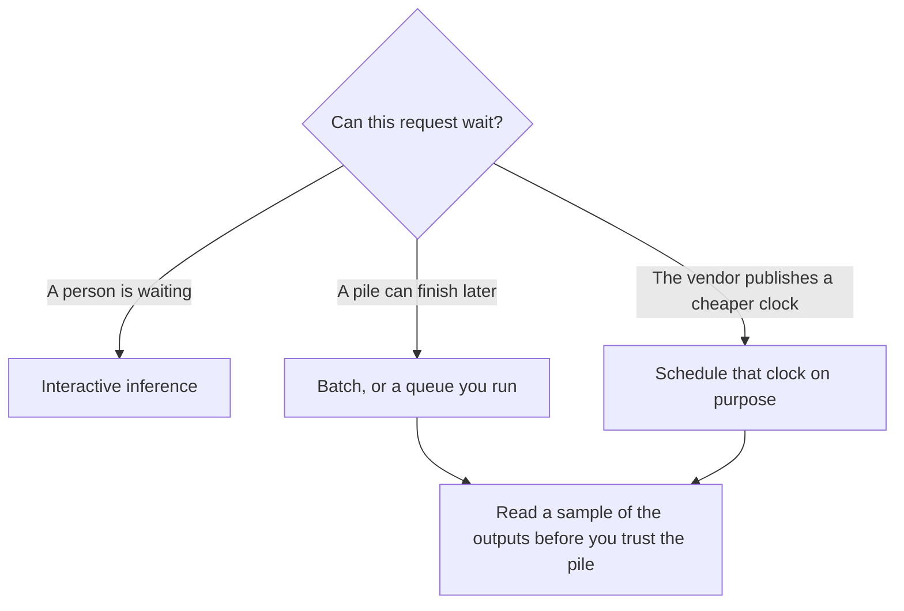

**Batch inference is a way to run many model requests that are allowed to wait, instead of answering one person who is sitting there.** You send a pile. The vendor, or your own queue, works through it. The person at a keyboard is a different job. Mixing the pile onto the live endpoint is how a chat user inherits a queue they did not join.

The work itself is still [inference, not training](/blog/what-is-ai-inference-vs-training-2026/). The two clocks are [latency versus throughput](/blog/what-is-ai-latency-vs-throughput-2026/). The bill is still counted in [tokens](/blog/what-are-ai-tokens-explained-2026/).

Prices below are US list prices from directory pages checked October 16, 2026. Published October 24, 2026. This page does not publish a universal "batch is half off" rule. A discount exists only when that vendor's card says so.

## What you are choosing

| Path | Who is waiting | What you optimize | A bad fit |
|---|---|---|---|
| Interactive | A person, or a UI that must respond now | Time to the first useful token | A folder of 10,000 documents |
| Batch | Nobody, until the pile is done | Finished requests per dollar | A support chat |
| Scheduled off-peak | A job you can move to a cheaper clock | The vendor's published off-peak window | A request that must finish during the expensive hours |
| A context cache | A repeated prefix on later calls | Not re-paying for the same prefix | A one-off prompt with no shared prefix |

A batch is not a smarter model. It is the same model, or a model you chose, with a looser deadline. If the answers are wrong one at a time, they are wrong in a file of ten thousand. The check is [what AI eval testing is](/blog/what-is-ai-eval-testing-2026/). Read the failures. Do not average them into a vibe.

## Two discounts people mix up

**A published batch price.** The [ChatGPT Images](/tools/dall-e/) directory page records GPT-Image-2.5 Sunburst at $8 per million image input tokens and $30 per million image output tokens on standard processing, and it says Batch is half price on that card. That is an image API. It is not a rule for every chat model. DALL·E 2 and DALL·E 3 were removed from OpenAI's API on May 12, 2026. New image calls use the GPT Image models. The seat that draws one picture in chat is a different product: [ChatGPT](/tools/chatgpt/) Free includes limited image creation. Plus is $20. The API key is not included in that seat. The split is [what an API for AI tools is](/blog/what-is-an-api-for-ai-tools-2026/).

**A cheaper clock that is not a batch product.** [DeepSeek](/tools/deepseek/) Flash is $0.30 input and $1.20 output per million tokens at peak, and half of that off-peak, on the directory card. The chat app is free. Off-peak is a schedule. It is not the same sentence as "submit a batch file." The directory records peak hours as 01:00–04:00 and 06:00–10:00 UTC on weekdays. A job that runs inside that window by accident pays peak. The review is [DeepSeek review](/blog/deepseek-review-2026/). Data governance is part of the choice: DeepSeek is a China-based company, and the directory says to check the docs before you build.

[Claude](/tools/claude/) Pro is $20 a month, or $17 billed annually. That seat is interactive chat and, on Pro, Claude Code. It is not a batch discount. If a vendor's docs mention a batch endpoint, the docs win. This page will not invent one for Claude.

A repeated prefix is a third trick. Caching the prefix does not make the job a batch. The definition is [what a context cache is](/blog/what-is-a-context-cache-2026/).

## When the pile is the wrong shape

Do not batch a workflow whose next step depends on a human reading the last answer. That is [human-in-the-loop](/blog/what-is-human-in-the-loop-ai-2026/) work. The wait you saved is the review you skipped.

Do not batch customer-facing replies "to save money" and then send them. A status line, a refund, and a security note are interactive even if you drafted ten of them. Generate the drafts. A person sends them.

Do not treat quantization, a smaller file on your own machine, as a batch discount on someone else's API. That is a different bill: hardware you operate. The definition is [what quantization is](/blog/what-is-quantization-in-ai-2026/).

## FAQ

### Is batch inference the same as batch image generation in an app?

No. Ideogram's Pro plan includes a batch control in the product. That is "make many images now" inside a subscription. Batch inference, on an API card, is a processing mode with its own price. Read the card you will actually call.

### Does every vendor offer a 50% batch discount?

No. The half-price line this directory records is for GPT-Image-2.5 Sunburst batch processing, and DeepSeek's half-price line is off-peak, not a batch file. If your vendor does not print a batch price, you do not have one.

### Will batch answers differ from interactive answers?

They can, if the vendor routes batch to a different configuration. They might not. This page did not measure a quality gap. Run your prompts on the path you will ship. Keep the failures next to the path name.

### Should a chatbot use batch?

Not for the turn the user is waiting on. A nightly job that tags yesterday's tickets can be a batch. The reply the customer sees cannot.

## Last verified

October 16, 2026 for the Sunburst rates, the DeepSeek peak and off-peak rates, and the Claude and ChatGPT seat prices named above. Published October 24, 2026.

**Sources:** [DeepSeek API docs](https://api-docs.deepseek.com/), [OpenAI image models](https://platform.openai.com/docs/guides/image-generation), [Claude pricing](https://claude.com/pricing).

*Published by Andrew for [AI Tools Optimizer](https://aitoolsoptimizer.com).*

[DeepSeek](/tools/deepseek/) is in the [chatbots and assistants directory](/tools/category/chatbots-assistants/). Directory pages may use affiliate links. A purchase through them may earn us a commission at no extra cost to you.
