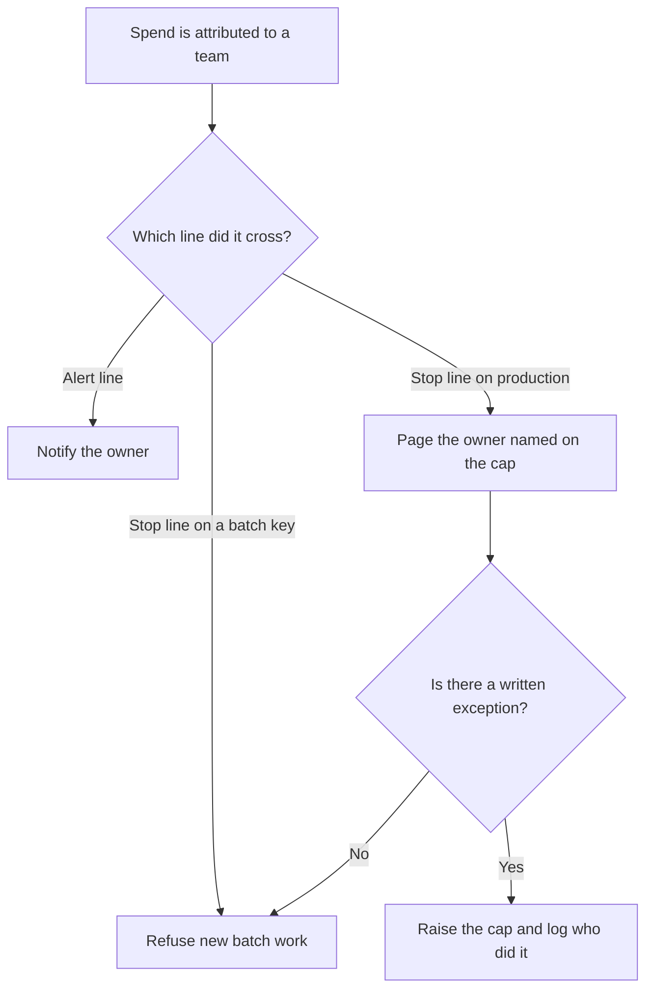

**An AI budget cap is a ceiling, in dollars or in tokens, that alerts someone or stops new model work when a team, a key, or a product crosses a number finance already agreed to.** An alert that nobody owns is a chart. A stop with no named exception is an outage. The cap is useful when both the number and the person are written down.

Which team the spend belongs to is [what AI cost attribution is](/blog/what-is-ai-cost-attribution-2026/). A spike after the fact is [what AI cost anomaly detection is](/blog/what-is-ai-cost-anomaly-detection-2026/). Slowing work before the ceiling, instead of cutting it, is [what AI traffic shaping is](/blog/what-is-ai-traffic-shaping-2026/). The unit on many invoices is [what AI tokens are](/blog/what-are-ai-tokens-explained-2026/).

Prices are US list prices excluding tax from directory pages checked October 16, 2026. Published October 24, 2026. We did not measure any team's spend. A cap product fee is not on the directory cards this page quotes.

## Alert, stop, or both

| Ceiling | What should happen | What should not happen |
|---|---|---|
| 50% of the month's number | Mail the owner. Production keeps running | Page the whole company |
| 80% | The owner confirms the forecast or cuts a batch job | A silent throttle on customer chat |
| 100% of a playground key | New playground calls stop | Production stops because it shared the key |
| 100% of a customer-facing key | The on-call follows the written exception | The app keeps spending because the cap was "informational" only |
| A vendor seat, not an API key | The admin removes a seat at renewal | Treating a $20 seat as a usage ceiling |

Raising a cap in the moment without a note will train the team to ignore the next one. The note belongs in the same system of record as the budget. That habit is [what a system of record for AI is](/blog/what-is-a-system-of-record-for-ai-2026/).

## Seats are not caps

**A personal chat seat.** [ChatGPT](/tools/chatgpt/) Plus is $20 a month. Go is $8, and the directory says it may include ads. Pro is $100, $200, or $500. None of those prices is a cap on your own API account. They are seats. The ladder is [ChatGPT Go vs Plus vs Pro](/blog/chatgpt-go-vs-plus-vs-pro-2026/).

**A writing and coding seat.** [Claude](/tools/claude/) Pro is $20 a month, or $17 billed annually ($200 up front). Max is $100 or $200. A Max plan raises usage. It does not set a company budget. The review is [Claude review](/blog/claude-review-2026/).

**An editor pool.** [Cursor](/tools/cursor/) prices new team seats at $30, $100, or $200 a month. Plus at $8 is an individual plan with a weekly pool, and the help page describes it as a ratio, not a dollar cap you can paste into finance. Read the usage screen. The invoice is [Cursor pricing explained](/blog/cursor-pricing-explained-2026/).

**A company coding seat with a credit number on the card.** [GitHub Copilot](/tools/github-copilot/) Business is $19 a user a month and lists 1,900 credits per user. That credit count is an allowance on Copilot's card. It is not a cap for every model your company calls. The invoice is [GitHub Copilot pricing explained](/blog/github-copilot-pricing-explained-2026/).

## How to set the first ceiling

Start with last month's attributed spend, add the launches you already planned, and write two lines: alert and stop. Put batch jobs on a key that is allowed to stop. Put the customer path on a key that pages a person. Review the cap when a launch ships, not only when finance closes the month.

A policy file can hold the number so a deploy cannot quietly raise it. That pattern is [what AI policy as code is](/blog/what-is-ai-policy-as-code-2026/).

## FAQ

### Is a budget cap the same as a rate limit?

A rate limit counts requests or tokens per minute. A budget cap counts money, or a token total you have converted to money, across a day or a month. You can have both. They fail in different ways.

### Should the cap be per person or per product?

Per product, if the bill is an API key behind a feature. Per person, if the bill is a seat. Mixing them in one number makes the exception list meaningless.

### What if the model is mid-answer when the cap hits?

Decide that before you turn the cap on. A common rule is: finish the request already accepted, refuse the next one, and log both. Cutting a customer sentence in half is a product bug.

### Can finance own the cap without engineering?

Finance can own the number. Engineering has to own the key that stops. A spreadsheet ceiling that no key reads will be crossed.

## Last verified

October 16, 2026 for ChatGPT, Claude, Cursor, and GitHub Copilot prices named above. Published October 24, 2026.

**Sources:** [ChatGPT pricing](https://chatgpt.com/pricing/), [Claude pricing](https://claude.com/pricing), [Cursor pricing](https://cursor.com/help/account-and-billing/pricing).

*Published by Andrew for [AI Tools Optimizer](https://aitoolsoptimizer.com).*

[Claude](/tools/claude/) is in the [chatbots and assistants directory](/tools/category/chatbots-assistants/). Directory pages may use affiliate links. A purchase through them may earn us a commission at no extra cost to you.
