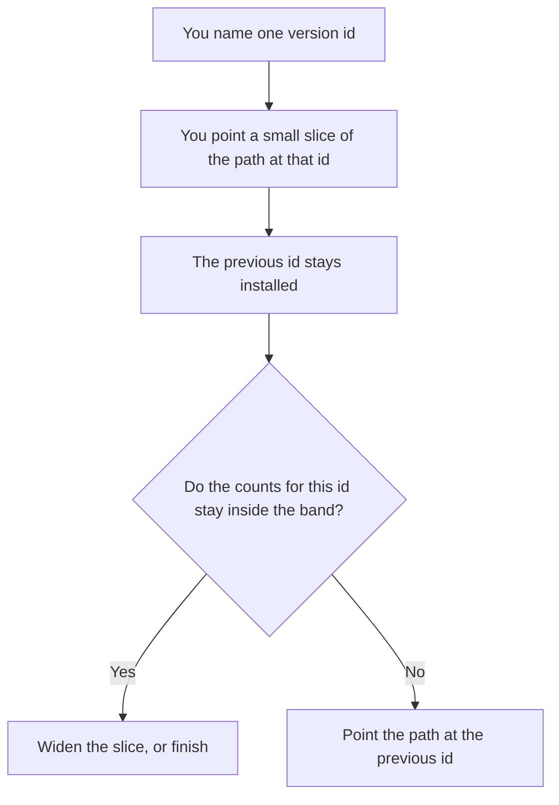

**An AI canary deployment is the placement of one named version — a prompt, a model id, or a retrieval index — onto the serving path for a small slice, while the previous version stays installed and can take the traffic back.** Who is in that slice is a separate decision. That decision is [what an AI canary release is](/blog/what-is-ai-canary-releases-2026/). This page is the artifact you placed: the version id, the config that points at it, and the path that answers.

The switch that can turn the path off without a second deploy is [what AI feature flags are](/blog/what-is-ai-feature-flags-2026/). A copy of live traffic that never becomes the answer the user sees is [what a shadow deployment for AI is](/blog/what-is-a-shadow-deployment-for-ai-2026/). Moving everyone back to the new version after a fix is [what AI rollforward is](/blog/what-is-ai-rollforward-2026/).

Prices are US list prices excluding tax from directory pages checked October 16, 2026. A live fetch of vendor pricing pages returned HTTP 401 on October 24, 2026, so this page stays on the directory record. Published October 24, 2026. The directory does not list a canary-deployment product fee, so this page does not invent one. We did not measure deploy safety.

## What you record on the deploy

| Piece | A canary deployment has | A change that only feels small |
|---|---|---|
| Version id | One prompt hash, model id, or index build | "The new one" |
| Path | The endpoint or flag that serves that id | A laptop demo |
| Previous version | Still installed, named, and able to take traffic | Deleted in the same change |
| Slice | A cohort id the release note already named | Whoever happens to refresh |
| Watch | Counts tied to this version id | One blended chart for all versions |
| Backout | A person who can point the path at the previous id | A redeploy nobody has practiced |

A deployment that also changes the database schema, the tool list, and the prompt in one step is three deployments. Split them, or you will not know which id to point back at. The written plan for the flag, the clock, and the owner is [how to create a feature flag rollout plan with AI](/blog/how-to-create-a-feature-flag-rollout-plan-with-ai-2026/).

## Where the deploy note is drafted

**The note.** [Claude](/tools/claude/) Pro is $20 a month, or $17 billed annually, when the deploy record is a long Project: version ids, the path, and the backout sentence. The review is [Claude review](/blog/claude-review-2026/).

**A short card you reuse.** [ChatGPT](/tools/chatgpt/) Plus is $20 a month when every deploy note has the same fields and you paste this change into a saved project. Free can format one note. The review is [ChatGPT review](/blog/chatgpt-review-2026/).

**The code that is the path.** [Cursor](/tools/cursor/) Plus is $8 a month, or $80 a year, when the deployment is a branch that changes which version the server loads. The editor does not know which branch is production. You do. The ladder is [Cursor pricing explained](/blog/cursor-pricing-explained-2026/).

**The editor you already use.** [GitHub Copilot](/tools/github-copilot/) Pro is $10 a user a month when the change is a pull request in the IDE you have. Pro includes the cloud agent and $15 in monthly credits on the October 16 card. The invoice is [GitHub Copilot pricing explained](/blog/github-copilot-pricing-explained-2026/).

A prompt that holds the line:

"Format a canary deployment note from the version id, path, previous id, slice, watch counts, and backout owner I pasted. Do not add a metric, a percent, or a rollback step I did not write. If the previous id is missing, write Previous version missing and stop."

## What not to call a canary deployment

Do not use the phrase for a full cutover that deleted the last version. Do not use it for a shadow path that never served a user. Do not deploy a write you cannot undo and then call the slice a canary. If the new version sends email or refunds a charge, the backout has to include that side effect, or you do not canary it. The place a test is allowed to run without those side effects is [what an AI tool sandbox is](/blog/what-is-ai-tool-sandbox-2026/).

## FAQ

### How is a deployment different from a canary release?

The release names who sees the change and for how long. The deployment is the version you placed on the path so that slice can see it. You can write a release plan and still fail to keep the previous version installed. That failure is a deployment failure.

### Can the model pick the percent?

No. The percent, the tenant, or the internal team is a number a person wrote. The model may copy it into the note. It may not "start at 5 percent" because that sounds careful.

### What if two versions answer in the same minute?

The log has to say which version id answered. A chart that blends them cannot tell you to roll back. The fields on that log are [what structured logging for AI is](/blog/what-is-structured-logging-for-ai-2026/).

### Who is allowed to point the path back?

The backout owner named on the note, using the path you already documented. A channel message that says "someone should revert" is not a deployment control.

## Last verified

October 16, 2026 for Claude, ChatGPT, Cursor, and GitHub Copilot. Published October 24, 2026. Live pricing fetches returned HTTP 401 that day.

**Sources:** [Claude pricing](https://claude.com/pricing), [ChatGPT pricing](https://chatgpt.com/pricing/), [Cursor pricing](https://cursor.com/help/account-and-billing/pricing), [GitHub Copilot plans](https://github.com/features/copilot).

*Published by Andrew for [AI Tools Optimizer](https://aitoolsoptimizer.com).*

[Claude](/tools/claude/) is in the [chatbots and assistants directory](/tools/category/chatbots-assistants/). Directory pages may use affiliate links. A purchase through them may earn us a commission at no extra cost to you.
