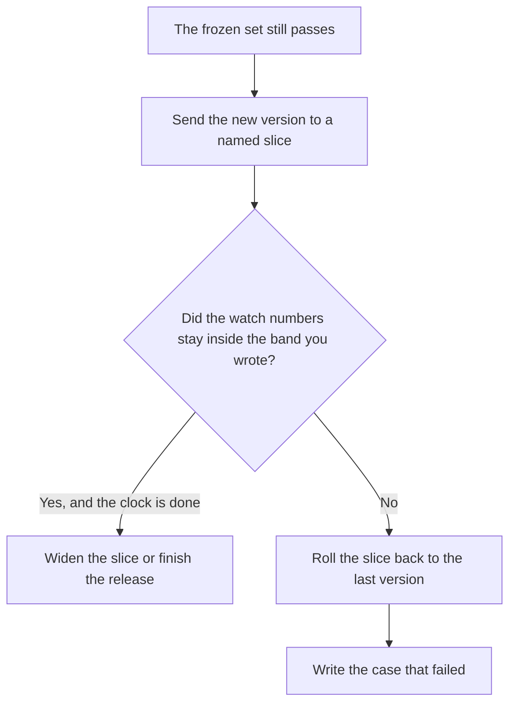

**An AI canary release is a planned exposure of a new prompt, model, or retrieval change to a small, named slice of real traffic, while everyone else stays on the last version you already accepted.** You watch a few numbers you wrote down. Then you widen the slice or you roll back. A feature flag can turn the change off. The canary is the decision to turn it on for some people first. Shipping to 100 percent because the demo looked good is not a canary. It is a launch.

The switch itself is [what AI feature flags are](/blog/what-is-ai-feature-flags-2026/). The offline set you run before any customer sees the change is [what prompt regression testing is](/blog/what-is-prompt-regression-testing-2026/). The broader testing habit is [what AI eval testing is](/blog/what-is-ai-eval-testing-2026/). If the canary goes wrong in production, the hour that follows is [what AI incident response is](/blog/what-is-ai-incident-response-2026/).

Prices are US list prices excluding tax from directory pages checked October 16, 2026. Published October 24, 2026. The directory does not list a canary-release product fee, so this page does not invent one. We did not measure rollout safety for any vendor.

## What you name before the slice starts

| Piece | A canary has | A launch that only feels careful |
|---|---|---|
| The cohort | A percent, a tenant, or an internal team, with an id | "Some users" |
| The change | One prompt version or one model id | A prompt, a model, and a new tool in the same hour |
| The watch | Two or three counts: error rate, refusal rate, a task you care about | A vibe check in a channel |
| The clock | A time box, then a decision | An open-ended experiment |
| The rollback | A person who can return everyone to the last version | A hope that someone is online |
| The log | Which version answered each request | One blended metric |

Do not canary a change you cannot undo. If the new prompt writes to a customer record, the rollback has to include that write, or you do not use a canary for it. The steps for the rollback belong in [an AI runbook](/blog/what-is-an-ai-runbook-2026/).

## Where the release note is drafted

**The change, if it is in the repo.** [Cursor](/tools/cursor/) Plus for new customers is $8 a month, or $80 a year. Premium is $30 a month. Teams seats are $30, $100, or $200 a month, matching the usage tier. The canary is still a flag and a cohort, not a pull request title. The invoice is [Cursor pricing explained](/blog/cursor-pricing-explained-2026/).

**The internal note.** [ChatGPT](/tools/chatgpt/) Plus is $20 a month. Business is $20 a user a month billed annually for two or more users when the note includes customer examples. Ask it to list the cohort, the watch, and the rollback owner. If any line is missing from your notes, it stays missing. The ladder is [ChatGPT Go vs Plus vs Pro](/blog/chatgpt-go-vs-plus-vs-pro-2026/).

**A second drafter for the longer postmortem if you roll back.** [Claude](/tools/claude/) Pro is $20 a month, or $17 billed annually. The review is [Claude review](/blog/claude-review-2026/).

**The counts, if they should be a chart you can reopen.** [Hex](/tools/hex/) Professional is $36 an editor a month. Community is free with a Hex agent trial and small compute. A screenshot in Slack is not the watch. The invoice is [Hex pricing explained](/blog/hex-pricing-explained-2026/).

A prompt that holds the line:

"Draft a canary plan from these notes only. Include cohort, change id, the metrics I named, the time box, and the rollback owner. If I did not name a metric or an owner, write Missing. Do not invent a success rate."

## What you refuse to learn from a canary

A canary is a bad place to discover that the new model is more expensive per request, unless cost is one of the watches and finance has agreed the band. That ledger is [what AI cost attribution is](/blog/what-is-ai-cost-attribution-2026/). A canary is also a bad place to test a safety policy. Run the policy cases offline. The file that should fail the build is [what AI policy as code is](/blog/what-is-ai-policy-as-code-2026/).

Keep the slice large enough to see the failure you fear, and small enough that the failure is tolerable. An internal team of five can miss a language your customers use. A 50 percent slice is a launch with a costume. Write the reason for the size you picked.

The person who may widen the slice is [what human-in-the-loop AI is](/blog/what-is-human-in-the-loop-ai-2026/).

## FAQ

### Is a canary the same as a feature flag?

A flag is the switch. A canary is the plan for who sees the on position first, what you watch, and when you turn it off. You can have a flag and still release to everyone. You can plan a canary and fail if the flag cannot target the cohort you named.

### Should the canary be random users or one tenant?

One tenant, or your own staff, when a failure would be easier to explain to a single account. A random percent when the bug depends on varied input and no single tenant represents it. Write the id either way so support can tell which version a customer hit.

### What if the offline tests passed and the canary fails?

Believe the canary for the metric you said you would watch. Roll back. Add the failing example to the frozen set so the next offline run includes it. A passing set that missed a production failure is now stale.

### Can I canary two changes at once?

You can, and then you will not know which change caused the move in the metric. Ship one. The second waits. A combined canary feels faster until the rollback, when you have to revert both.

## Last verified

October 16, 2026 for Cursor, ChatGPT, Claude, and Hex. No canary-release vendor fee is recorded in the directory. Published October 24, 2026.

**Sources:** [Cursor pricing](https://cursor.com/help/account-and-billing/pricing), [ChatGPT pricing](https://chatgpt.com/pricing/), [Claude pricing](https://claude.com/pricing).

*Published by Andrew for [AI Tools Optimizer](https://aitoolsoptimizer.com).*

[Cursor](/tools/cursor/) is in the [coding directory](/tools/category/coding/). Directory pages may use affiliate links. A purchase through them may earn us a commission at no extra cost to you.
