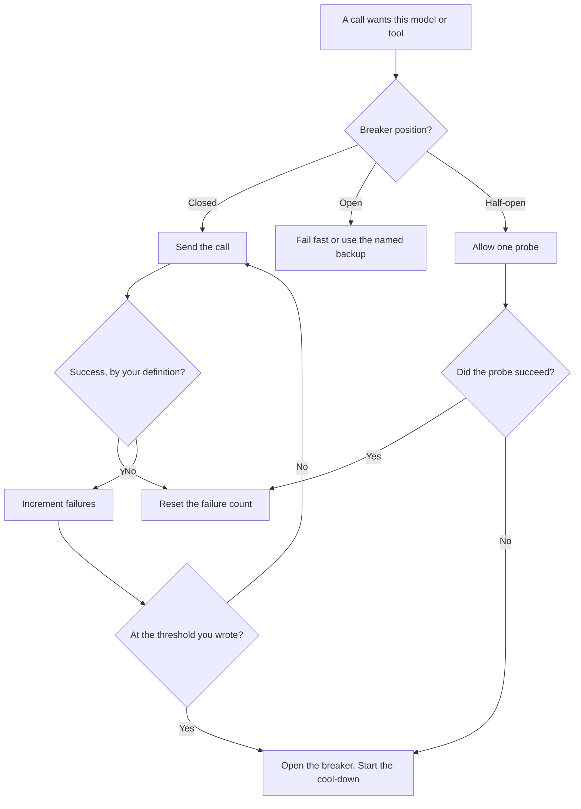

**An AI circuit breaker is a switch in front of a model or a tool: after a failure count you defined, it stops sending new calls, returns a fast error or a backup you already named, and tries one probe later to see if the dependency recovered.** The point is to stop a pile of callers from waiting on a model that is already failing. A retry loop is the opposite of a breaker. It spends the outage.

Sending the same request to a second model is [what AI fallback routing is](/blog/what-is-ai-fallback-routing-2026/). The breaker decides whether the primary is eligible to be called. The fallback decides where the work goes if you still intend to answer. Dropping optional work during overload is [what AI load shedding is](/blog/what-is-ai-load-shedding-2026/). The hour after a customer-visible failure is [what AI incident response is](/blog/what-is-ai-incident-response-2026/).

Prices are US list prices excluding tax from directory pages checked October 16, 2026. Published October 24, 2026. The directory does not list a circuit-breaker product fee, so this page does not invent one. We did not measure failover time for any vendor.

## The three positions

| Position | What it means | What the caller gets |
|---|---|---|
| Closed | The dependency is eligible. Failures are counted | A normal call |
| Open | The failure count crossed your line. New calls do not go out | A fast error, or the backup you named. Not a long wait |
| Half-open | The cool-down elapsed. One probe is allowed | The probe's result. Everyone else stays on the open behavior until the probe succeeds |

You define success. A timeout is a failure. A refusal the product intended, such as a safety refusal, is not a broken circuit. If you count polite refusals as outages, you will open the breaker on a policy. Write the error classes down.

## What you set before the first outage

**The threshold and the window.** For example, a count of timeouts inside a minute. This page does not recommend a universal number. A chat feature and a batch job should not share one. Pick the number from the failure you are willing to absorb.

**The cool-down.** How long the breaker stays open before a probe. Too short, and you hammer the model while it is down. Too long, and you stay on the backup after recovery. Write the duration next to the threshold.

**The backup, or the honest error.** If a backup exists, it is the fallback you already tested. If it does not, the open state returns an error a person can understand. A spinner until the cool-down ends is a closed breaker that ignores its own switch.

**The log.** Position, error class, and whether the answer came from the backup. That field is part of [structured logging for AI](/blog/what-is-structured-logging-for-ai-2026/).

## Plans that are not a breaker

A subscription does not open a circuit for you. These prices are context for the call you might wrap. They are not uptime promises.

| Call you might wrap | Price the directory recorded | What you still build |
|---|---|---|
| [ChatGPT](/tools/chatgpt/) as a product seat | Plus is $20 a month. The API is a different contract. This page does not invent an API rate | A breaker in your app, if you call an API |
| [Claude](/tools/claude/) | Pro is $20 a month, or $17 billed annually | The same. A seat timeout is not a logged breaker |
| [Gemini](/tools/gemini/) | Google AI Pro is $19.99 a month | The same |
| [DeepSeek](/tools/deepseek/) API | Input from $0.15 per 1 million tokens off-peak on a cache miss. Output $0.60 off-peak | A breaker is more useful here, because you own the client |
| A workflow that calls a model | [Zapier](/tools/zapier/) Professional is $19.99 a month billed annually | Zapier's retries are Zapier's. Confirm they match the cool-down you want. Do not assume they do |

The routing choice among these models, before anything fails, is [what AI routing is](/blog/what-is-ai-routing-2026/). The canary that should not open a breaker on the whole product is [what an AI canary release is](/blog/what-is-ai-canary-releases-2026/).

## FAQ

### Is a breaker the same as a fallback?

They stack. The breaker stops the bad dependency. The fallback is optional and must be named in advance. A fallback without a breaker will keep calling the broken model and the backup together if your client retries the primary.

### Should safety refusals trip it?

No, unless you have decided a surge of refusals is itself an incident. Count transport failures, timeouts, and server errors. A policy refusal is a successful round trip with an answer you may not like.

### What is a good threshold?

The one you can explain on the incident call. Start from a real outage you had, or from a drill. Copying a number from a blog, including this one, is how the probe fires every minute on a healthy model.

### Do I need one in front of ChatGPT Plus?

Not for a person clicking a website. You need one when your software calls a model on behalf of many users. A human who waits and retries is already the breaker, informally. Software will not be that polite unless you write it.

## Last verified

October 16, 2026 for the prices named above. Published October 24, 2026. The definition does not depend on a price change.

**Sources:** [ChatGPT pricing](https://chatgpt.com/pricing/), [Claude pricing](https://claude.com/pricing), [Google AI subscriptions](https://gemini.google/subscriptions/), [DeepSeek API docs](https://api-docs.deepseek.com/).

*Published by Andrew for [AI Tools Optimizer](https://aitoolsoptimizer.com).*

[DeepSeek](/tools/deepseek/) is in the [chatbots and assistants directory](/tools/category/chatbots-assistants/). Directory pages may use affiliate links. A purchase through them may earn us a commission at no extra cost to you.
