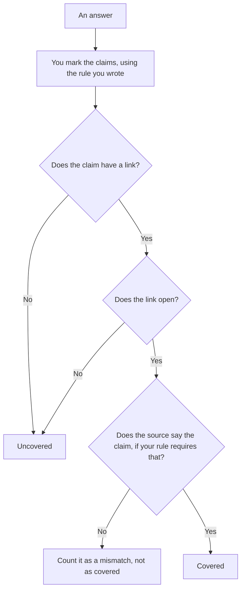

**AI citation coverage is the share of claims, defined by a rule you wrote, that point at a source a person can open.** A claim with no link is uncovered. A link that does not open is uncovered. A link that opens and does not say the thing is a different failure, and you count it separately if your rule says so. This is a count. It is not a grade of whether the model is "right." A different meter, about how sure a system says it is, is [what an AI output confidence score is](/blog/what-is-ai-output-confidence-score-2026/).

How fresh the source may be is [what an AI retrieval freshness SLA is](/blog/what-is-ai-retrieval-freshness-sla-2026/). The order of candidate sources before the answer is [what AI retrieval hybrid rerank is](/blog/what-is-ai-retrieval-hybrid-rerank-2026/).

Perplexity, Elicit, and ChatGPT prices are from directory pages checked October 16, 2026. perplexity.ai/pro and chatgpt.com/pricing returned HTTP 403 on October 24. Claude's prices are from claude.com/pricing that day. Published October 24, 2026. We did not publish a coverage score for any product.

## How a count is defined

| Your rule | Counted as covered | Not covered |
|---|---|---|
| Every sentence that states a fact needs a link | That sentence has a link a person opened | A fluent sentence with no link |
| A number needs a source that contains the number | The source shows that number | A link to a homepage |
| A quote needs the passage | The passage matches | A paraphrase with a decorative link |
| The denominator is claims, not paragraphs | You listed the claims first | "The answer looked sourced" |

Coverage without a written denominator is a vibe. Write what a claim is before you count. A bibliography at the bottom that no sentence points at does not cover the sentences. A sentence that points at three sources is still one claim if your rule says so. Do not change the rule after you see a low number.

## Where you count it

**Answers that already attach links.** [Perplexity](/tools/perplexity/) Pro is $17 a month billed annually on the October 16 card. Open the links. A citation widget is not coverage until the rule is applied. The literature job is [Perplexity vs Elicit for literature maps](/blog/perplexity-vs-elicit-for-literature-maps-2026/).

**A paper set.** [Elicit](/tools/elicit/) is the seat when the sources are papers. Coverage is still your count of which findings point at which paper. The directory card is the October 16 price record.

**The rule, kept stable.** [Claude](/tools/claude/) Pro is $17 a month billed annually, $200 up front, or $20 monthly. Put the definition of a claim in a Project. The review is [Claude review](/blog/claude-review-2026/).

**A one-page tally.** [ChatGPT](/tools/chatgpt/) Plus is $20 a month on the October 16 card. Paste the claims and the links. Discard a tally that marks a claim covered because the prose was confident.

A prompt that holds the line:

"Count citation coverage using only the claim rule I pasted. List each claim as covered, uncovered, or mismatch. Do not add a claim. Do not call the answer high quality."

## What not to delegate

Do not ask which product has the best coverage. We did not measure that, and a single answer is not a benchmark. Do not treat a confidence number as coverage. Do not drop a claim from the denominator because it was hard to source. That is how the percentage goes up without the answer getting more sourced.

## FAQ

### How is this different from a confidence score?

A confidence score is a number the system, or a rubric, attaches to an output. Citation coverage is a count of claims that point at sources, under your rule. An answer can be confident and uncovered. An answer can be covered and still wrong if the source is wrong. Those are separate columns.

### Does a link that opens always count?

Only if your rule stops at "opens." If your rule says the source must contain the claim, a homepage link is a mismatch. Write that down before the count. Do not decide it per row to make the sheet look even.

### What is the denominator?

The claims you marked with the rule. Paragraphs, slides, and "main points" are different denominators. Pick one and keep it. A coverage figure from another team that used another denominator is not your figure.

### Who may publish the percentage?

The person who owns the rule, next to the date of the count and the definition. A percentage with no definition is not a metric. It is a sentence.

## Last verified

October 16, 2026 for Perplexity, Elicit, and ChatGPT. October 24, 2026 for Claude. No citation-coverage product fee is on those pages. Published October 24, 2026.

**Sources:** [Perplexity](https://www.perplexity.ai/), [Elicit](https://elicit.com/), [Claude pricing](https://claude.com/pricing), [ChatGPT pricing](https://chatgpt.com/pricing/).

*Published by Andrew for [AI Tools Optimizer](https://aitoolsoptimizer.com).*

[Perplexity](/tools/perplexity/) is in the [research and search directory](/tools/category/research-search/). Directory pages may use affiliate links. A purchase through them may earn us a commission at no extra cost to you.
