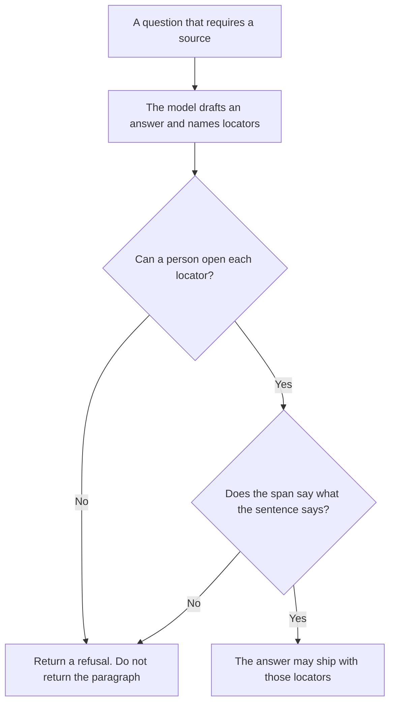

**AI citation-required mode is a product setting where an answer must attach a source a person can open, or the product returns a refusal instead of the answer.** A footnote the model typed, that leads nowhere, does not satisfy the mode. The mode is the rule. Opening the source is the check.

An answer you can open at all is [what AI grounding is](/blog/what-is-ai-grounding-2026/). The test that compares the finished sentences to the passages you allowed is [what an AI groundedness check is](/blog/what-is-ai-groundedness-check-2026/). Which product to use when the source is a paper versus a web page is [Perplexity vs Elicit for citations](/blog/perplexity-vs-elicit-for-citations-2026/). The passages allowed into the prompt in the first place are [what an AI retrieval filter is](/blog/what-is-ai-retrieval-filter-2026/).

Prices are US list prices excluding tax from directory pages checked October 16, 2026. A live fetch of vendor pricing pages on October 24, 2026 returned HTTP 401, so this page stays on the directory record. Published October 24, 2026. We did not score citation accuracy.

## What counts as a citation in this mode

| The model offers | Citation-required mode |
|---|---|
| A URL or a document id you can open, and a span you can find | Allowed, after a person or a check confirms the span is really there |
| A title and an author, with no locator | Refusal. A bibliography line is not a source |
| "According to the docs" | Refusal. Name the doc |
| A source that failed the retrieval filter | Refusal. The mode does not revive a dropped passage |
| No source, and a confident paragraph | Refusal. The paragraph does not ship |

Grounding is the property you want: a reader can get from the sentence to a source. Citation-required mode is how you enforce it when a missing source should block the reply. A groundedness check can run on answers you already decided to show. The mode decides there is nothing to show.

This is a product switch, not a prompt that says "please cite sources." Prompts are ignored under load. The switch is in the application: if the locator list is empty, the response is the refusal string you wrote.

## Where you turn it on

**Web questions, where the product already retrieves.** [Perplexity](/tools/perplexity/) Pro is $17 a month billed annually. Use it when the citation is a page you will open. A vendor's claim that answers are cited is not a score from us. The invoice is [Perplexity pricing explained](/blog/perplexity-pricing-explained-2026/).

**Papers, where the citation is a row in a literature set.** [Elicit](/tools/elicit/) Plus is $11 a user a month billed annually. Pro is $39 a user a month billed annually and is the directory's line for screening up to 5,000 papers. The invoice is [Elicit pricing explained](/blog/elicit-pricing-explained-2026/).

**The refusal text and the rule.** [Claude](/tools/claude/) Pro is $20 a month, or $17 billed annually, when the mode's spec is a long note: which questions require a source, and the exact refusal. The review is [Claude review](/blog/claude-review-2026/).

**A short refusal you will paste into the spec.** [ChatGPT](/tools/chatgpt/) Plus is $20 a month. Discard a refusal that apologizes and then answers anyway.

A prompt that holds the line:

"List the locators my draft used. If a sentence has no locator I pasted, delete the sentence. If nothing remains, write the refusal I pasted and stop. Do not add a source."

## What not to delegate

Do not accept a citation you have not opened when the claim will be published. Do not let the model satisfy the mode by repeating the question as if it were a source. Do not turn the mode off for "just this launch." The launch is when an unsourced sentence does the most damage. The habit of checking a paragraph you already wrote is [how to fact-check AI writing](/blog/how-to-fact-check-ai-writing-2026/).

## FAQ

### How is this different from grounding?

Grounding describes the link between a sentence and a source. Citation-required mode is the switch that withholds the sentence when the link is missing. You can talk about grounding without having the switch. The switch is what stops the ship.

### How is this different from a groundedness check?

The check scores or flags an answer that already exists. The mode can refuse to emit the answer. Run the check on what the mode allowed through. A refusal does not need a groundedness score. It needs the log line that says no locator passed.

### Does Perplexity's Pro plan turn this mode on inside my product?

No. Pro is Perplexity's own product. Citation-required mode inside your app is your switch, on your retriever, with your refusal string. Perplexity is a reasonable place to draft a sourced brief. It is not the switch.

### What should the refusal say?

The sentence you wrote: which source is missing, and who can add it. It should not guess. It should not apologize for three paragraphs and then answer.

## Last verified

October 16, 2026 for Perplexity, Elicit, Claude, and ChatGPT. Published October 24, 2026.

**Sources:** [Perplexity](https://www.perplexity.ai/pro), [Elicit pricing](https://elicit.com/pricing), [Claude pricing](https://claude.com/pricing), [ChatGPT pricing](https://chatgpt.com/pricing/).

*Published by Andrew for [AI Tools Optimizer](https://aitoolsoptimizer.com).*

[Perplexity](/tools/perplexity/) is in the [research and search directory](/tools/category/research-search/). Directory pages may use affiliate links. A purchase through them may earn us a commission at no extra cost to you.
